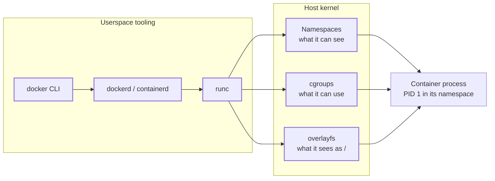
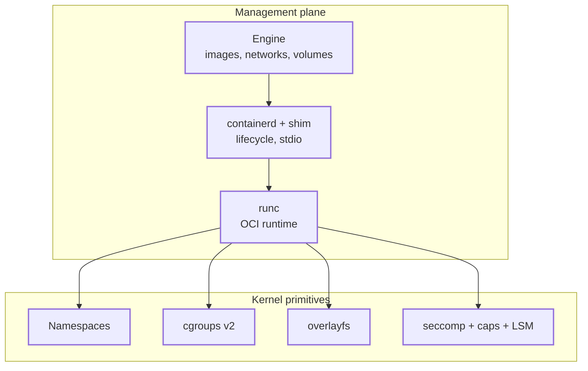
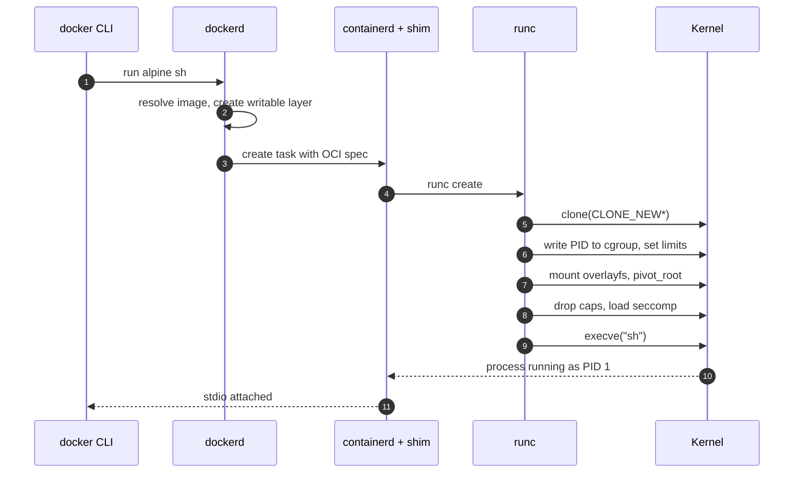

A container is not a kernel feature. You will not find a `struct container` anywhere in Linux. What Docker, containerd, Podman and Kubernetes call a container is an ordinary process that has been started with a restricted view of the system and a capped share of its resources.

Once you accept that, most of the mystery goes away. This post breaks the idea into the kernel primitives that make it work, and then into the userspace layers that glue them together.

## Table of contents

## Problem Statement

Servers need to run many workloads that must not interfere with each other. Before containers there were two answers, and both had real costs.

**Run everything on one OS.** Processes already give memory isolation, but they share the filesystem, the network ports, the process table, the users, and the library versions. Two services that need different versions of `libssl` cannot coexist cleanly. One runaway process can eat all the memory and take the host with it.

**Run a virtual machine per workload.** A hypervisor gives strong isolation, but each VM carries a full guest kernel, a boot sequence, and statically reserved memory. Starting one takes seconds to minutes and the density per host is low.

What people wanted was the isolation of a VM at roughly the cost of a process: fast start, small footprint, and a reproducible filesystem that ships with the application. Linux already had most of the parts. Containers are the packaging of those parts.

## High-Level Mental Model

A container is a process tree that sees a private copy of selected system resources (via **namespaces**), is limited in what it can consume (via **cgroups**), and has a private root filesystem assembled from read-only image layers plus a writable layer (via **overlayfs** and `pivot_root`). All of it runs on the **same host kernel** as every other process.



## Core Architecture

There are two halves: the kernel primitives that do the isolation, and the userspace stack that orchestrates them.

1. **Namespaces** partition *visibility*. Each namespace type wraps one global resource so that processes inside see their own instance.
2. **cgroups** partition *consumption*. They account for and limit CPU, memory, I/O and PIDs for a group of processes.
3. **Union filesystem and image layers** provide the root filesystem. Layers are immutable and content-addressed, and a copy-on-write layer sits on top.
4. **Security filters** (capabilities, seccomp, LSMs such as AppArmor and SELinux) shrink what the process may ask the kernel to do.
5. **The runtime (runc)** is a small program that performs the syscalls in the right order and then `exec`s your command.
6. **The engine (dockerd, containerd)** manages images, networking, storage drivers and the lifecycle, and delegates actual process creation to the runtime.



The boundary worth remembering: the engine and `containerd` are not in the isolation path. Once `runc` has set things up and called `exec`, the kernel enforces everything. You can kill `dockerd` and the container keeps running, because the `containerd-shim` process is its parent, not the daemon.

## Execution Flow

What happens when you run `docker run -m 256m alpine sh`.

1. The CLI sends the request to `dockerd` over a Unix socket.
2. The engine resolves the image. If a layer is missing, it pulls it from the registry by digest and unpacks it into a directory such as `/var/lib/docker/overlay2/<id>/diff`.
3. The engine creates a writable layer and prepares an overlayfs mount spec: `lowerdir` is the image layers, `upperdir` is the new writable layer.
4. It generates an OCI runtime spec (`config.json`): namespaces to create, cgroup limits, mounts, capabilities, seccomp profile, the command.
5. containerd starts a `containerd-shim` and the shim invokes `runc create`.
6. `runc` calls `clone()` with `CLONE_NEWPID | CLONE_NEWNS | CLONE_NEWNET | CLONE_NEWUTS | CLONE_NEWIPC` (and optionally `CLONE_NEWUSER`). The child is now PID 1 in a new PID namespace.
7. The parent writes the child's PID into the new cgroup (`cgroup.procs`) and sets `memory.max`, `cpu.max`, `pids.max`.
8. In the child: mount overlayfs, bind-mount `/proc`, `/dev` and `/sys` entries, then `pivot_root` into the new root and unmount the old one.
9. The child drops capabilities, sets `no_new_privs`, loads the seccomp BPF filter, and applies the LSM profile.
10. `runc start` makes the child `execve` the user command (`sh`). From this point `runc` is gone from the picture.



## Key Internal Mechanisms

### Namespaces

Each process has a set of namespace pointers in `task_struct->nsproxy`. A namespace type decides which global lookup table a syscall consults.

| Namespace | Isolates | Effect |
| --- | --- | --- |
| `pid` | Process IDs | Child sees itself as PID 1. The host sees a different PID for the same process. |
| `mnt` | Mount table | Private view of the filesystem tree. |
| `net` | Interfaces, routes, sockets, iptables | Own `lo`, own port space. |
| `uts` | Hostname, domain | Container can have its own hostname. |
| `ipc` | SysV IPC, POSIX queues | No shared memory with the host. |
| `user` | UID/GID mappings | UID 0 inside maps to an unprivileged UID outside. |
| `cgroup` | cgroup root view | Container sees its own cgroup as `/`. |
| `time` | Boot and monotonic clocks | Rarely used. |

The PID namespace is a good example of the idea. A process has one PID per namespace level it is visible in. The kernel stores a `struct pid` with an array of `upid` entries, one per level. `getpid()` returns the number from the caller's namespace, and a process in a child namespace simply cannot name a process outside it.

Network isolation is done with a `veth` pair. One end sits in the container's net namespace, the other is attached to a bridge (`docker0`) in the host namespace. Outbound traffic is NATed by iptables or nftables rules, and published ports are DNAT rules.

### cgroups

cgroups v2 is a single hierarchy of directories under `/sys/fs/cgroup`. Controllers are enabled per directory and a process belongs to exactly one leaf.

- **memory**: `memory.max` is a hard limit. When a charge fails and reclaim cannot free enough, the kernel invokes the cgroup-scoped OOM killer. The kill is local to the group.
- **cpu**: `cpu.max` is a CFS bandwidth quota expressed as `quota period`, for example `50000 100000` for half a core. `cpu.weight` sets relative shares under contention.
- **io**: `io.max` throttles bytes and IOPS per block device.
- **pids**: `pids.max` caps the number of tasks, which stops fork bombs.

Resource accounting is charged at allocation time. A page cache page is charged to the cgroup that first touched it, which is why file-heavy containers can show surprising memory usage.

### Layered filesystem

An image is a stack of tar layers, each identified by the SHA-256 of its contents, plus a JSON manifest. overlayfs merges them:

```text
mount -t overlay overlay \
  -o lowerdir=L3:L2:L1,upperdir=U,workdir=W  /merged
```

- Reads go through the stack top to bottom and return the first match.
- A write to a file that exists only in a lower layer triggers **copy-up**: the whole file is copied to `upperdir` and then modified.
- Deletes create a **whiteout** (a character device with 0/0 device number) in the upper layer to mask the lower file.

Because layers are content-addressed, ten images built on the same base share one copy of it on disk and in the page cache.

### Isolation of the isolation

Namespaces alone are not a security boundary. A root process in a container still holds powerful capabilities by default, and the syscall surface is huge.

- **Capabilities** split root into around 40 bits. Docker drops most of them, keeping a small default set.
- **seccomp-bpf** attaches a classic BPF program that runs on every syscall entry and can return ALLOW, ERRNO or KILL. The default profile blocks around 40 to 50 syscalls such as `kexec_load` and `mount` variants.
- **User namespaces** map container root to an unprivileged host UID, so an escape lands you as `nobody`.

## OS and System-Level Interactions

| Syscall | Role |
| --- | --- |
| `clone(2)` / `clone3` | Create a process in new namespaces. |
| `unshare(2)` | Move the calling process into new namespaces. |
| `setns(2)` | Join an existing namespace. This is how `docker exec` works. |
| `mount(2)` / `pivot_root(2)` | Build the new root and swap into it. |
| `execve(2)` | Replace the runtime with the user program. |
| `prctl(PR_SET_NO_NEW_PRIVS)` | Prevent privilege gain via setuid binaries. |
| `seccomp(2)` | Install the syscall filter. |

Why `pivot_root` and not `chroot`? `chroot` only changes the root for path lookups of that process. The old root is still reachable through open file descriptors or by re-chrooting, and it remains in the mount table. `pivot_root` swaps the root mount of the mount namespace and lets you unmount the old one, so nothing is left to walk back to.

`docker exec` is the best demonstration that containers are not objects: it forks a new process and calls `setns` for each namespace file in `/proc/<pid>/ns/`, then joins the container's cgroup. You can do the same by hand with `nsenter`.

The scheduler is unaware of containers. It schedules tasks. cgroup CPU limits are applied by the CFS bandwidth controller, which throttles the whole group's runqueue entities when the quota for the period is exhausted. This explains a common production symptom: a container with a limit of 1 CPU running 16 threads can burn its quota in the first 6 ms of a 100 ms period and then stall for 94 ms, producing latency spikes while average CPU looks low.

## Failure Modes and Trade-offs

**Shared kernel.** The defining trade-off. A kernel bug or a misconfigured container (privileged mode, mounted Docker socket, `CAP_SYS_ADMIN`) gives access to the host and to every neighbour. VMs have a much narrower interface (the hypervisor), which is why multi-tenant clouds wrap containers in microVMs (Firecracker, Kata) or user-space kernels (gVisor).

**Memory limits and the OOM killer.** Limits are enforced by killing, not by backpressure. Page cache, kernel memory and tmpfs count towards the limit. A JVM that sizes its heap from host memory rather than the cgroup limit gets killed with exit code 137.

**CPU throttling.** See above. Quotas produce tail latency. Using `cpu.weight` (requests) rather than hard limits avoids it at the price of weaker guarantees.

**PID 1 semantics.** The first process in a PID namespace has no default signal handlers for SIGTERM and must reap orphaned children. An application that ignores this leaks zombies and fails to stop gracefully. This is why `tini` and `--init` exist.

**Storage.** overlayfs copy-up makes writes to large files in the image layer slow and space-hungry. Write-heavy data belongs in volumes, which are plain bind mounts that bypass the union.

**Networking overhead.** veth plus bridge plus NAT adds per-packet cost and conntrack state. Host networking or CNI plugins with direct routing remove it at the cost of isolation.

| Concern | Container | VM |
| --- | --- | --- |
| Startup | Milliseconds | Seconds |
| Overhead | Near zero | Guest kernel and device emulation |
| Isolation | Kernel policy | Hardware virtualization |
| Kernel choice | Host only | Any |

## Minimal Pseudocode

This is the shape of what `runc` does after `clone`. The syscalls are shown as methods on a hypothetical `Sys` class.

```java
// Parent side
int childPid = Sys.clone(
    CLONE_NEWPID | CLONE_NEWNS | CLONE_NEWNET | CLONE_NEWUTS | CLONE_NEWIPC,
    () -> containerInit(spec));

Cgroup cg = Cgroup.create("/sys/fs/cgroup/docker/" + id);
cg.write("memory.max", spec.memoryBytes);
cg.write("cpu.max", spec.quota + " " + spec.period);
cg.write("pids.max", spec.pids);
cg.write("cgroup.procs", childPid);
Net.attachVeth(childPid, "docker0");
Sys.signal(childPid, START);

// Child side, runs as PID 1 inside the new namespaces
void containerInit(Spec spec) {
    waitForStartSignal();
    Sys.mount("overlay", "/merged", "overlay",
        "lowerdir=" + spec.lower + ",upperdir=" + spec.upper + ",workdir=" + spec.work);
    Sys.mount("proc", "/merged/proc", "proc");
    Sys.pivotRoot("/merged", "/merged/.old");
    Sys.umount("/.old");
    Sys.sethostname(spec.hostname);

    Sys.dropCapabilities(spec.keepCaps);
    Sys.prctl(PR_SET_NO_NEW_PRIVS, 1);
    Sys.seccomp(spec.filter);

    Sys.execve(spec.args[0], spec.args, spec.env);   // never returns
}
```

## How to Think About Similar Systems

- **Look for the object that does not exist.** "Container", "pod" (a set of containers sharing net and IPC namespaces), "sandbox" and "jail" are labels for a combination of primitives. When a technology feels magical, ask which smaller mechanisms it composes.
- **Separate visibility from consumption.** Namespaces answer "what exists for me", cgroups answer "how much may I use". The same split appears in hypervisors, in database multi-tenancy, and in cloud IAM versus quotas.
- **Separate the control plane from the enforcement point.** The engine configures and then steps out of the data path. Kubernetes controllers, service meshes with eBPF, and Postgres replication managers follow the same pattern.
- **Content-addressed immutable layers plus copy-on-write** shows up in git, Nix, ZFS snapshots, and LSM trees. Immutability makes sharing and caching safe.
- **Isolation strength is proportional to the narrowness of the interface.** Containers expose the full syscall table, gVisor exposes a reimplemented subset, microVMs expose a handful of virtio devices. When you evaluate a sandbox, measure the surface, not the marketing.
