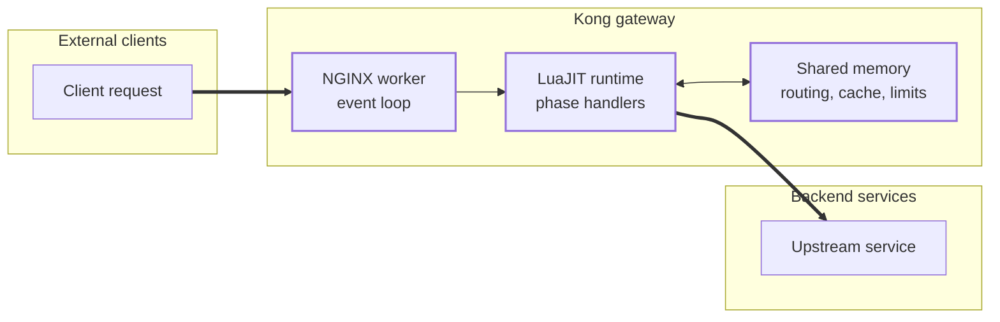
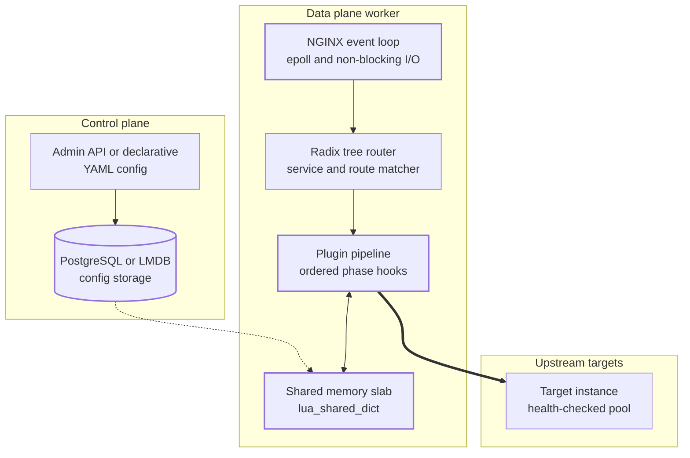
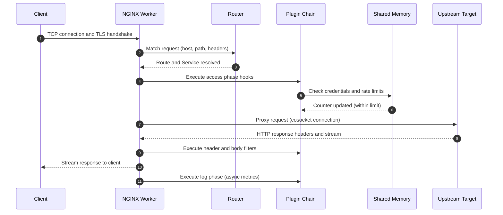
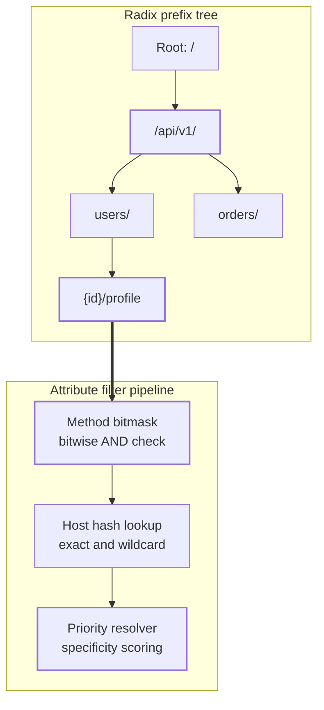

Every API gateway promises to centralize routing, authentication, rate limiting, and observability. Most implementations run into a fundamental trade-off: either modify static proxy configuration and reload processes continuously, or route traffic through a separate application layer that adds latency and CPU overhead.

Kong resolves this tension by embedding a programmable runtime directly into the network event loop of NGINX. It transforms a static web server into a dynamic API gateway without process hops, out-of-band IPC, or configuration reloads.

This post explains the internal architecture of Kong Gateway, tracing how NGINX, OpenResty, LuaJIT, shared memory slabs, and radix routing trees cooperate to process millions of requests per second.

## Table of contents

## Problem Statement

Microservice architectures split business logic into tens or hundreds of discrete network endpoints. This introduces a set of non-functional requirements that every service requires:

- Authentication and token verification
- Dynamic path routing and service discovery
- Traffic control and distributed rate limiting
- Mutual TLS termination and SNI-based certificate dispatch
- Structured telemetry, tracing, and access logging

Implementing these capabilities within application code causes immediate operational friction. Each service team must maintain identical security libraries across multiple programming languages, recompile services whenever security patches drop, and coordinate rollout flags across disparate codebases.

Earlier infrastructure approaches attempted to solve this at the network boundary, but introduced severe bottlenecks:

1. **Static Reverse Proxies (Standard NGINX, HAProxy).** Traditional reverse proxies route traffic with exceptional speed. However, modifying a route or updating an upstream target requires updating a configuration file on disk and signaling the master process to reload (`nginx -s reload`). In high-churn environments like Kubernetes, where pods appear and disappear every second, frequent worker reloads cause persistent connection churn, ephemeral memory spikes, and CPU waste.
2. **Application-Layer Gateways (JVM or Go-based proxies).** Frameworks written in high-level languages allow dynamic in-memory route updates. Yet they introduce garbage collection pauses, heavy thread-per-connection memory allocations (in older runtimes), or higher CPU overhead per byte transferred compared to highly optimized C network servers.

Kong exists to merge the raw I/O throughput of NGINX with the dynamic programmability of an in-memory application runtime.

## High-Level Mental Model

Kong is an OpenResty application executed by LuaJIT inside NGINX worker processes. NGINX provides the non-blocking event loop, TLS termination, and socket handling. Kong injects Lua hooks into NGINX HTTP processing phases, evaluating route trees and executing plugin pipelines entirely in memory. Dynamic state (such as routes, tokens, and rate limit counters) is stored in NGINX shared memory slabs and synchronized without process reloads.



## Core Architecture

The Kong runtime divides into six primary internal subsystems operating between the host operating system and upstream services.



### 1. NGINX Master and Event-Driven Workers

Kong runs as a standard NGINX master-worker process topology:

- **Master Process:** Runs with root privileges, parses bootstrap flags, opens privileged listening ports (such as 80 and 443), allocates shared memory zones, and supervises worker lifecycles. It does not handle client traffic.
- **Worker Processes:** Unprivileged worker processes spawned by the master. Each worker runs a single-threaded, non-blocking event loop driven by operating system notification primitives (`epoll` on Linux, `kqueue` on BSD). Workers handle network sockets independently.

### 2. OpenResty and LuaJIT Engine

OpenResty embeds the LuaJIT compiler directly into each NGINX worker. LuaJIT compiles Lua source code into native x86/ARM machine instructions through its trace compiler.

The key innovation is the **cosocket** (coroutine-based socket). When a Lua script in Kong initiates an upstream connection or queries a database, OpenResty suspends the running Lua coroutine and yields execution back to the NGINX event loop. When the kernel signals that the network socket has data ready to read, NGINX resumes the coroutine at the exact byte where it paused. Lua code reads sequentially like synchronous code, but executes as non-blocking, event-driven I/O under the hood.

### 3. In-Memory Router Engine

When Kong receives an HTTP request, it must rapidly identify which **Service** (the target backend) and **Route** (the matching rule) apply.

Older gateways used regular expression loops that degraded linearly (`O(N)`) as the route count grew. Kong builds an in-memory prefix tree (radix tree) indexed by URI segments, paired with hash tables for HTTP methods, hostnames, and headers. Route matching runs in `O(K)` time, where `K` is the length of the request path, regardless of whether Kong hosts 10 or 10,000 routes.

### 4. Shared Memory Layer (`lua_shared_dict`)

Because each NGINX worker process runs in its own isolated memory address space, workers cannot share standard Lua tables directly without serialization overhead.

Kong uses NGINX shared memory dictionaries (`lua_shared_dict`). These memory zones are pre-allocated by the master process during startup and mapped into the virtual address space of every worker. They contain:

- In-memory routing trees and service definitions (`kong_core_db_cache`)
- Rate limiting counters and sliding window buckets
- Cached cryptographic certificates and public keys
- Worker cluster communication queues

Reads and writes to shared memory bypass the Lua garbage collector and use atomic primitives protected by shared memory spinlocks.

### 5. Plugin Execution Pipeline

Kong decouples business logic into modular plugins (such as rate-limiting, key-auth, cors, prometheus). Plugins register callback methods corresponding to discrete NGINX request processing phases.

Each plugin defines a static `PRIORITY` integer. At each phase, Kong executes plugins in strict descending order of priority. For instance, an IP restriction plugin runs at priority 3000, authentication runs at 1000, and rate limiting runs at 900. This ensures authentication always precedes quota checks.

### 6. Configuration Plane and Data Synchronization

Kong operates in two primary modes:

- **Database-Backed Mode:** Routes, services, and plugins are stored in a PostgreSQL database. When an operator mutates state via the Admin API, Kong writes the change to the database and broadcasts an invalidation event. Workers poll or listen for these events, clearing stale keys from their local `lua_shared_dict` cache.
- **DB-less and Hybrid Mode:** In modern deployments, Kong Data Planes run entirely without a database. The Control Plane compiles configuration into a declarative snapshot (via YAML or LMDB format) and streams it over a secure WebSocket connection to all Data Planes. The Data Planes load the snapshot directly into memory without disk writes or proxy reloads.

## Execution Flow (Step-by-Step)

Here is the exact lifecycle of an incoming client request as it traverses Kong Gateway.



1. **Connection Handshake (`ssl_certificate_by_lua`):** The client opens a TCP socket. If TLS is requested, Kong intercepts the Server Name Indication (SNI) during the TLS handshake, looks up the corresponding SSL certificate in shared memory, and completes the handshake with the matching certificate without touching disk.
2. **Initialization and Rewrite (`rewrite_by_lua`):** Early plugins modify request URIs or parse headers before route resolution occurs.
3. **Route Resolution:** The router compares the request method, host header, path, and headers against the pre-compiled radix tree. It binds the request context (`ngx.ctx`) to a specific Route, Service, and upstream load balancer definition.
4. **Access Control (`access_by_lua`):** Kong runs security and policy plugins in descending order of priority:
   - Verification plugins (e.g., OAuth2, JWT, Key-Auth) inspect request headers. If verification fails, Kong halts processing and responds with `401 Unauthorized`.
   - Rate limiting plugins atomically increment and check counters in the shared memory slab. If a quota is exceeded, Kong halts processing and returns `429 Too Many Requests`.
5. **Upstream Balancing (`balancer_by_lua`):** Kong selects an upstream target instance from the target pool using the configured algorithm (round-robin, consistent hashing, or least-connections). Health check states stored in shared memory eliminate failing targets from the pool.
6. **Cosocket Proxying:** NGINX forwards the sanitized request to the upstream target over an established or newly pooled keepalive connection. The worker yields on upstream I/O.
7. **Response Header Filtering (`header_filter_by_lua`):** The upstream begins returning headers. Plugins inspect and modify response headers (e.g., injecting CORS headers, tracking latency markers, or appending rate-limit headers).
8. **Response Body Streaming (`body_filter_by_lua`):** Response body chunks stream through the worker. If transformation plugins are enabled, they inspect or mutate data chunks. Otherwise, NGINX streams the bytes directly to the client without buffering the full payload in memory.
9. **Asynchronous Telemetry (`log_by_lua`):** Once the connection to the client finishes, Kong executes the log phase. Plugins record metrics (Prometheus histograms), push traces (OpenTelemetry), and flush access logs. This phase runs entirely after client delivery, ensuring logging overhead does not increase client-perceived latency.

## Key Internal Mechanisms

### 1. The In-Memory Router Engine: Radix Trees and Multi-Attribute Filtering

In a basic web server, routing only checks path prefixes. In an enterprise API gateway, routing is multi-dimensional. A single incoming HTTP request must match against four distinct dimensions simultaneously:

- **Request Path:** Exact paths, prefix wildcards, or regex patterns.
- **HTTP Method:** `GET`, `POST`, `PUT`, `DELETE`, etc.
- **Host Header / SNI:** Exact hostnames (`api.example.com`) or wildcard domains (`*.example.com`).
- **Request Headers:** Custom headers such as `X-API-Version: 2`.

Evaluating thousands of routes by iterating sequentially through a list (`O(N)`) costs milliseconds of latency per request. Kong overcomes this by decomposing multi-dimensional routing into a two-stage indexed pipeline: a **radix prefix tree** followed by a **bitmask and hash filter**.



#### Radix Tree Representation

A standard trie stores each character on a separate edge, requiring many pointer dereferences. A radix tree (compact prefix tree) merges common prefixes into a single compressed edge.

For instance, paths `/api/v1/users`, `/api/v1/users/{id}/profile`, and `/api/v1/orders` all share the common edge `/api/v1/`. Each node in Kong's router tree stores:

- `prefix`: The string literal for the compressed path edge.
- `children`: A hash map of child branches indexed by the first character of the next segment.
- `param_child`: A handler for parameterized variable segments (such as `{id}`).
- `wildcard_child`: A catch-all handler for wildcard prefixes (`*`).
- `candidates`: An array of route definitions that terminate at or cover this node.

Path traversal runs in `O(K)` time, where `K` is the number of characters in the request path, completely independent of how many thousands of routes exist in the gateway.

#### Multi-Attribute Indexing: Methods, Hosts, and Headers

Once the radix tree locates the most specific path node, Kong evaluates the candidate routes attached to that node against the remaining request attributes:

1. **Method Bitmasks:**
   Comparing HTTP method strings (`GET`, `POST`, `PUT`) on every request allocates memory and wastes CPU cycles. Kong maps each HTTP method to a single bit position in an integer:
   - `GET` = `1 << 0` (1)
   - `POST` = `1 << 1` (2)
   - `PUT` = `1 << 2` (4)
   - `DELETE` = `1 << 3` (8)
   - `PATCH` = `1 << 4` (16)
   - `HEAD` = `1 << 5` (32)

   If a route permits `GET` and `HEAD`, its bitmask is `1 | 32 = 33`. When a request arrives with method `GET` (mask `1`), Kong checks compatibility with a single CPU instruction:

   ```text
   is_allowed = (route.method_mask & request.method_mask) != 0
   ```

2. **Two-Tier Host Indexing:**
   - **Exact Hosts:** Hostnames like `api.example.com` are stored in an in-memory hash table for instant `O(1)` lookup.
   - **Wildcard Hosts:** Domains like `*.example.com` are reversed into `com.example.*` and matched against a domain suffix trie.

3. **Header Matching:**
   Only candidate routes passing path, method, and host filters undergo header comparison, minimizing table scans.

#### Deterministic Specificity Scoring

If multiple routes match the same request, Kong avoids ambiguity through a deterministic specificity score. The winning route is chosen using strict priority rules:

1. **Field Count:** A route specifying more criteria (`Host + Method + Path + Header`) ranks higher than a route specifying only `Path`.
2. **Host Specificity:** Exact host matches beat wildcard domain matches.
3. **Path Length:** Longer matching path prefixes beat shorter prefixes (for example, `/api/v1/users/export` beats `/api/v1/users`).
4. **Method Specificity:** An explicit method (`GET`) beats a wildcard method (`ANY`).
5. **Tie-Breakers:** If two routes have identical specificity scores, Kong breaks the tie using an explicit user-defined `priority` integer, or falls back to route creation order.

#### Concrete Routing Walkthrough

Consider four routes registered in Kong:

| Route       | Host              | Path                         | Method | Target Service         |
| ----------- | ----------------- | ---------------------------- | ------ | ---------------------- |
| **Route 1** | `*.example.com`   | `/api/v1/`                   | `ANY`  | `Fallback-Service`     |
| **Route 2** | `api.example.com` | `/api/v1/users`              | `ANY`  | `User-Service`         |
| **Route 3** | `api.example.com` | `/api/v1/users`              | `POST` | `User-Create-Service`  |
| **Route 4** | `api.example.com` | `/api/v1/users/{id}/profile` | `GET`  | `User-Profile-Service` |

Now trace an incoming request:

```http
GET https://api.example.com/api/v1/users/42/profile
```

1. **Path Traversal:** The router starts at `Root: /`, follows edge `/api/v1/`, follows edge `users/`, matches parameterized segment `42`, and reaches `/profile`.
2. **Candidate Extraction:** The router identifies matching candidate routes along the path branch: `Route 4` (exact path match) and `Route 1` (ancestor prefix wildcard).
3. **Method Bitmask Check:**
   - `Route 4`: configured for `GET` (mask `1`). Request mask is `1`. `1 & 1 != 0` (Match).
   - `Route 1`: configured for `ANY` (all bits set). `0xFFFF & 1 != 0` (Match).
4. **Host Check:**
   - `Route 4`: exact host `api.example.com` matches request host (Exact match).
   - `Route 1`: wildcard host `*.example.com` matches request host (Wildcard match).
5. **Specificity Resolution:**
   - `Route 4` matches an exact path of length 27, an exact host, and a specific HTTP method.
   - `Route 1` matches a short prefix path of length 8, a wildcard host, and an `ANY` method.
     `Route 4` wins with higher specificity and forwards the request to `User-Profile-Service`.

---

### 2. Slab Allocator for Shared Memory

NGINX `lua_shared_dict` implements a buddy-system slab allocator paired with a red-black tree and a doubly linked list:

- **Red-black tree:** Indexes keys for `O(log N)` lookup and insertion.
- **Doubly linked list:** Tracks entry access order to implement strict Least Recently Used (LRU) eviction when memory is exhausted.
- **Fixed-size memory slabs:** Pre-allocates memory slots (chunks of 32, 64, 128 bytes) to eliminate runtime OS memory fragmentation.

---

### 3. Rate Limiting: Atomic Sliding Window in Shared Memory

Kong implements local rate limiting using atomic increments on shared memory keys. To prevent boundary bursts inherent in fixed-window algorithms, Kong uses a weighted sliding window combining the previous window with the current window:

```text
estimated_count = count_prev * (1 - fraction) + count_curr
```

Where:

- `count_prev`: The total number of requests recorded in the previous time window (for example, the previous 60-second bucket).
- `count_curr`: The counter of requests recorded so far in the current active time window.
- `fraction`: The proportion of the current window that has already elapsed (for example, at 15 seconds into a 60-second window, `fraction = 15 / 60 = 0.25`).

The increment operation executes via the `ngx.shared.DICT:incr` primitive. It utilizes a shared memory spinlock to increment the integer counter atomically, preventing race conditions between concurrent worker processes on multi-core systems.

---

### 4. Upstream Load Balancing and Health Checks

Kong manages upstreams through an internal ring balancer based on consistent hashing and weighted round-robin:

- **Passive Health Checking (Circuit Breaking):** When an upstream connection returns repeated timeouts or 5xx status codes, the worker marks the target as unhealthy in shared memory. Every other worker immediately stops routing traffic to that instance.
- **Active Health Checking:** A designated background timer in a single worker process periodically dispatches asynchronous probe requests to all registered targets. When an unhealthy target passes repeated health checks, the worker flags it as healthy, and traffic resumes automatically.

---

### 5. Memory Partitioning: LuaJIT GC vs. NGINX Slabs

A critical architectural constraint of LuaJIT on 64-bit platforms is its **2 GB garbage collection memory ceiling**. LuaJIT uses 32-bit tagged pointers internally to optimize register allocation and execution speed. If the Lua heap exceeds 2 GB, the worker aborts with an out-of-memory error.

Kong protects against this limit through strict memory partitioning:

- **Transient Lua Heap:** Handles short-lived per-request state (request headers, intermediate strings). The garbage collector sweeps these objects rapidly.
- **Shared Memory Slabs:** Stores routing tables, configuration entities, certificate stores, and rate limit counters outside the LuaJIT GC heap, in raw C memory pools managed by NGINX.
- **LMDB (Off-Heap Mapped Database):** In modern DB-less modes, route snapshots sit in memory-mapped files accessed directly by pointer, keeping the LuaJIT heap footprint tiny (often under 50 MB per worker).

## OS and System-Level Interactions

Kong achieves high throughput because its abstractions map directly to modern Linux kernel networking primitives.

| Primitive / Syscall                          | Role in Kong          | Architectural Rationale                                                                                                                                                                                                      |
| -------------------------------------------- | --------------------- | ---------------------------------------------------------------------------------------------------------------------------------------------------------------------------------------------------------------------------- |
| `epoll_create1` / `epoll_ctl` / `epoll_wait` | I/O multiplexing      | Enables a single worker thread to monitor tens of thousands of open client and upstream sockets without thread context switching.                                                                                            |
| `SO_REUSEPORT`                               | Socket load balancing | Allows multiple independent NGINX worker processes to bind to the same network interface and port. The Linux kernel distributes incoming connections across workers, eliminating lock contention and thundering herd issues. |
| `accept4(2)`                                 | Connection acceptance | Atomically accepts a new TCP connection and marks its file descriptor as non-blocking (`SOCK_NONBLOCK`), saving an explicit `fcntl` syscall per connection.                                                                  |
| `TCP_NODELAY`                                | Network latency       | Disables Nagle's algorithm on client and upstream sockets, transmitting packets immediately rather than buffering small writes.                                                                                              |
| `writev(2)`                                  | Vectored I/O          | Transmits HTTP headers and payload chunks gathered from multiple memory buffers in a single system call.                                                                                                                     |
| `mmap(2)`                                    | Configuration storage | Maps the declarative LMDB configuration database directly into the virtual address space of all workers, providing copy-free, lock-free reads.                                                                               |

### Why Single-Threaded Event Loops Outperform Multi-Threading for Gateways

In a multi-threaded architecture (common in older Java servers), each request occupies a thread or thread-pool worker. As concurrency grows to 50,000 connections:

- Thread stacks consume gigabytes of host RAM.
- The operating system scheduler wastes significant CPU cycles performing context switches between active threads.
- Shared data structures require mutexes, which stall CPU cores under lock contention.

By contrast, Kong pins one single-threaded event loop per physical CPU core. The worker never blocks on network I/O; it simply calls `epoll_wait`, pulls ready network events from the kernel queue, executes Lua phase logic in-memory, writes response bytes to outbound socket buffers, and loops.

## Failure Modes and Trade-offs

### 1. Internal Failure Modes

**Blocking Syscalls in Plugins:**
Because Lua execution is single-threaded inside each worker, any plugin that calls a blocking C function or uses standard Lua I/O (such as `io.open` on local disk, or `luasocket` instead of OpenResty cosockets) **halts the entire NGINX worker process**. Thousands of other client connections multiplexed on that worker freeze until the blocking call returns.

**Shared Memory Lock Contention:**
`lua_shared_dict` operations protect updates with a fast spinlock. If thousands of requests per second attempt to increment the exact same rate-limiting counter key simultaneously, CPU cores burn cycles spinning on the lock (`ngx_shmtx_lock`), causing latency spikes across all workers.

**LuaJIT Trace Compiler Aborts:**
LuaJIT relies on trace compilation, identifying hot execution loops and compiling them to native assembly. If plugin code uses unsupported constructs (such as `pairs()` table traversal in older LuaJIT versions, or deep recursion), the JIT compiler aborts and falls back to interpreted bytecode. This degrades CPU efficiency by up to an order of magnitude.

**DNS Resolution Stalls:**
When upstreams are defined by hostnames rather than static IP addresses, Kong uses an internal asynchronous DNS resolver. If upstream authoritative nameservers exhibit high latency or packet loss, the resolver table stalls target selection, producing upstream timeouts.

### 2. Architectural Trade-offs

| Dimension                 | Kong (NGINX + LuaJIT)                                             | Envoy (C++)                                                  | Go-based Gateways (Traefik)                                           |
| ------------------------- | ----------------------------------------------------------------- | ------------------------------------------------------------ | --------------------------------------------------------------------- |
| **Concurrency Model**     | Multi-process, single-threaded workers                            | Multi-threaded worker event loops                            | Multi-threaded goroutine scheduler                                    |
| **Extensibility**         | Dynamic Lua scripts and WASM                                      | Compiled C++ filters or WASM                                 | Go plugins or internal middleware                                     |
| **Fault Isolation**       | High: crashing worker process is isolated and restarted by master | Medium: segmentation fault kills entire multi-threaded proxy | High: panics caught per goroutine, but shared memory corruption risks |
| **Memory Ceiling**        | 2 GB Lua heap limit (mitigated by shm/LMDB)                       | Bounded only by host memory                                  | Bounded only by host memory                                           |
| **Configuration Updates** | Dynamic in-memory updates via shm/LMDB                            | Dynamic xDS gRPC streaming API                               | Dynamic internal channels and config reloads                          |

## Minimal Pseudocode

This pseudocode illustrates how the core Kong request engine matches routes, executes the prioritized plugin chain across phases, and maintains atomic counters in shared memory.

```java
public class KongDataPlaneEngine {

    private final RadixRouter router;
    private final SharedMemorySlab sharedMemory;
    private final List<Plugin> activePlugins;

    public KongDataPlaneEngine(RadixRouter router, SharedMemorySlab sharedMemory, List<Plugin> plugins) {
        this.router = router;
        this.sharedMemory = sharedMemory;
        // Plugins sorted in descending order of priority
        this.activePlugins = plugins.stream()
                .sorted(Comparator.comparingInt(Plugin::getPriority).reversed())
                .toList();
    }

    public void onRequest(HttpRequest request, HttpResponse response, SocketContext socket) {
        // Phase 1: Route Matching (Radix Tree prefix match)
        MatchedRoute route = router.match(request.getMethod(), request.getPath(), request.getHeaders());
        if (route == null) {
            response.setStatus(404);
            response.write("{\"message\":\"No route matched\"}");
            socket.close();
            return;
        }

        RequestContext context = new RequestContext(request, route);

        // Phase 2: Access Phase (Authentication, Rate Limiting, IP Restriction)
        for (Plugin plugin : activePlugins) {
            PluginDecision decision = plugin.executeAccessPhase(context, sharedMemory);
            if (decision.isTerminated()) {
                response.setStatus(decision.getStatusCode());
                response.write(decision.getPayload());
                socket.close();
                executeLogPhaseAsync(context);
                return;
            }
        }

        // Phase 3: Balancer Phase (Select target instance from healthy pool)
        UpstreamTarget target = route.getUpstreamBalancer().selectNextHealthyTarget(sharedMemory);
        if (target == null) {
            response.setStatus(503);
            response.write("{\"message\":\"Service unavailable\"}");
            socket.close();
            return;
        }

        // Phase 4: Non-blocking Cosocket Proxying
        UpstreamResponse upstreamResponse = socket.proxyCosocket(target, request);

        // Phase 5: Header and Body Filters
        for (Plugin plugin : activePlugins) {
            plugin.executeHeaderFilter(context, upstreamResponse.getHeaders());
        }

        response.copyHeadersFrom(upstreamResponse.getHeaders());
        response.streamBodyFrom(upstreamResponse.getBodyStream());
        socket.close();

        // Phase 6: Asynchronous Log Phase
        executeLogPhaseAsync(context);
    }

    private void executeLogPhaseAsync(RequestContext context) {
        // Runs outside the client latency critical path
        for (Plugin plugin : activePlugins) {
            plugin.executeLogPhase(context);
        }
    }
}

// Atomic Shared Memory Counter with Sliding Window
class SharedMemorySlab {
    private final ConcurrentHashMap<String, AtomicLong> slabCounters = new ConcurrentHashMap<>();

    public boolean incrementAndCheckLimit(String key, long windowLimit) {
        // Emulates atomic ngx.shared.DICT:incr
        AtomicLong counter = slabCounters.computeIfAbsent(key, k -> new AtomicLong(0));
        long currentCount = counter.incrementAndGet();
        return currentCount <= windowLimit;
    }
}
```

## How to Think About Similar Systems

Understanding the internal design of Kong equips you to evaluate and decode other distributed data planes:

- **The Programmable Data Plane Pattern:** Fast network proxies (NGINX, Envoy, the Linux kernel) excel at moving bytes, while application runtimes excel at business logic. Systems that dominate cloud infrastructure embed programmable runtimes directly into the network loop. You see this in Kong (NGINX + LuaJIT), Envoy (C++ + WebAssembly / xDS), and eBPF (Linux kernel + bytecode).
- **Phased Interceptor Chains:** When evaluating any gateway or proxy (from Envoy filters to Java Servlet filters or Node.js middleware), map the extension points directly to the protocol state machine: connection creation, header parsing, body streaming, and connection closure. Execution order must be deterministic and prioritized.
- **Hierarchical Memory Tiering:** Kong separates state into three tiers: transient per-request memory (Lua GC), host-shared process memory (NGINX shm / LMDB), and persistent storage (Control Plane / PostgreSQL). High-throughput systems avoid placing global operational state into garbage-collected heaps.
- **Shared-Nothing Multi-Processing:** The decision to avoid shared-memory multi-threading eliminates lock contention across cores. When scaling network gateways, look for systems that bind independent event loops to distinct cores using `SO_REUSEPORT` or core-pinned worker threads.
