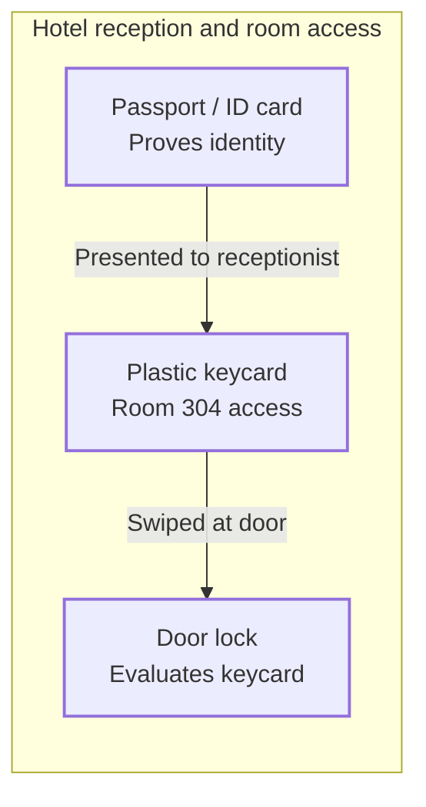
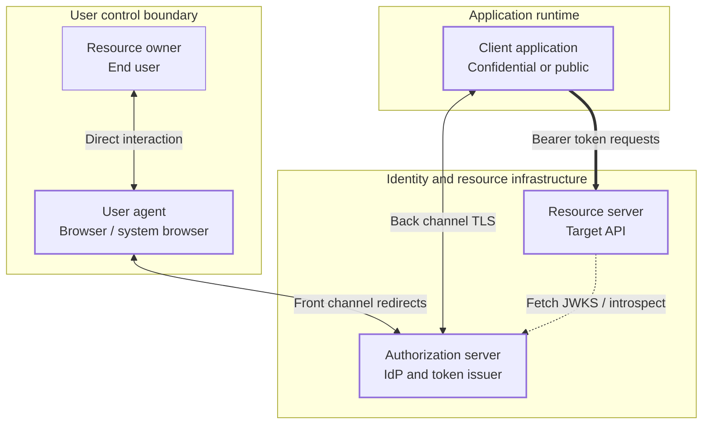
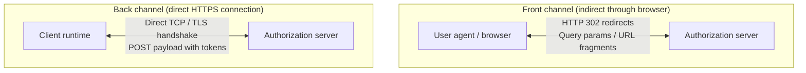
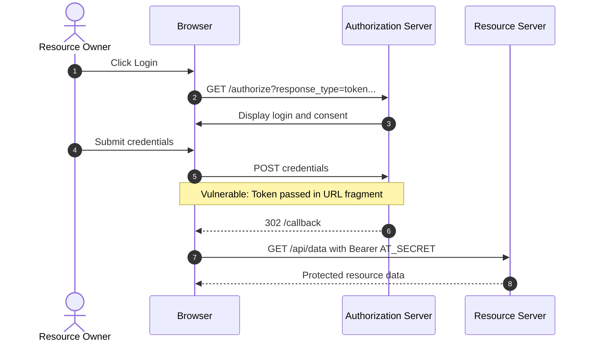
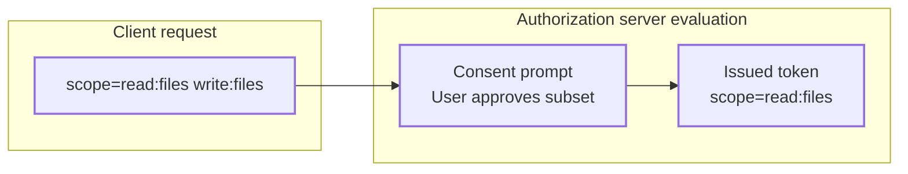

Modern software architecture relies on distributed authorization. When a third-party application wants to read files from Google Drive, print photos from Instagram, or synchronize events with Microsoft Outlook, it must never receive the user's primary password. 

Before OAuth, granting third-party access meant surrendering your raw account credentials. Early financial aggregators literally prompted users for their online banking username and password, storing them in plaintext or reversible encryption to scrape transaction screens via headless scripts.

This pattern breaks fundamental security invariants:

1. **Unbounded blast radius.** The third-party client receives the exact same privileges as the user. If an application only needs to read a contact list, it also gains the ability to delete the account, alter billing details, or transfer funds.
2. **Revocation requires destruction.** The only way to revoke access for one misbehaving application is to change the primary account password, simultaneously breaking every other integrated service.
3. **Password proliferation.** Secrets escape their origin boundary and get duplicated across untrusted client datastores. A single breach at a third-party vendor compromises the user's root account across the internet.
4. **No way to identify the acting application.** The service sees only a valid username and password. It cannot tell which third-party application is acting, so it cannot audit, rate-limit, or selectively cut off a single integration.

OAuth 2.0 ([RFC 6749](https://datatracker.ietf.org/doc/html/rfc6749)) was engineered to solve this dilemma. It is not an authentication protocol; it is a delegated authorization framework. It separates the role of the resource owner from the resource consumer by introducing an intermediary: an authorization server issuing scoped, short-lived bearer credentials.

This article is Part 1 of a technical deep dive into OAuth 2.0 mechanics. We examine the core mental model, dissect the system roles and trust boundaries, unpack the physical realities of front and back communication channels, and examine why earlier designs like the Implicit grant were abandoned.

## Table of contents

## OAuth 2.0 vs OpenID Connect: The Hotel Keycard Analogy

The most persistent source of architectural bugs in modern identity systems is conflating *delegated authorization* with *federated authentication*. 

- **OAuth 2.0** answers: *What is this software allowed to do on my behalf?*
- **OpenID Connect (OIDC)** answers: *Who is the user currently sitting at the keyboard?*

OAuth 2.0 issues an **Access Token**. An access token is an authorization credential meant for APIs (Resource Servers). The client application that holds this token is not supposed to inspect it or understand its contents. To the client, an access token is merely an opaque string to attach to an HTTP `Authorization: Bearer <token>` header ([RFC 6750](https://datatracker.ietf.org/doc/html/rfc6750)).

OpenID Connect is an identity layer built directly on top of OAuth 2.0. It introduces an **ID Token**. An ID token is an identity assertion formatted as a signed JSON Web Token (JWT). It is explicitly intended for the *client application* to parse, cryptographically verify, and read to establish the user's local session.



Consider checking into a hotel:

1. **The Passport (OpenID Connect ID Token).** When you arrive at the reception desk, you present your government passport. The receptionist verifies your photo, confirms your name, and checks your reservation. The passport proves *who you are*. Once the clerk verifies your identity, they hand the passport back to you. The hotel doors do not read your passport.
2. **The Keycard (OAuth 2.0 Access Token).** The receptionist hands you a magnetic keycard. The keycard does not have your name or photo printed on it. It simply contains encoded permissions: access to Room 304 and the fitness center until 11:00 AM tomorrow.
3. **The Door Lock (Resource Server / API).** When you swipe your card at Room 304, the electronic lock on the door reads the magnetic strip. The lock does not know who you are, nor does it care. It only evaluates one condition: *Does this keycard hold valid authorization to retract the latch right now?*

Using an OAuth 2.0 access token to authenticate a user in your application is the equivalent of a security guard looking at a plastic hotel keycard and saying, "Because this card opens Room 304, you must be Alice Smith." The keycard proves capability, not identity.

## Core Architecture and the Five System Roles

[RFC 6749 Section 1.1](https://datatracker.ietf.org/doc/html/rfc6749#section-1.1) formally defines four roles: resource owner, client, authorization server, and resource server. The RFC also references the **user agent** throughout its flows, but it is a participant rather than a formal role. In practice, modeling the user agent explicitly as a fifth entity is essential to understanding the network security boundary.



### 1. Resource Owner (User)
The entity capable of granting access to a protected resource. When the resource owner is an individual, we refer to them as the end user. The resource owner possesses the ultimate authority to authorize third-party software to act on their behalf.

### 2. User Agent (Device / Browser)
The software runtime through which the Resource Owner interacts with the system. This is typically a web browser, a mobile operating system browser view, or a terminal environment. The user agent is an untrusted intermediary: it executes inside an environment controlled by the user, caching URLs, recording navigation history, and executing client scripts.

### 3. Client (Application)
The application making protected resource requests on behalf of the resource owner and with its authorization. The term "client" does not denote where the code runs; it simply denotes the software requesting access. A client may be a server-side Go service, a React Single Page Application (SPA), a native iOS application, or a cron daemon.

### 4. Authorization Server (AS)
The server issuing access tokens to the client after successfully authenticating the resource owner and obtaining authorization. In enterprise deployments, the authorization server is often an Identity Provider (IdP) like Okta, Keycloak, Auth0, or Ping Identity. It hosts the user login interface, handles multi-factor authentication (MFA), evaluates risk policies, and manages consent lifecycles.

### 5. Resource Server (RS / API)
The server hosting the protected resources, capable of accepting and responding to protected resource requests using access tokens. This is the API your client wants to consume: GitHub's REST API, a payments gateway, or an internal microservice cluster. The resource server does not concern itself with how the token was obtained; its duty is strictly to validate incoming tokens and enforce access control policies.

## Client Profiles: Confidential vs Public

An authorization system cannot make uniform assumptions about client security. Where the client code executes determines its cryptographic capabilities. [RFC 6749 Section 2.1](https://datatracker.ietf.org/doc/html/rfc6749#section-2.1) divides clients into two distinct profiles.

| Property | Confidential Client | Public Client |
| :--- | :--- | :--- |
| **Execution Environment** | Secure server-side infrastructure (e.g. Node.js backend, Go API, Java Spring service) | Client-controlled hardware (e.g. iOS/Android apps, React SPAs, Electron apps) |
| **Credential Storage** | Can protect long-term cryptographic secrets (API keys, private keys, certificates) | Cannot protect secrets; all embedded assets can be decompiled or inspected |
| **Client Authentication** | Authenticates directly against the Authorization Server using mutual TLS, private key JWTs, or client secrets | Cannot authenticate; uses Proof Key for Code Exchange (PKCE) to bind the authorization code to the app instance that started the flow |
| **Trust Model** | Higher trust; the AS can verify the client's identity on every token request | Lower trust; runs in an adversarial sandbox exposed to user observation and manipulation |

### Confidential Clients and Application Identity
A confidential client runs inside a protected data center or cloud environment where end users cannot inspect the process memory, read environment variables, or intercept internal network sockets. 

Because confidential clients can maintain secrets, the Authorization Server can reliably verify the application's identity. Traditional setups use a shared `client_id` and `client_secret`. Modern systems avoid shared symmetric secrets in favor of asymmetric cryptographic authentication:
- **Private Key JWT ([RFC 7523](https://datatracker.ietf.org/doc/html/rfc7523)).** The client generates an asymmetric key pair. It registers the public key with the Authorization Server and signs a client assertion JWT with its private key whenever requesting tokens.
- **Mutual TLS (mTLS) Client Authentication ([RFC 8705](https://datatracker.ietf.org/doc/html/rfc8705)).** The client establishes a TLS connection where both client and server present X.509 certificates, binding the transport session directly to the client's cryptographic identity.

### Public Clients
A public client executes on a device controlled by the user. This includes mobile applications running on iOS or Android, Single Page Applications executing within a web browser, and desktop binaries distributed to workstations.

Any secret embedded within a mobile APK or JavaScript bundle is compromised the moment the application is distributed:
- Mobile APKs can be unpacked using tools like `apktool` or inspected via dynamic instrumentation with Frida.
- JavaScript running in a browser can be read directly via browser developer tools or intercepted via network inspection proxies.
- Decompilers can extract any hardcoded strings, symmetric API keys, or embedded tokens in seconds.

Because public clients cannot hold static secrets, an Authorization Server cannot use a `client_secret` to verify their identity. Any attacker can copy the `client_id` of a public client and start a flow in its name. **PKCE ([RFC 7636](https://datatracker.ietf.org/doc/html/rfc7636)) does not change this: it does not authenticate the client.** Instead, it binds each authorization code to the specific app instance that initiated the request, so an intercepted or injected code is useless to anyone else. We examine PKCE in detail in Part 2.

## Channels of Communication: Front Channel vs Back Channel

Understanding OAuth requires modeling the physical network paths over which data travels. The protocol deliberately splits its traffic into two separate channels with completely different security characteristics.



### The Courier vs Pneumatic Tube Analogy
To understand the difference, consider sending sensitive documents between two bank branches:

- **The Front Channel is a hand delivery by a third-party courier.** You take an envelope, hand it to a freelance bicycle courier on the street, and ask them to ride across town and hand it to the manager at Branch B. The courier can look at the envelope, write down whatever is stamped on the outside, drop it, or deliver it to the wrong desk. You have no direct control over the transit path; you are relying on an untrusted intermediary to bounce the payload forward.
- **The Back Channel is an armored pneumatic tube.** A secure, direct pipe connects Branch A directly to Branch B. It uses end-to-end authenticated transport. You insert the document into the tube, press a button, and it arrives directly inside the secure vault of Branch B without passing through any third party's hands.

### Front Channel Dynamics
The front channel moves data **indirectly** by leveraging the User Agent (browser) as a relay mechanism. 

When an Authorization Server needs to send information to a client application via the front channel, it does not open a network socket to the client. Instead, it returns an HTTP redirect response to the browser:

```http
HTTP/1.1 302 Found
Location: https://client.example.com/callback?code=splat-938210&state=xyz123
```

The browser receives this instruction and immediately executes a `GET` request to `client.example.com` with the parameters encoded directly inside the target URL.

**Characteristics and Failure Modes of the Front Channel:**
1. **Observable in browser history and logs.** Every URL traversed by a browser is recorded in the local navigation history database.
2. **Exposed in intermediate proxy logs.** Web proxies, firewalls, and CDN edge servers log full request URIs, including query parameters, into access logs.
3. **Leaked via the HTTP Referer header.** If the callback page loads external resources (scripts, images, analytics beacons), the browser automatically includes the full current URL in the `Referer` header sent to those third parties.
4. **Subject to URL truncation.** Browsers and intermediate gateways enforce arbitrary limits on maximum URL length (often 2048 to 8192 bytes), making it impossible to pass large cryptographic payloads reliably.

### Back Channel Dynamics
The back channel is a **direct point-to-point HTTPS connection** established between the client application's execution environment and the Authorization Server's token endpoint.

A critical point of confusion for many software engineers is the word "back". **Back channel does not mean "backend server".** It means a direct network socket using TLS between the client runtime and the server endpoint, with no browser redirection in the middle. 

When a Single Page Application running in a browser executes `fetch("https://auth.example.com/oauth/token", { method: "POST", ... })`, that HTTP request is traveling over a **back channel**. The payload is contained in the HTTP POST request body, protected by TLS encryption, and never appears in browser history, address bars, or HTTP referer headers.

Note the limit of this guarantee: the *transport* is direct, but the tokens returned to a browser-based client land in JavaScript-accessible memory. A back channel from a browser protects against URL leakage, not against Cross-Site Scripting (XSS). This is why Part 2 recommends keeping tokens out of the browser entirely.

## The Demise of the Implicit Flow

In the original [RFC 6749](https://datatracker.ietf.org/doc/html/rfc6749) specification published in 2012, browser-based Single Page Applications faced a structural limitation: the same-origin policy blocked cross-origin requests, and **Cross-Origin Resource Sharing (CORS)** was not yet a reliable escape hatch. Browser support was incomplete (Internet Explorer 8 and 9 offered only the limited `XDomainRequest`), and authorization servers did not yet send CORS headers. An application running on `https://spa.example.com` therefore could not dependably make `XMLHttpRequest` calls to a token endpoint on `https://auth.example.com`.

To circumvent this, RFC 6749 created the **Implicit Grant Flow** ([RFC 6749 Section 4.2](https://datatracker.ietf.org/doc/html/rfc6749#section-4.2)).

Instead of returning an authorization code that the client exchanges over a secure back channel, the Authorization Server issued the access token **directly in the front channel**, embedding it inside the URL hash fragment:

```http
HTTP/1.1 302 Found
Location: https://spa.example.com/callback#access_token=2YotnFZFEjr1zCsicMWpAA&token_type=bearer&expires_in=3600&state=xyz123
```



### Why the Implicit Flow is Flawed and Deprecated
The Implicit flow violated foundational security principles by delivering bearer credentials across an untrusted channel.

1. **Token Persistence in Browser History.** The full callback URL, fragment included, is recorded in the browser's history, where other users of the device, sync services, or malware can recover it.
2. **Leakage via Open Redirectors.** Browsers carry a URL fragment over across subsequent redirects. If the redirect URI or any page it forwards to contains an open redirector, the access token is delivered straight to an attacker-controlled site.
3. **No Sender Binding.** The token is a pure bearer credential delivered through an untrusted channel. Whoever obtains it can use it.
4. **Access Token Injection Attacks.** The client has no way to verify whether the incoming access token was actually issued for this user and this application session, or if an attacker injected a token obtained elsewhere.
5. **No Refresh Tokens Permitted.** Because the front channel is fundamentally leaky, RFC 6749 explicitly banned issuing refresh tokens in the Implicit flow. When an access token expired, the client had to trigger hidden iframe redirects to silently re-authenticate the user, introducing complex state race conditions.
6. **Script Access to the Fragment.** While browsers do not send URL hash fragments to the server in the HTTP request line, client-side scripts running on the page (including third-party tracking libraries and tag managers) have unrestricted read access to `window.location.hash`. Any compromised third-party script could siphon incoming access tokens silently.

With the universal adoption of CORS support across all modern web browsers and the standardization of **PKCE ([RFC 7636](https://datatracker.ietf.org/doc/html/rfc7636))**, the Implicit Flow is no longer recommended. The OAuth 2.0 Security Best Current Practice ([RFC 9700](https://datatracker.ietf.org/doc/html/rfc9700)) states that clients **SHOULD NOT** use it, and the upcoming [OAuth 2.1](https://datatracker.ietf.org/doc/draft-ietf-oauth-v2-1/) specification removes it entirely. Modern SPAs should use the Authorization Code Flow with PKCE instead.

## Scopes and the Mechanics of User Consent

The central mechanism for enforcing the principle of least privilege in OAuth 2.0 is the **Scope** parameter ([RFC 6749 Section 3.3](https://datatracker.ietf.org/doc/html/rfc6749#section-3.3)).



A scope is a space-delimited list of case-sensitive strings representing permissions requested by the client. RFC 6749 defines the **syntax** (each `scope-token` is a string of printable ASCII characters excluding space, `"` and `\`, and the order of tokens does not matter) but intentionally leaves the **semantics** undefined, allowing APIs to design authorization models tailored to their domain.

Common patterns for scope naming include:
- Action-Resource: `read:reports`, `write:orders`
- Hierarchical: `calendar.events.readonly`, `user.profile.write`
- Role-based: `admin`, `auditor`

### The Lifecycle of Consent
When an application requests authorization, it presents a list of desired scopes:

```http
GET /authorize?
  response_type=code&
  client_id=analytics-dashboard-492&
  redirect_uri=https%3A%2F%2Fapp.example.com%2Fcallback&
  scope=read%3Atransactions%20write%3Atransactions&
  state=d34db33f&
  code_challenge=E9Melhoa2OwvFrEMTJguCHaoeK1t8URWbuGJSstw-cM&
  code_challenge_method=S256 HTTP/1.1
Host: auth.example.com
```

The Authorization Server evaluates this request through a deterministic pipeline:

1. **Client Scope Validation.** The Authorization Server queries its internal client registry to verify that `analytics-dashboard-492` is permitted to request `write:transactions`. If the client asks for an administrative scope it was never registered for, the Authorization Server rejects it with an `invalid_scope` error. Because the client and redirect URI are valid, this error is delivered by redirecting back to the client (`?error=invalid_scope&state=...`, [RFC 6749 Section 4.1.2.1](https://datatracker.ietf.org/doc/html/rfc6749#section-4.1.2.1)). The AS only shows an error page itself when the client or redirect URI is invalid.
2. **Consent Prompt Evaluation.** If the scopes are valid, the server checks if the user has already granted permanent consent for this client and this exact scope set. If not, the server presents a consent screen.
3. **User Discretion and Downscoping.** The Resource Owner reviews the requested permissions. Advanced authorization servers allow granular consent: the user may uncheck `write:transactions` while permitting `read:transactions`.
4. **Token Issuance with Final Scopes.** The Authorization Server returns an authorization code bound to the *consented* scopes, not necessarily the *requested* scopes. When the client exchanges the code for a token, the response includes the granted scope. Per [RFC 6749 Section 5.1](https://datatracker.ietf.org/doc/html/rfc6749#section-5.1), `scope` is OPTIONAL when it is identical to the requested scope and REQUIRED when it differs. An absent `scope` therefore means "everything you asked for":

```json
{
  "access_token": "eyJhbGciOiJSUzI1NiIs...",
  "token_type": "Bearer",
  "expires_in": 3600,
  "scope": "read:transactions"
}
```

The client application must inspect the returned `scope` parameter to handle downscoping gracefully, adjusting its user interface to disable features whose permissions were denied by the user.

## Summary and Series Roadmap

OAuth 2.0 solves the credential delegation problem by introducing an intermediate authorization server and separating capabilities into distinct roles:

- It separates authorization from authentication: OAuth provides keycards (access tokens); OpenID Connect provides passports (ID tokens).
- It models clients according to their physical threat boundaries: Confidential clients can protect secrets; Public clients cannot.
- It bifurcates communication: Front-channel browser redirects handle user interaction; Back-channel TLS connections transfer bearer credentials.
- It deprecates leaky designs: The Implicit flow is dead, replaced everywhere by Authorization Code with PKCE.

In **[Part 2](/posts/how-it-works/oauth-2-flows-and-runtimes)**, we explore how these foundational components execute across real-world client runtimes: diving deep into the Authorization Code Flow with PKCE for server-side, native mobile, and single-page applications, inspecting the Device Flow for IoT, and examining the Client Credentials Grant for machine-to-machine microservices.
