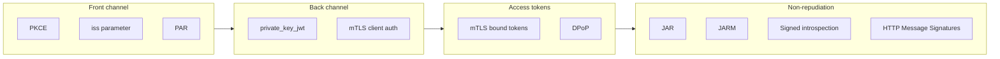
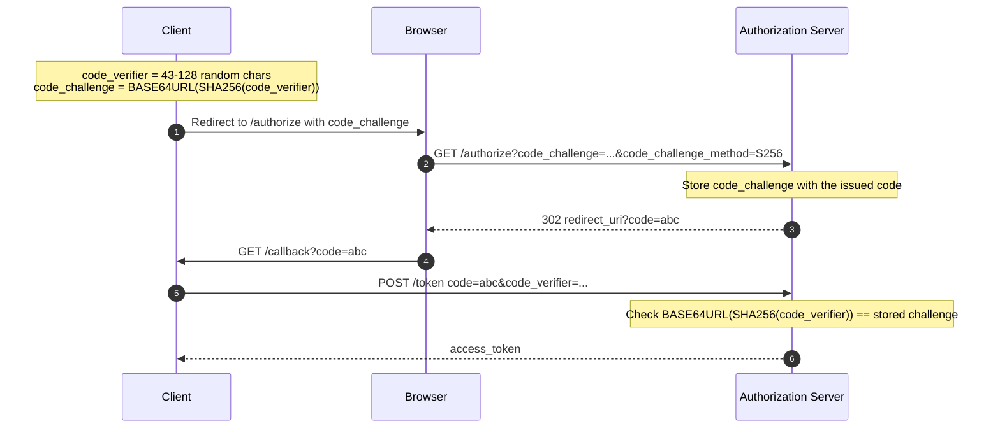
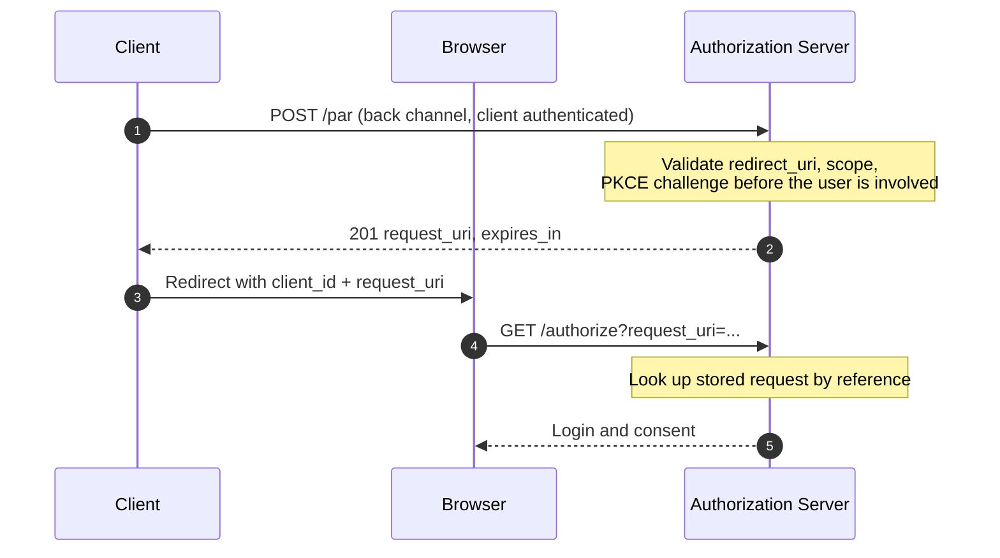
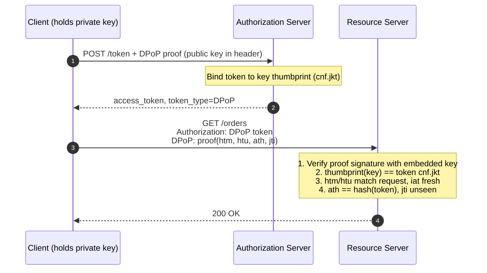

The first three parts of this series described a protocol that works. Part 4 is about a protocol that keeps working when someone is actively attacking it.

Plain OAuth 2.0 with a client secret and bearer tokens is fine for many applications. It is not fine for open banking, health records, or anything where a leaked token moves money or exposes regulated data. For those cases the [FAPI (Financial-grade API) working group](https://oauth.net/fapi/) at the OpenID Foundation defines profiles of OAuth that remove optional behavior, require specific extensions, and close known attack classes one by one. The name comes from its origin in open banking, but the profiles apply to any API where the cost of a compromise is high.

This post does not treat FAPI as a checklist. It asks a different question: for each extension, what exactly is the attack, and which message in the flow does the extension change?

In [Part 1](/posts/how-it-works/oauth-1-architecture) we covered roles and channels. In [Part 2](/posts/how-it-works/oauth-2-flows-and-runtimes) we covered flows and client runtimes. In [Part 3](/posts/how-it-works/oauth-3-tokens-and-validation) we covered tokens and validation. Here we cover:

1. Securing the front channel: PKCE, issuer identification, and Pushed Authorization Requests
2. Securing the back channel: client authentication with `private_key_jwt` and mTLS
3. Securing access tokens: sender-constrained tokens with mTLS and DPoP
4. Non-repudiation: JAR, JARM, signed introspection, and HTTP Message Signatures

## Table of contents

## What Are We Protecting?

Before adding mechanisms, name the assets. In the OAuth and FAPI threat model there are three:

- **Authentication.** The Authorization Server must be sure which client it is talking to, and the client must be sure which Authorization Server it is talking to.
- **Authorization.** The grant, meaning the scopes and the user's consent, must reach the right client and only the right client. Access tokens must be usable only by the party they were issued to.
- **Session integrity.** The authorization response that arrives at the client must belong to the request that the same client instance started, in the same browser session, with the same Authorization Server.

One assumption is fixed. **OAuth and FAPI assume that TLS is not compromised.** Everything below is about attackers who sit inside that boundary: malicious browser extensions, other apps on the device, compromised logs, rogue proxies, a hostile Authorization Server that a client was tricked into talking to, or a stolen token replayed from another machine. TLS protects the pipe. These extensions protect what travels through the pipe and where it ends up.

The current baseline is the [FAPI 2.0 Security Profile](https://openid.net/specs/fapi-security-profile-2_0-final.html). Its structure is a useful map for the rest of this post: confidential clients only, authorization code flow only, PAR, PKCE with `S256`, the `iss` response parameter, strong client authentication, and sender-constrained access tokens. A separate [FAPI 2.0 Message Signing](https://openid.net/specs/fapi-message-signing-2_0-final.html) profile adds the non-repudiation pieces.



## Section 1: Securing the Front Channel

The front channel is the user's browser. Part 1 defined it as the untrusted, observable path: URLs land in history, logs, `Referer` headers, and extensions. Three attacks live here.

### Authorization Code Injection

The authorization code that returns to the client's `redirect_uri` is a bearer artifact with one flaw: **it does not say which browser session it was meant for.** The client receives `?code=abc&state=xyz` and has to trust that this code belongs to the flow it started.

An attacker can exploit that in two ways:

1. **Inject the attacker's code into the victim's session.** The attacker starts a flow with their own account, captures the redirect, and tricks the victim's browser into loading that callback URL. The victim's client exchanges the attacker's code and ends up logged in as the attacker, or linked to the attacker's account.
2. **Steal the victim's code and redeem it elsewhere.** On a mobile device, a malicious app registers the same custom URI scheme as the legitimate app and intercepts the redirect. It then redeems the stolen code itself. This works against **public** clients. Against a confidential client the attacker would also need the client's credentials, which is why this attack drove PKCE's original design for native apps.

The `state` parameter helps with the first case only if the client binds it to the user agent session and checks it. It does nothing for the second. What is missing is a way for the client to prove at the token endpoint that it is the same party that started the authorization request.

### How PKCE Closes This

Proof Key for Code Exchange ([RFC 7636](https://datatracker.ietf.org/doc/html/rfc7636)) adds exactly that proof, using a one-way function so the secret never travels in the front channel.



The client generates a high-entropy `code_verifier` and keeps it in memory, never in the URL. It sends only the hash, the `code_challenge`, in the front channel. The Authorization Server stores the challenge alongside the code it issues. At the token endpoint the client reveals the verifier, and the server hashes it and compares.

An attacker who steals the code from the redirect has the code and the challenge, but SHA-256 is preimage resistant, so they cannot derive the verifier. Without it, the code is worthless. An attacker who injects their code into the victim's session fails the other way around: the victim's client holds a verifier for a different challenge, so the exchange fails.

Two practical notes. Always use `S256`. The `plain` method sends the verifier as the challenge and defeats the purpose, and FAPI forbids it. And watch for downgrades: if PKCE is optional, an attacker can obtain a code from a flow they start *without* a `code_challenge` and inject it into the victim's session. The victim's client then redeems it with its own `code_verifier`, and an AS that ignores a verifier it has nothing to compare against will happily issue tokens. [RFC 9700 Section 2.1.1](https://datatracker.ietf.org/doc/html/rfc9700#section-2.1.1) requires the Authorization Server to support PKCE and to **reject a token request containing a `code_verifier` when the authorization request had no `code_challenge`**. FAPI 2.0 and OAuth 2.1 go further and require PKCE on every authorization request.

The [history of PKCE](https://oauth.net/2/pkce/) is instructive. It was designed in 2015 for native mobile apps, which could not keep a client secret and were exposed to the custom scheme interception above. It was then recognized that the same injection class applies to every client type, including confidential ones, and the current Security BCP recommends it everywhere. OAuth 2.1 makes it mandatory.

### Authorization Server Mix-Up Attacks

PKCE protects one flow against injection. It does not help when a client talks to **multiple Authorization Servers** and one of them is malicious. This is the mix-up attack described in the Security BCP.

The mechanics:

1. The client supports both an honest AS (`honest.example`) and an attacker-run AS (`evil.example`). The user picks `evil.example`.
2. The client starts a flow and redirects the user to `evil.example`'s authorization endpoint.
3. `evil.example` redirects the browser onward to `honest.example`, using the client's real `client_id`. The user authenticates at the honest server and approves.
4. `honest.example` redirects back to the client with a valid code.
5. The client has recorded that this flow is with `evil.example`, so it sends the code and its PKCE verifier to `evil.example`'s token endpoint. (It authenticates with the credentials it registered at `evil.example`, which are useless at the honest server.)
6. The attacker now holds a valid code for the honest AS, plus the verifier. If the client is **public**, the attacker redeems it at `honest.example` directly. If the client is **confidential**, the attacker cannot redeem it alone, but can inject it into a fresh flow of their own with the same client (code injection) and gain access to the victim's resources through their own session.

The core problem: the authorization response does not identify who sent it. The client infers the issuer from its own bookkeeping, which the attacker manipulated.

### Preventing Mix-Up with the Issuer Identifier

[RFC 9207](https://www.rfc-editor.org/rfc/rfc9207.html) fixes this by adding the issuer to the authorization response itself:

```http
HTTP/1.1 302 Found
Location: https://app.example.com/callback?
  code=SplxlOBeZQQYbYS6WxSbIA&
  state=af0ifjsldkj&
  iss=https%3A%2F%2Fhonest.example
```

The client compares `iss` with the issuer it recorded when it started the flow. A mismatch means the response came from somewhere other than where the client thinks it is, and the flow aborts before any secret leaves the client. Servers advertise support with the `authorization_response_iss_parameter_supported` metadata field from [RFC 8414](https://datatracker.ietf.org/doc/html/rfc8414). FAPI 2.0 requires the check.

### The Problem with Starting in the Front Channel

PKCE and `iss` harden the response. The **request** is still a bag of URL parameters sent through the browser, and that has structural problems:

- **No integrity.** Any parameter (`redirect_uri`, `scope`, `code_challenge`) can be modified by anything that touches the URL: an extension, a compromised device, a malicious page that initiates the flow.
- **No confidentiality.** The request lands in browser history, proxy logs, and `Referer` headers. For rich requests (for example [RAR, RFC 9396](https://datatracker.ietf.org/doc/html/rfc9396), which carries structured payment details) this can leak sensitive data.
- **No client authentication.** The authorization endpoint cannot tell whether the request came from the real client or from anyone who knows a public `client_id`.
- **Size limits.** Rich requests overflow practical URL lengths.

### Avoiding the Front Channel with PAR

Pushed Authorization Requests ([RFC 9126](https://www.rfc-editor.org/rfc/rfc9126.html)) remove the problem by not sending the request through the browser at all. The client POSTs the parameters directly to the Authorization Server, authenticating as itself, and gets back a short reference.

```http
POST /par HTTP/1.1
Host: auth.example.com
Content-Type: application/x-www-form-urlencoded

client_id=web-portal-91&
client_assertion_type=urn%3Aietf%3Aparams%3Aoauth%3Aclient-assertion-type%3Ajwt-bearer&
client_assertion=eyJhbGciOiJQUzI1NiIs...&
response_type=code&
redirect_uri=https%3A%2F%2Fapp.example.com%2Fcallback&
scope=payments&
code_challenge=E9Melhoa2OwvFrEMTJguCHaoeK1t8URWbuGJSstw-cM&
code_challenge_method=S256
```

```http
HTTP/1.1 201 Created
Content-Type: application/json

{
  "request_uri": "urn:ietf:params:oauth:request_uri:6esc_11ACC5bwc014ltc14eY22c",
  "expires_in": 60
}
```

The browser redirect then carries only the reference:

```http
GET /authorize?client_id=web-portal-91&request_uri=urn%3Aietf%3Aparams%3Aoauth%3Arequest_uri%3A6esc_11ACC5bwc014ltc14eY22c HTTP/1.1
Host: auth.example.com
```



What this buys:

- **Integrity and confidentiality.** The parameters travel over a TLS connection the browser never sees. Nobody can edit them in transit.
- **Authenticated requests.** The AS knows which client sent the request before any user interaction.
- **Early validation.** Bad `redirect_uri` or scope errors surface to the client in the back channel instead of as a confusing browser error page.
- **Smaller front channel.** The `request_uri` is short-lived, typically single-use (RFC 9126 says the AS SHOULD treat it as one-time use, but MAY tolerate a reload), and meaningless without the authorization server's state.

FAPI 2.0 requires PAR for exactly these reasons. Servers can also advertise `require_pushed_authorization_requests` so that direct front-channel requests are rejected outright.

## Section 2: Securing the Back Channel

The token endpoint is where the code becomes tokens. Part 1 described client authentication briefly. Here we look at why the default is weak and what replaces it.

### Client Authentication in OAuth

Confidential clients must authenticate at the token endpoint (and at PAR, introspection, and revocation). [RFC 6749 Section 2.3](https://datatracker.ietf.org/doc/html/rfc6749#section-2.3) defines the baseline: a shared client secret sent either in an HTTP Basic header or in the form body. OpenID Connect Core and [RFC 7591](https://datatracker.ietf.org/doc/html/rfc7591) name these methods `client_secret_basic` and `client_secret_post`.

Shared secrets have properties that matter at high assurance:

- **Both sides hold the secret.** The Authorization Server stores it (or a derivative that can verify it). A breach of the AS database leaks every client's credentials.
- **The secret is sent on every request.** It crosses TLS termination points, appears in memory of every proxy, and can end up in debug logs.
- **No audience restriction.** A secret stolen from one request works at any endpoint of that AS, indefinitely.
- **Rotation is operationally painful**, so in practice secrets live for years.

Both replacements below use asymmetric cryptography: the client holds a private key, and the AS holds only public material. A server breach exposes nothing that can impersonate the client.

### Private Key JWT as Client Authentication

OAuth defines a general framework for using assertions as credentials in [RFC 7521](https://datatracker.ietf.org/doc/html/rfc7521), and a JWT profile of it in [RFC 7523](https://datatracker.ietf.org/doc/html/rfc7523). OpenID Connect Core names the resulting method `private_key_jwt`.

The client signs a short JWT with its private key and sends it in place of a secret:

```http
POST /token HTTP/1.1
Host: auth.example.com
Content-Type: application/x-www-form-urlencoded

grant_type=authorization_code&
code=SplxlOBeZQQYbYS6WxSbIA&
code_verifier=dBjftJeZ4CVP-mB92K27uhbUJU1p1r_wW1gFWFOEjXk&
client_id=web-portal-91&
client_assertion_type=urn%3Aietf%3Aparams%3Aoauth%3Aclient-assertion-type%3Ajwt-bearer&
client_assertion=eyJhbGciOiJQUzI1NiIsImtpZCI6ImNsaWVudC1rZXktMDEifQ...
```

The assertion's claims:

```json
{
  "iss": "web-portal-91",
  "sub": "web-portal-91",
  "aud": "https://auth.example.com",
  "iat": 1709118800,
  "exp": 1709118860,
  "jti": "5f3c1d9e-7a24-4f0a-b1c2-0d98e4a7c331"
}
```

How the AS validates it:

1. Look up the client by `iss` (equal to the `client_id`) and fetch its registered public key (directly registered, or via the client's `jwks_uri`) using the header `kid`.
2. Verify the signature, pinning the algorithm to what the client registered.
3. Check `iss` and `sub` both equal the `client_id`, and that `aud` identifies this AS. FAPI 2.0 requires the AS to accept only its issuer identifier, as a single string, in `aud`. This was tightened after research into **audience injection** attacks, in which a malicious AS tricks a client into signing an assertion whose `aud` is also accepted by an honest AS (for example its token endpoint URL). A single unambiguous audience value shuts this down, and an update to RFC 7523 ([draft-ietf-oauth-rfc7523bis](https://datatracker.ietf.org/doc/draft-ietf-oauth-rfc7523bis/)) applies the same fix generally.
4. Check `exp` is short (minutes at most) and reject any `jti` that was already seen within that window.

The assertion is bound to one audience, one short time window, and one use. Capturing it gains an attacker very little. Compare that with a shared secret that is valid everywhere forever.

### Mutual TLS as Client Authentication

[RFC 8705](https://www.rfc-editor.org/rfc/rfc8705) moves client authentication into the TLS handshake. The client presents an X.509 certificate during the handshake, and the AS requires and verifies it. Proof of possession of the private key is part of TLS itself, so no assertion needs to be built at the application layer.

The RFC defines two methods:

- **`tls_client_auth`**: the certificate chains to a trusted CA and its subject (DN, SAN) matches what was registered for the client.
- **`self_signed_tls_client_auth`**: the certificate is self-signed and the AS compares it against a certificate or JWKS registered for the client.

The operational cost is real. Termination has to happen on something that exposes the client certificate to the AS logic, which complicates load balancers and CDNs. Browsers are a poor fit for presenting client certificates, which is why mTLS is mostly used for server-to-server and regulated API ecosystems. `private_key_jwt` works anywhere you can sign a JWT, so it is the more common choice when a proxy sits in the path. FAPI 2.0 allows either.

## Section 3: Securing Access Tokens

Part 3 introduced sender-constrained tokens. Here we look at how they work in detail, and at what FAPI requires.

### Validation Requirements Beyond Part 3

Everything in Part 3 about validating JWT access tokens still applies: signature, `iss`, `aud`, `exp`, `typ`. (Similarly, high-assurance APIs often enforce step-up authentication challenges under [RFC 9470](https://datatracker.ietf.org/doc/html/rfc9470)—covered in [Part 3](/posts/how-it-works/oauth-3-tokens-and-validation#step-up-authentication-the-rfc-9470-challenge-protocol)—when operations demand elevated authentication assurance `acr` or fresh authentication `auth_time`). The [FAPI 2.0 Security Profile](https://openid.net/specs/fapi-security-profile-2_0-final.html) adds requirements on top, and the biggest is that the resource server must **verify the sender constraint**, meaning that the party presenting the token is the party the token was issued to. It also requires the Authorization Server to issue **only sender-constrained access tokens**, forbidding plain bearer tokens altogether, and recommends that access tokens be audience-restricted to the resource servers that will consume them.

### The Problem with Bearer Tokens

[RFC 6750](https://datatracker.ietf.org/doc/html/rfc6750) defines the bearer model, and its own security considerations section states the issue: any party in possession of the token can use it. [Bearer tokens](https://oauth.net/2/bearer-tokens/) behave like cash. The resource server does not ask who is holding the token, only whether it is valid.

That means every place the token lives becomes an attack surface:

- Application logs and error reporting that capture headers
- A compromised or malicious proxy, API gateway plugin, or observability sidecar
- Memory dumps on the client
- An XSS payload in a browser client
- A compromised downstream service that receives a forwarded token

Short lifetimes bound the damage window. They do not prevent a stolen token from being used during that window from a different machine.

Sender-constrained tokens change what "valid" means. The token is bound to a key that only the legitimate client controls. To use the token, the caller must also **prove possession of that key on each request**. A stolen token without the key is a string.

### mTLS for Sender-Constrained Access Tokens

The second half of [RFC 8705](https://www.rfc-editor.org/rfc/rfc8705#section-3) defines [certificate-bound access tokens](https://oauth.net/2/mtls/). The sequence:

1. The client connects to the token endpoint using its certificate.
2. The AS computes the SHA-256 thumbprint of that certificate and records it in the token, in the `cnf` (confirmation) claim:

```json
{
  "iss": "https://auth.example.com",
  "sub": "user_9482019",
  "aud": "https://api.example.com",
  "exp": 1709122400,
  "cnf": {
    "x5t#S256": "bwcK0esc3ACC3DB2Y5_lESsXE8o9ltc05O89jdN-dg2"
  }
}
```

3. When calling the API, the client connects over mTLS with the same certificate.
4. The resource server hashes the certificate from the TLS session and compares it with `cnf.x5t#S256`. If they differ, the request is rejected.

The binding is enforced by the TLS handshake, which already proves private-key possession. There is nothing extra to build per request.

Certificate binding does not require mTLS *client authentication*. [RFC 8705 Section 4](https://www.rfc-editor.org/rfc/rfc8705#section-4) lets a client that authenticates some other way, or a public client that cannot authenticate at all, present a self-signed certificate purely to bind its tokens.

The constraint is the same as for mTLS client authentication: the TLS terminator must pass certificate information to the component that validates tokens, and each hop in a proxy chain needs a plan for it.

### DPoP for Sender-Constrained Access Tokens

[DPoP](https://oauth.net/2/dpop/), defined in [RFC 9449](https://datatracker.ietf.org/doc/html/rfc9449), gets the same property at the application layer, so it works for browsers, mobile apps, and anything behind TLS-terminating infrastructure.

The client generates a key pair and attaches a fresh signed proof to every request in a `DPoP` header. The proof is a JWT with the public key embedded in the header:

```json
{
  "typ": "dpop+jwt",
  "alg": "ES256",
  "jwk": { "kty": "EC", "crv": "P-256", "x": "l8tFrhx-34tV3hRICRDY9zCkDlpBhF42UQUfWVAWBFs", "y": "9VE4jf_Ok_o64zbTTlcuNJajHmt6v9TDVrU0CdvGRDA" }
}
```

```json
{
  "jti": "e1j3V_bKic8-LAEB",
  "htm": "GET",
  "htu": "https://api.example.com/orders",
  "iat": 1709118830,
  "ath": "fUHyO2r2Z3DZ53EsNrWBb0xWXoaNy59IiKCAqksmQEo"
}
```

The claims, and what each one defeats:

- **`htm` and `htu`** bind the proof to one HTTP method and URL, so a proof captured for `GET /orders` cannot be replayed as `DELETE /orders/1`. Note that `htu` is compared *without* the query string and fragment, so the proof does not bind query parameters.
- **`iat` and `jti`** limit the proof to a short window and make each one unique, so servers can reject replays within that window.
- **`ath`** is the hash of the access token, binding the proof to this specific token.
- **`nonce`** (optional) lets the server hand out a value the client must include, which prevents the client from pre-generating proofs for future use. The server delivers it in a `DPoP-Nonce` response header, typically alongside an `error="use_dpop_nonce"` response that tells the client to retry with it.

At the token endpoint, the AS sees the `DPoP` header, takes the JWK SHA-256 thumbprint ([RFC 7638](https://datatracker.ietf.org/doc/html/rfc7638)) of the embedded public key, and records it in the access token as `cnf.jkt` (or, for opaque tokens, returns it in the introspection response). The token type returned is `DPoP`, not `Bearer`. Refresh tokens issued to public clients are bound to the same key, which is how DPoP satisfies RFC 9700's requirement that public-client refresh tokens be sender-constrained or rotated. The API call then looks like this:

```http
GET /orders HTTP/1.1
Host: api.example.com
Authorization: DPoP eyJhbGciOiJSUzI1NiIs...
DPoP: eyJ0eXAiOiJkcG9wK2p3dCIsImFsZyI6IkVTMjU2Ii...
```



An attacker who exfiltrates the token cannot produce valid proofs without the private key. In a browser the key can be generated as a **non-extractable** WebCrypto key, so even an XSS payload can use it only while the page is compromised, and cannot take it away.

Be precise about what DPoP does not do. It does not prevent an attacker with live code execution in the client from making requests through it. It stops the *portable* theft case: tokens copied out of logs, gateways, and storage. FAPI 2.0 accepts either DPoP or mTLS binding, and the choice mostly follows where you can operate TLS termination.

Because tokens are sender-constrained, FAPI 2.0 also tightens other parts of the token lifecycle. Authorization codes must expire within 60 seconds, and refresh-token rotation is discouraged: a bound refresh token is already useless to a thief, and rotation adds failure modes (lost responses, races) without adding protection.

## Section 4: Non-Repudiation

Everything so far authenticates a message to its recipient at the moment of receipt. If the AS says "the client sent this authorization request", a client can later claim it did not, and the client can equally claim the AS's response was never issued. The properties above do not give a third party a way to settle that.

**Non-repudiation** means a party cannot credibly deny having produced a message, because the message carries a digital signature that only that party's key could have made, and a third party can verify it later. This is the focus of [FAPI 2.0 Message Signing](https://openid.net/specs/fapi-message-signing-2_0-final.html). It matters in settings with legal or financial dispute resolution, where "who asked for what, and what did the server answer" must be provable.

Note the difference from DPoP or mTLS binding. Those prove possession to the live recipient. A signed message is a durable artifact that can be stored and verified later by someone else. In practice, signatures also give you integrity across intermediaries that terminate TLS, since the signature covers the content end to end.

The profile signs each step of the flow in turn.

### Signing Authorization Requests: JAR

JWT-Secured Authorization Request ([RFC 9101](https://datatracker.ietf.org/doc/html/rfc9101)) wraps the authorization request parameters in a signed JWT, the **request object**. Its header carries `"typ": "oauth-authz-req+jwt"` ([RFC 9101 Section 10.8](https://datatracker.ietf.org/doc/html/rfc9101#section-10.8)), and FAPI 2.0 Message Signing requires both `nbf` and `exp`, no more than 60 minutes apart:

```json
{
  "iss": "web-portal-91",
  "jti": "0b8f2c5e-3d14-4a7b-9e21-6c4f8a1d7e93",
  "nbf": 1709118800,
  "aud": "https://auth.example.com",
  "response_type": "code",
  "client_id": "web-portal-91",
  "redirect_uri": "https://app.example.com/callback",
  "scope": "payments",
  "code_challenge": "E9Melhoa2OwvFrEMTJguCHaoeK1t8URWbuGJSstw-cM",
  "code_challenge_method": "S256",
  "exp": 1709118860
}
```

It is passed either by value in the `request` parameter or by reference in `request_uri`. Used with PAR, the signed object is sent in the back channel push, which gives you both authenticated transport and a signature that persists as evidence. The AS can store the request object and later show that the client asked for exactly these scopes and this redirect.

### Signing Authorization Responses: JARM

The mirror image is JWT Secured Authorization Response Mode ([JARM](https://openid.net/specs/oauth-v2-jarm.html)). With `response_mode=jwt`, the AS returns a single signed `response` parameter instead of plain query parameters:

```http
HTTP/1.1 302 Found
Location: https://app.example.com/callback?
  response=eyJhbGciOiJQUzI1NiIsImtpZCI6ImFzLWtleS0wMSJ9...
```

Decoded, the payload carries the usual values plus identification:

```json
{
  "iss": "https://auth.example.com",
  "aud": "web-portal-91",
  "exp": 1709118920,
  "code": "SplxlOBeZQQYbYS6WxSbIA",
  "state": "af0ifjsldkj"
}
```

The client verifies the signature and checks `iss` and `aud`. This subsumes the RFC 9207 check, since `iss` is inside the signed payload, and it also prevents tampering with `code` or `state`. The AS has produced a signed statement that it issued this code to this client, which it cannot later disown.

### Signing Token Introspection Responses

Part 3 covered token introspection ([RFC 7662](https://datatracker.ietf.org/doc/html/rfc7662)), where the resource server asks the AS whether a token is active. The plain JSON response is authenticated only by TLS. If a resource server makes a high-stakes decision based on it, there is nothing to show later.

The JWT response for introspection, originally the [draft-ietf-oauth-jwt-introspection-response](https://datatracker.ietf.org/doc/html/draft-ietf-oauth-jwt-introspection-response) and since published as [RFC 9701](https://datatracker.ietf.org/doc/html/rfc9701), lets the resource server (acting as the introspection client) ask for a signed answer by sending `Accept: application/token-introspection+jwt`:

```json
{
  "iss": "https://auth.example.com",
  "aud": "https://api.example.com",
  "iat": 1709118830,
  "token_introspection": {
    "active": true,
    "scope": "payments",
    "client_id": "web-portal-91",
    "sub": "user_9482019",
    "exp": 1709122400
  }
}
```

The resource server can keep the signed response as a record that, at that moment, the AS stated the token was active with these scopes.

### Signing Resource Requests and Responses

The last two legs are the API calls themselves: the client's request to the resource server and the server's response. These are not OAuth messages, so OAuth tokens and JWT wrappers do not apply directly. The general-purpose answer is HTTP Message Signatures ([RFC 9421](https://www.rfc-editor.org/rfc/rfc9421.html)), which [FAPI 2.0 Message Signing](https://openid.net/specs/fapi-message-signing-2_0-final.html) adopts for signing resource requests and responses (see also [oauth.net](https://oauth.net/http-signatures/)).

HTTP Message Signatures sign a chosen set of **components** of a request or response (method, target URI, selected headers, and a digest of the body) and carry the result in two headers:

```http
POST /payments HTTP/1.1
Host: api.example.com
Authorization: DPoP eyJhbGciOiJSUzI1NiIs...
Content-Type: application/json
Content-Digest: sha-256=:X48E9qOokqqrvdts8nOJRJN3OWDUoyWxBf7kbu9DBPE=:
Signature-Input: sig1=("@method" "@target-uri" "content-digest" "authorization");created=1709118830;keyid="client-key-01";alg="ecdsa-p256-sha256"
Signature: sig1=:dHVyaW5nLWNvbXBsZXRlLXNpZ25hdHVyZS1yLXM...:

{"amount": "100.00", "currency": "EUR", "to": "NL91ABNA0417164300"}
```

The pieces:

- **`Content-Digest`** ([RFC 9530](https://www.rfc-editor.org/rfc/rfc9530.html)) hashes the body. (The digest and signature values above are illustrative and not computed over this exact body.) Signing that header transitively signs the body without making the signature cover raw bytes.
- **`Signature-Input`** declares exactly which components were signed, plus parameters like `created` and `keyid`. The verifier rebuilds the signature base from this list.
- **`Signature`** is the signature over that base. For `ecdsa-p256-sha256`, RFC 9421 requires the raw 64-byte `r || s` encoding, not the DER encoding many crypto libraries produce by default, which is a common interoperability bug.

Responses are signed the same way, and may reference components of the originating request, so the signed response is tied to the exact request that triggered it.

The result is the missing end of the chain. A payment instruction is signed by the client, a signed receipt comes back from the server, and both can be verified later by an auditor who has only the public keys. The authorization request (JAR), the grant (JARM), the token state (signed introspection), and the resource calls (HTTP signatures) all carry evidence of who said what.

## Putting the Layers Together

Each extension answers one question about one message. Reading the FAPI 2.0 profile with the table below in mind makes the requirements less arbitrary.

| Message | Attack | Mechanism | Spec |
| :--- | :--- | :--- | :--- |
| Authorization request | Parameter tampering, leakage, unauthenticated requests | PAR | [RFC 9126](https://www.rfc-editor.org/rfc/rfc9126.html) |
| Authorization response (code) | Code injection and theft | PKCE | [RFC 7636](https://datatracker.ietf.org/doc/html/rfc7636) |
| Authorization response (issuer) | Mix-up | `iss` parameter | [RFC 9207](https://www.rfc-editor.org/rfc/rfc9207.html) |
| Token request | Shared secret theft and replay | `private_key_jwt` or mTLS client auth | [RFC 7523](https://datatracker.ietf.org/doc/html/rfc7523), [RFC 8705](https://www.rfc-editor.org/rfc/rfc8705) |
| Access token | Theft and replay of bearer tokens | mTLS binding or DPoP | [RFC 8705](https://www.rfc-editor.org/rfc/rfc8705), [RFC 9449](https://datatracker.ietf.org/doc/html/rfc9449) |
| Authorization request (evidence) | Repudiation by client | JAR | [RFC 9101](https://datatracker.ietf.org/doc/html/rfc9101) |
| Authorization response (evidence) | Repudiation by AS | JARM | [JARM](https://openid.net/specs/oauth-v2-jarm.html) |
| Introspection response | Repudiation, tampering behind TLS terminators | Signed introspection | [RFC 9701](https://datatracker.ietf.org/doc/html/rfc9701) |
| API request and response | Repudiation, integrity across intermediaries | HTTP Message Signatures | [RFC 9421](https://www.rfc-editor.org/rfc/rfc9421.html) |

A practical way to adopt these, rather than all at once:

1. Start with the FAPI 2.0 Security Profile set: PAR, PKCE, `iss`, `private_key_jwt` or mTLS, and sender-constrained tokens. This closes the realistic theft and injection attacks.
2. Add message signing only where you have a dispute-resolution or regulatory requirement. It adds key management, canonicalization, and storage burdens that are not worth it otherwise.

## Conclusion

Parts 1 through 3 described what OAuth does. This part described what it takes to make each message in the flow resistant to a specific attacker: the browser path with PKCE, `iss`, and PAR, the token endpoint with asymmetric client authentication, the access token with sender constraints, and the whole conversation with signatures for non-repudiation.

The common design principle is to stop trusting position and start trusting proof. A request is trusted because it is authenticated and integrity-protected, not because it arrived through the right redirect. A token is trusted because its sender proves possession of a key, not because it is well formed. A response is trusted because it is signed by a known issuer, not because it came back over TLS.

## References and Further Reading

- [FAPI on oauth.net](https://oauth.net/fapi/)
- [FAPI 2.0 Security Profile](https://openid.net/specs/fapi-security-profile-2_0-final.html)
- [FAPI 2.0 Message Signing](https://openid.net/specs/fapi-message-signing-2_0-final.html)
- [RFC 6749: The OAuth 2.0 Authorization Framework](https://datatracker.ietf.org/doc/html/rfc6749)
- [RFC 6750: Bearer Token Usage](https://datatracker.ietf.org/doc/html/rfc6750)
- [RFC 7521: Assertion Framework for OAuth 2.0 Client Authentication and Authorization Grants](https://datatracker.ietf.org/doc/html/rfc7521)
- [RFC 7523: JWT Profile for OAuth 2.0 Client Authentication and Authorization Grants](https://datatracker.ietf.org/doc/html/rfc7523)
- [RFC 7636: Proof Key for Code Exchange (PKCE)](https://datatracker.ietf.org/doc/html/rfc7636)
- [RFC 7662: OAuth 2.0 Token Introspection](https://datatracker.ietf.org/doc/html/rfc7662)
- [RFC 7591: OAuth 2.0 Dynamic Client Registration Protocol](https://datatracker.ietf.org/doc/html/rfc7591)
- [RFC 7638: JSON Web Key (JWK) Thumbprint](https://datatracker.ietf.org/doc/html/rfc7638)
- [RFC 8414: OAuth 2.0 Authorization Server Metadata](https://datatracker.ietf.org/doc/html/rfc8414)
- [RFC 8705: OAuth 2.0 Mutual-TLS Client Authentication and Certificate-Bound Access Tokens](https://www.rfc-editor.org/rfc/rfc8705)
- [RFC 9101: JWT-Secured Authorization Request (JAR)](https://datatracker.ietf.org/doc/html/rfc9101)
- [RFC 9126: OAuth 2.0 Pushed Authorization Requests](https://www.rfc-editor.org/rfc/rfc9126.html)
- [RFC 9207: OAuth 2.0 Authorization Server Issuer Identification](https://www.rfc-editor.org/rfc/rfc9207.html)
- [RFC 9396: OAuth 2.0 Rich Authorization Requests](https://datatracker.ietf.org/doc/html/rfc9396)
- [RFC 9421: HTTP Message Signatures](https://www.rfc-editor.org/rfc/rfc9421.html)
- [RFC 9449: OAuth 2.0 Demonstrating Proof of Possession (DPoP)](https://datatracker.ietf.org/doc/html/rfc9449)
- [RFC 9530: Digest Fields](https://www.rfc-editor.org/rfc/rfc9530.html)
- [RFC 9700: Best Current Practice for OAuth 2.0 Security](https://datatracker.ietf.org/doc/html/rfc9700)
- [RFC 9701: JWT Response for OAuth Token Introspection](https://datatracker.ietf.org/doc/html/rfc9701)
- [JWT Secured Authorization Response Mode (JARM)](https://openid.net/specs/oauth-v2-jarm.html)
- [OAuth.net: PKCE](https://oauth.net/2/pkce/)
- [OAuth.net: Bearer Tokens](https://oauth.net/2/bearer-tokens/)
- [OAuth.net: Mutual TLS](https://oauth.net/2/mtls/)
- [OAuth.net: DPoP](https://oauth.net/2/dpop/)
- [OAuth.net: HTTP Signatures](https://oauth.net/http-signatures/)
