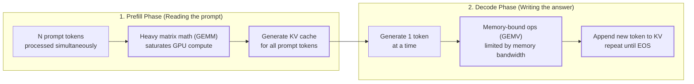
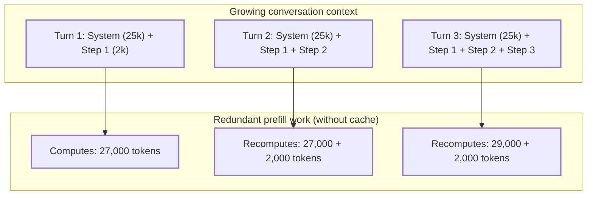
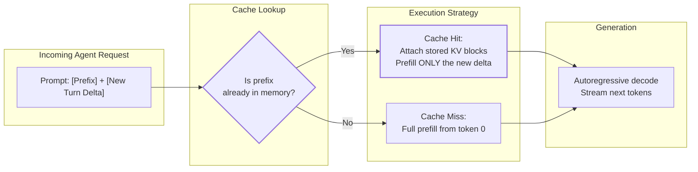
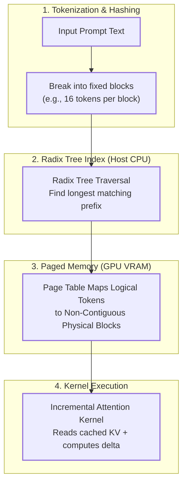
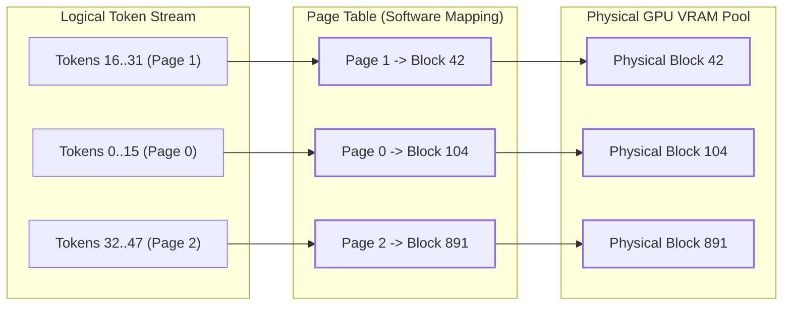
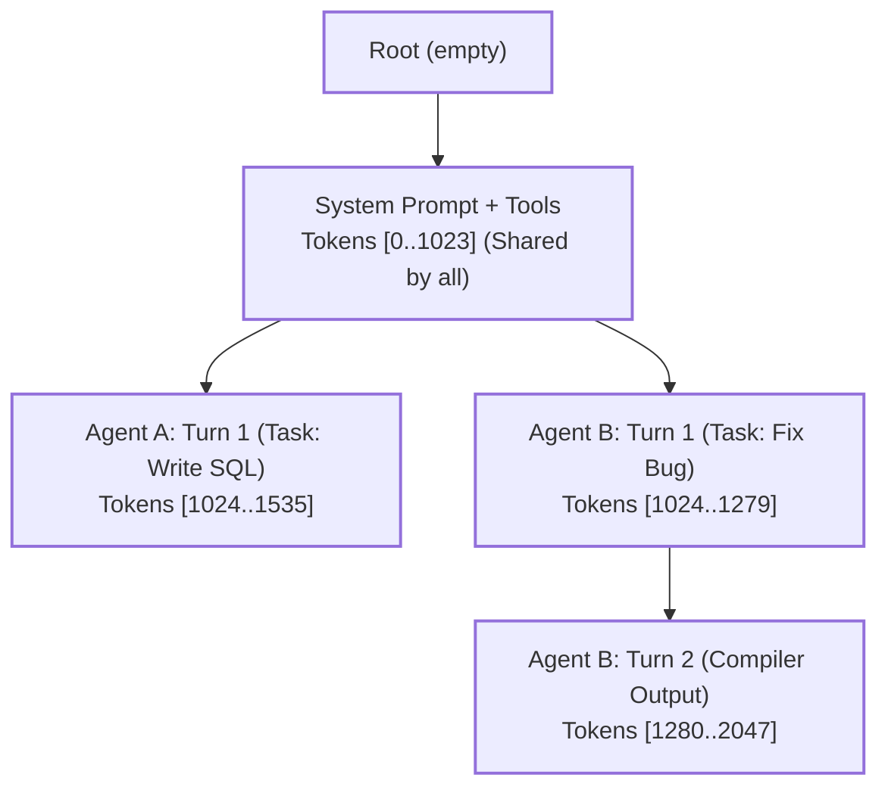

Modern AI agents don't just answer one question and stop. They work in loops: reasoning, picking a tool, reading the tool's output, thinking again, and taking the next step.

In standard Large Language Model (LLM) inference, every single step in this loop forces the server to re-read and re-calculate the entire conversation history from token zero. For an agent carrying lengthy system instructions, database schemas, and twenty turns of tool logs, this redundant work balloons Time To First Token (TTFT), slows down the agent, and dramatically inflates API bills.

**Prompt caching** solves this by storing the model's intermediate mathematical memory, known as the **Key-Value (KV) cache**, across requests. When an agent takes its next step, the model skips re-reading the familiar history and computes only what is new.

This post breaks down how prompt caching works under the hood: why LLM processing splits into two distinct phases, how the KV cache is virtualized like operating system memory, how inference engines match prefixes, and the practical rules every agent developer must follow to avoid breaking the cache.

## Table of contents

## Problem Statement

To understand why multi-step agents slow down and become expensive, we need to look at how an LLM processes text. Every request consists of two fundamentally different phases: **prefill** and **decode**.

### Prefill vs. Decode



1. **Prefill (Ingesting the Prompt)**: 
   The model takes all your input tokens at once. Because all tokens are known upfront, the GPU runs massive, highly parallel matrix multiplications (GEMM). Prefill is **compute-bound**: it pushes GPU Tensor Cores to their limit calculating the initial attention representations for every token.
2. **Decode (Generating Tokens One by One)**:
   The model generates words sequentially, one token per step. Each new token must attend to all previous tokens. Because this step produces only a single token at a time, it cannot fully utilize the GPU's raw compute power; instead, it is **memory-bandwidth bound**, waiting on the GPU memory (VRAM) to stream weights and prior context.

### The Agent Loop Bottleneck: Quadratic Accumulation

In a typical ReAct (Reason + Act) loop, the agent appends its thoughts, actions, and observations turn by turn:

$$
\text{Context}_t = [\text{System Prompt}] + [\text{Tool Schemas}] + \sum_{i=1}^{t-1} \left( \text{Thought}_i + \text{Action}_i + \text{Observation}_i \right)
$$

On Turn 1, the model reads the system prompt, tool definitions, and the initial user request.
On Turn 2, the agent client sends back the system prompt, tools, initial request, **plus** the tool output.
On Turn 3, it sends everything from Turn 1 and 2, **plus** the next tool output.

Without caching, the inference engine is completely stateless. It throws away all calculations from Turn 1 as soon as the response finishes. On Turn 2, it **re-tokenizes, re-projects, and re-computes attention over the entire prompt from scratch**.



#### The Math of Redundant Work

Let's look at real numbers for a standard coding agent:
* **Static Prefix ($S$)**: 25,000 tokens (detailed system rules, coding guidelines, tool schemas).
* **Per-Turn Delta ($\Delta$)**: 2,000 tokens (diffs, tool outputs, user comments).
* **Agent Loop Length ($T$)**: 30 turns.

The total prefill tokens processed across all 30 turns without caching is:

$$
N_{\text{total}} = \sum_{t=1}^T (S + t\Delta) = (30 \times 25{,}000) + \left(2{,}000 \times \frac{30 \times 31}{2}\right) = 1{,}680{,}000 \text{ tokens}
$$

The server ends up processing **1.68 million tokens of prefill compute**. 

With prompt caching, the engine processes the 25,000-token system prompt **once**, and on each subsequent turn only processes the new 2,000-token delta:

$$
N_{\text{cached}} = S + (T \times \Delta) = 25{,}000 + (30 \times 2{,}000) = 85{,}000 \text{ tokens}
$$

> **Takeaway**: Prompt caching cuts prefill compute in this scenario from **1,680,000 tokens down to 85,000 tokens**, achieving a **~95% reduction** in prefill workload.

---

## High-Level Mental Model

Think of standard LLM inference like an advisor with severe amnesia: every time you ask a follow-up question, they must read your entire 500-page dossier from page 1 before saying a single word.

Prompt caching is like letting that advisor keep their **annotated bookmark tabs and working memory** between questions. When you hand them page 501, they don't re-read pages 1 through 500; they simply glance at their stored notes and start responding immediately.



### Why Can't We Just Cache the Text Output?
In standard web development, caching stores final HTTP responses or database query results. But an agent's next turn is **never identical to the previous one**: it contains new tool results and requires a brand-new response.

Prompt caching does not cache the output text. It caches the **internal numerical vectors (Keys and Values)** that the attention mechanism computed for the input tokens. This allows the model to generate a brand-new answer while reusing all the reading work it already did.

### The Economics of Prompt Caching
Because the inference provider's GPUs do not need to re-run matrix multiplications for cached tokens, providers pass these hardware savings directly to users:

* **Anthropic (Claude)**: 90% discount on cached input tokens (with a 25% one-time surcharge to create the cache).
* **DeepSeek**: 90% discount on cached input tokens.
* **OpenAI (GPT-4o)**: 50% automatic discount on cached input tokens.
* **Google (Gemini)**: Up to 75% discount on cached context.

For an agent running 20 to 50 iterations per task, prompt caching routinely drops API costs by **60% to 80%**, while dropping Time To First Token from several seconds down to a fraction of a second.

---

## How It Works Under the Hood

To make prompt caching work without exhausting GPU memory, inference engines (like **vLLM** and **SGLang**) combine three key mechanisms:

1. **The KV Cache**: What is actually saved.
2. **PagedAttention**: How memory is organized.
3. **Radix Trees**: How identical prefixes are discovered and shared.



---

### 1. What is the KV Cache?

In a Transformer model, attention determines how much every word relates to every other word:

$$
\text{Attention}(Q, K, V) = \text{softmax}\left(\frac{Q K^T}{\sqrt{d_k}}\right) V
$$

* **Query ($Q$)**: "What am I looking for right now?"
* **Key ($K$)**: "What information do I contain?"
* **Value ($V$)**: "Here is my actual content."

When processing token $n$, the model computes its Key and Value vectors across every layer. In an autoregressive model with **causal masking**, token $n$ only attends to tokens that came before it ($0 \dots n-1$). It never looks ahead.

Because of this forward-only property:
* Token 5's Key and Value vectors **depend only on tokens 0 through 5**.
* When you append token 6, the Keys and Values for tokens 0 through 5 **do not change**.
* They are completely immutable. Once computed, they can be saved and reused indefinitely as long as the prefix remains untouched.

---

### 2. PagedAttention: Virtual Memory for GPUs

Before modern engines like vLLM, storing the KV cache required allocating continuous blocks of GPU memory for each request's maximum possible context length. This caused massive **memory fragmentation**: if you reserved space for 8,000 tokens but only used 1,000, the remaining 7,000 tokens of VRAM sat empty, unavailable to any other request.

**PagedAttention** solves this by borrowing the concept of **virtual memory paging** from operating systems:



* GPU VRAM is pre-sliced into uniform, small physical blocks (typically **16 tokens per block**).
* Memory doesn't have to be contiguous. Page 0 can live in Block 104, while Page 1 lives in Block 42.
* A software **page table** maps logical token positions to physical blocks.
* When caching a prefix, the engine doesn't need to move memory around. It simply saves the page table pointers. Multiple requests (or multiple agent turns) share the exact same physical blocks in VRAM without duplicating a single byte.

> **Note**: Unlike OS virtual memory, which is managed by the computer's CPU hardware MMU, PagedAttention is managed **in software inside custom GPU kernels** (like FlashInfer or Paged FlashAttention). The kernel receives the table of block pointers and fetches the non-contiguous memory directly inside GPU threads.

---

### 3. Radix Tree: Finding Shared Prefixes

How does the server know that an incoming prompt shares a prefix with an earlier request? It organizes cached blocks using a **Radix Tree** (a space-efficient prefix tree, popularized for KV caching by **SGLang**):



* **The Trunk**: The static system instructions and tool schemas are shared across all sessions. They live near the root.
* **The Branches**: When Agent A and Agent B ask different questions, the tree branches.
* **Matching**: When a new request arrives, the server walks the tree from the root. If it matches 2,000 tokens along an existing path, it pins those 2,000 tokens' physical blocks, mounts their page tables, and only calculates the remaining suffix tokens.
* **Eviction (LRU)**: When GPU memory fills up, the server evicts unpinned nodes that haven't been accessed recently (Least Recently Used), freeing physical blocks back into the available pool.

---

## How Caching Works Across Major LLM Providers

Depending on which LLM API your agent uses, prompt caching operates in one of two modes: **Automatic** or **Explicit**.

| Provider / Engine | Caching Type | Minimum Prefix Size | Cache Pricing | Eviction Policy |
| :--- | :--- | :--- | :--- | :--- |
| **OpenAI** (GPT-4o, o1) | Automatic | 1,024 tokens | 50% discount on hits; 0% write fee | 5-10 min idle eviction |
| **Anthropic** (Claude 3.5 Sonnet / Opus) | Explicit (`cache_control`) | 1,024 tokens (2,048 on Haiku) | 90% discount on hits; 25% write surcharge | 5-minute TTL (refreshed on hit) |
| **DeepSeek** (V3, R1) | Automatic | 64 tokens | 90% discount on hits; 0% write fee | Dynamic LRU |
| **Google Gemini** | Explicit (Context Cache API) + Automatic | 32k tokens (explicit) | 75% discount on hits; hourly storage fee | Explicit TTL (default 1 hr) |
| **Open-Source** (vLLM, SGLang) | Automatic (APC) | Block size (typically 16 tokens) | Hardware cost only | Dynamic LRU / Radix eviction |

### The Anthropic Breakpoint Rule
If you build agents on Anthropic's Claude API, **caching is not automatic**. You must explicitly insert a `cache_control` breakpoint into the message array:

```json
{
  "role": "user",
  "content": [
    {
      "type": "text",
      "text": "... 5,000 tokens of static documentation and tools ...",
      "cache_control": {"type": "ephemeral"}
    },
    {
      "type": "text",
      "text": "Please solve this specific error: [new error log]"
    }
  ]
}
```

Anthropic allows up to **4 cache breakpoints** per request. If you forget to place the breakpoint, or place it after your dynamic user turn, you will pay full price on every single turn.

---

## The Golden Rules: How to Avoid Breaking the Cache

Prompt caching requires a **strict, byte-for-byte exact prefix match from token 0**. If even one character changes near the beginning of your prompt, **every single token after it becomes a cache miss**.

```
[System Prompt]   [Current Timestamp]   [Tool Definitions]   [History]
      ^                    ^                     ^
   CACHED              DIVERGES!            CACHE MISS!
                    (Changes every turn)  (Must recompute all)
```

### Rule 1: Order by Volatility (Static First, Dynamic Last)
Always structure your agent's prompt so that unchanging text is at the very top, and rapidly changing text is at the very bottom:

`Core System Rules` → `Tool Schemas` → `Static Context / Docs` → `Turn History` → `Volatile Variables`

* ❌ **Bad**: Putting `Current Time: 2026-11-01 10:45:12` at the top of your system prompt. This invalidates the entire cache every second.
*  **Good**: Injecting timestamps into the latest user turn or tool observation at the end of the context.

### Rule 2: Deterministic Serialization
* ❌ **Bad**: Serializing tool definitions or JSON schemas from an unordered dictionary or hash set. On Turn 1, Tool A comes before Tool B; on Turn 2, Tool B comes before Tool A. This causes a cache miss.
*  **Good**: Always sort dictionary keys (`json.dumps(obj, sort_keys=True)`) to ensure identical string output every time.

### Rule 3: Session Isolation
* ❌ **Bad**: Placing `Session ID: 8dae-457f` or `User ID: 1042` inside the global system prompt.
*  **Good**: Keep the system prompt completely agnostic of the user. That way, 1,000 concurrent users running the same agent can all share the same cached system prompt blocks in GPU memory.

---

## Minimal Code: Simulating Prefix Caching

The following Python script illustrates the foundational mechanics: representing prompts as token blocks, checking a Radix Tree for existing prefixes, reusing cached blocks, and prefilling only the novel suffix delta.

```python
import time
from typing import List, Dict, Optional, Tuple

BLOCK_SIZE = 16  # Fixed tokens per physical KV page

class PhysicalBlock:
    """Represents a physical chunk of GPU memory holding KV activations."""
    def __init__(self, block_id: int):
        self.block_id = block_id
        self.ref_count = 0
        self.last_accessed = time.time()

class RadixNode:
    """A node in the prefix tree representing a cached sequence of tokens."""
    def __init__(self, token_chunk: List[int], block_ids: List[int]):
        self.token_chunk = token_chunk
        self.block_ids = block_ids
        self.children: Dict[int, 'RadixNode'] = {}  # keyed by first token of next chunk

class PrefixCacheSimulator:
    def __init__(self, total_blocks: int = 1000):
        self.root = RadixNode(token_chunk=[], block_ids=[])
        self.blocks = {i: PhysicalBlock(i) for i in range(total_blocks)}
        self.free_pool = list(range(total_blocks))

    def match_prefix(self, tokens: List[int]) -> Tuple[int, List[int], List[int]]:
        """
        Traverses the radix tree to find the longest cached prefix.
        Returns: (matched_token_count, cached_block_ids, suffix_tokens)
        """
        curr = self.root
        matched_blocks = []
        idx = 0

        while idx < len(tokens):
            first_tok = tokens[idx]
            if first_tok not in curr.children:
                break
            
            child = curr.children[first_tok]
            chunk = child.token_chunk
            chunk_len = len(chunk)

            # Check if prompt matches this chunk
            if tokens[idx:idx + chunk_len] == chunk:
                matched_blocks.extend(child.block_ids)
                idx += chunk_len
                curr = child
            else:
                break  # Partial mismatch, stop traversal

        suffix_tokens = tokens[idx:]
        return idx, matched_blocks, suffix_tokens

    def register_suffix(self, parent_tokens: List[int], suffix_tokens: List[int]) -> List[int]:
        """
        Allocates new blocks for the novel suffix tokens and inserts them into the tree.
        """
        if not suffix_tokens:
            return []

        # Calculate how many full blocks this suffix requires
        num_blocks = (len(suffix_tokens) + BLOCK_SIZE - 1) // BLOCK_SIZE
        allocated_blocks = [self.free_pool.pop(0) for _ in range(num_blocks)]

        # Traverse to the parent insertion node
        curr = self.root
        idx = 0
        while idx < len(parent_tokens):
            first_tok = parent_tokens[idx]
            child = curr.children[first_tok]
            idx += len(child.token_chunk)
            curr = child

        # Insert novel suffix as a new child edge
        curr.children[suffix_tokens[0]] = RadixNode(
            token_chunk=suffix_tokens,
            block_ids=allocated_blocks
        )
        return allocated_blocks


# --- Demonstration with an Agent Loop ---
if __name__ == "__main__":
    cache = PrefixCacheSimulator()

    # Turn 1: 32 tokens of System/Tools + 16 tokens of User Query
    system_prompt = [101] * 32
    turn_1_query = [201] * 16
    full_turn_1 = system_prompt + turn_1_query

    matched_len, cached_blocks, suffix = cache.match_prefix(full_turn_1)
    print(f"Turn 1 -> Matched: {matched_len} tokens (Cache Miss). Computing: {len(suffix)} tokens.")
    cache.register_suffix(parent_tokens=[], suffix_tokens=full_turn_1)

    # Turn 2: Same 32 System tokens + Turn 1 (16 tokens) + Turn 2 Tool Result (16 tokens)
    turn_2_tool_output = [301] * 16
    full_turn_2 = system_prompt + turn_1_query + turn_2_tool_output

    matched_len, cached_blocks, suffix = cache.match_prefix(full_turn_2)
    print(f"Turn 2 -> Matched: {matched_len} tokens (Cache HIT!). Computing ONLY: {len(suffix)} tokens.")
    cache.register_suffix(parent_tokens=full_turn_2[:matched_len], suffix_tokens=suffix)
```

**Output:**
```
Turn 1 -> Matched: 0 tokens (Cache Miss). Computing: 48 tokens.
Turn 2 -> Matched: 48 tokens (Cache HIT!). Computing ONLY: 16 tokens.
```

---

## Summary & Key Takeaways

Prompt caching is the architectural foundation that makes deep, multi-turn AI agents commercially viable:

1. **Prefill is the Bottleneck**: Without caching, an agent re-evaluates its entire conversation history on every turn, causing $O(T^2)$ quadratic token waste.
2. **We Cache Attention States, Not Text**: Caching stores the precomputed Key and Value tensors in GPU VRAM, allowing the model to produce novel responses without re-reading the past.
3. **Paged Memory Prevents Waste**: PagedAttention slices VRAM into small pages (e.g. 16 tokens), allowing multiple requests to point to the same physical memory without duplication.
4. **Order Matters**: Prefixes must match byte-for-byte from token 0. Always put invariant instructions at the start of your prompt and volatile variables (like timestamps) at the very end.
5. **Know Your Provider**: Open models (vLLM, SGLang, DeepSeek) and OpenAI cache automatically; Anthropic Claude requires deliberate `cache_control` breakpoints to unlock its 90% discount.
