Every production service operates with a finite budget of CPU cycles, memory, database connections, and network bandwidth. When incoming traffic exceeds that processing envelope, systems do not degrade gracefully by default; they queue requests, exhaust memory pools, trigger cascading timeouts, and collapse.

Rate limiting is the primary admission control mechanism that prevents this failure mode. By placing a mathematically rigorous filter on incoming traffic, rate limiters guarantee that upstream request volume never exceeds downstream execution capacity.

This post examines how rate limiting algorithms work internally: the data structures and mathematical proofs behind each algorithm, concurrency models, timekeeping traps in distributed environments, and how traffic control operates from userspace proxies down to kernel socket queues.

## Table of contents

## Problem Statement

At its core, rate limiting solves the impedance mismatch between unbounded client arrival rates and bounded server throughput.

In queuing theory, this dynamic is formalized by **Little's Law**:

$$
L = \lambda W
$$

Where:
* $L$ is the average number of requests actively in the system (concurrency).
* $\lambda$ is the arrival rate of incoming requests.
* $W$ is the average time a request spends in the system (latency).

When incoming arrival rate $\lambda$ approaches the service processing capacity $\mu$, queue depth $L$ diverges toward infinity, driving latency $W$ into hyperbolic growth ($W = \frac{1}{\mu - \lambda}$).

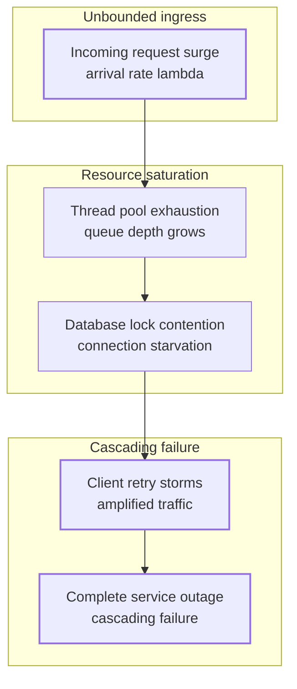

Traditional engineering mitigations fail when used in isolation:

1. **Horizontal Autoscaling Latency**: Auto-scalers rely on metrics like CPU utilization or queue length. Spinning up new virtual machines or container pods requires between 30 seconds and several minutes. A flash crowd or volumetric denial-of-service attack can saturate a system in milliseconds, long before new instances register with the load balancer.
2. **Stateful Bottlenecks**: Even if stateless web tiers scale infinitely, downstream storage engines (relational databases, transactional ledgers, disk I/O channels) have fixed write thresholds. Unthrottled traffic shifts the saturation point directly to the database, where connection pools deplete and lock contention halts all throughput.
3. **Client Retry Death Spirals**: When an overloaded service begins timing out, poorly configured clients immediately retry. These redundant retries compound the original load, multiplying total arrival rate $\lambda$ and ensuring the system cannot recover even after the initial burst subsides.

Rate limiting solves this by enforcing an explicit upper bound on $\lambda$ at the system boundary. Excess requests are terminated instantly with an HTTP `429 Too Many Requests` status code, preserving CPU cycles and memory for already admitted workloads.

## High-Level Mental Model

A rate limiter functions as an in-line gatekeeper that intercepts requests, evaluates them against a persistent policy, and issues an instantaneous binary verdict: admit or drop.

To make this decision without adding latency, the rate limiter converts the problem of tracking millions of historical timestamps into a fast mathematical state transition over a minimal set of counters. For every incoming operation, the system resolves a tenant key (such as an IP address, user ID, or API token), reads its current state from an atomic cache, computes whether the quota has been exceeded given the elapsed time, updates the state, and immediately releases the request or aborts execution.

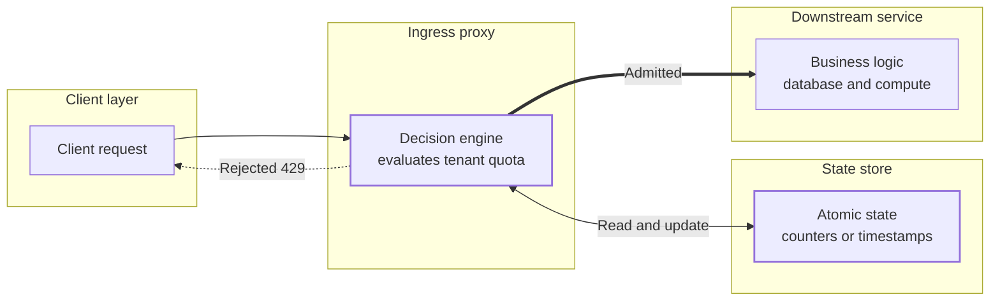

## Core Architecture

A production rate-limiting system comprises four distinct components that sit between the public network and backend application code:

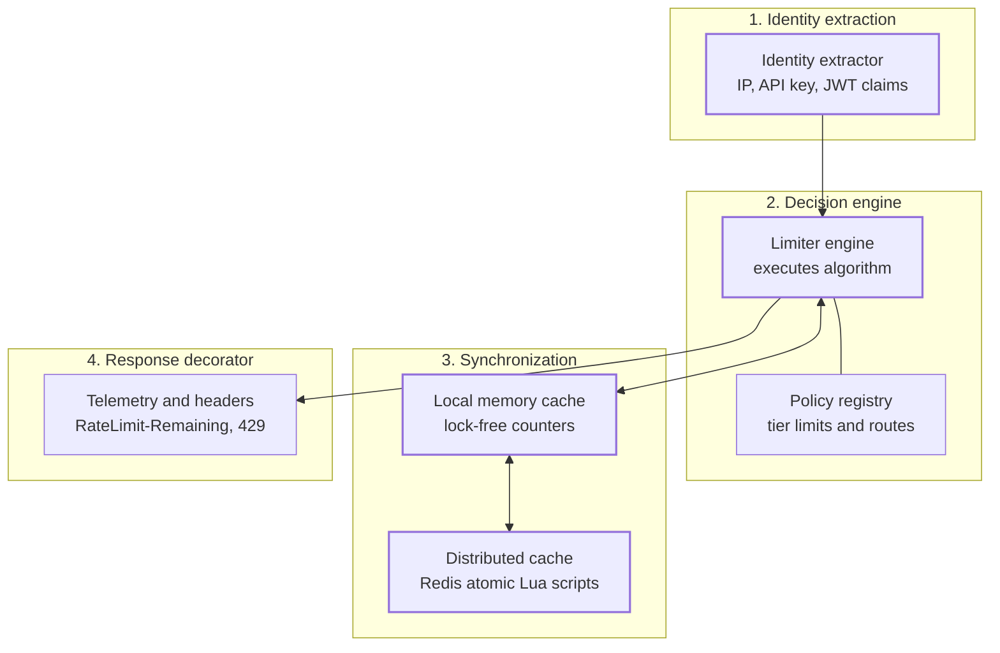

### 1. Identity & Context Extractor
The identity extractor maps raw network packets and HTTP frames to an isolated rate-limiting key. Depending on security requirements, keys are generated from:
* **Network-level attributes**: Client IPv4/IPv6 address or CIDR subnet block.
* **Application credentials**: API keys, OAuth client IDs, or verified cryptographic JWT claims (`sub`, `tenant_id`).
* **Route attributes**: Specific HTTP verbs and endpoint paths (e.g. assigning a strict 5 req/min quota to `/api/v1/auth/login` while granting 1,000 req/min to `/api/v1/products`).

### 2. Decision Engine & Policy Registry
The engine fetches the policy assigned to the extracted identity (for example: Free Tier = 60 req/min; Enterprise Tier = 10,000 req/min). It evaluates the specific mathematical algorithm (Token Bucket, Sliding Window, or Leaky Bucket) against the current clock reading.

### 3. State Store & Synchronization Layer
Because web servers run across horizontally scaled fleets, rate-limiting state must either be synchronized across nodes or partitioned deterministically:
* **Local In-Memory Stores**: Implemented using lock-free data structures (such as concurrent hash maps with atomic primitives). Offers microsecond evaluation speed but does not share state across machines.
* **Distributed Central Stores**: Implemented using high-throughput in-memory datastores like Redis or Memcached. Guarantees global quota enforcement across all edge proxies at the cost of network round-trip overhead (typically 1 to 3 milliseconds).

### 4. Response Decorator & Telemetry
Standardized by the IETF, rate limiters decorate egress headers to keep clients informed of their quota status before an error occurs:
* `RateLimit-Limit`: The quota ceiling in the current time window.
* `RateLimit-Remaining`: The number of requests remaining in the active window.
* `RateLimit-Reset`: The number of seconds until the quota window resets.
* `Retry-After`: Emitted alongside HTTP status `429 Too Many Requests` to specify how many seconds the client must sleep before re-attempting.

## Execution Flow (Step-by-Step)

Here is the operational lifecycle of a request passing through a distributed API gateway equipped with rate limiting:

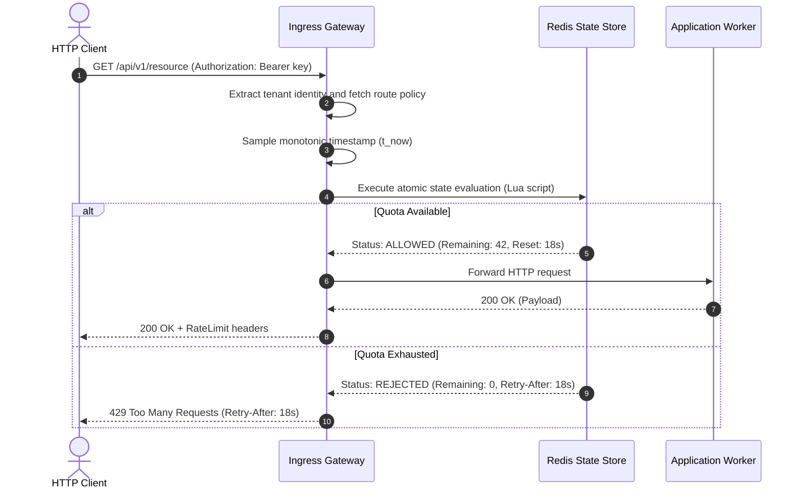

1. **Ingress Parsing**: The gateway receives the TLS connection, parses HTTP headers, and extracts the client identifier.
2. **Policy Lookup**: The gateway matches the request path and client identity against its in-memory route configuration to retrieve the algorithm parameters (capacity $C$ and rate $r$).
3. **Timestamp Sampling**: The gateway captures the current point in time. In distributed environments, it relies on server-side clock evaluation inside the datastore to avoid skew across different gateway hosts.
4. **Atomic State Mutation**: The gateway calls the state store. In Redis, this runs inside a single-threaded Lua script, executing read-calculate-write steps atomically without multi-client race conditions.
5. **Branching Decision**:
   * If the calculated consumption is within capacity, the state store decrements available quota, updates the record, and returns success. The gateway dispatches the request to the backend microservice.
   * If the quota is exceeded, the state store rejects the decrement. The gateway halts the request immediately, constructs a `429 Too Many Requests` response containing a `Retry-After` header, and drops execution without invoking backend microservices.
6. **Egress Decoration**: Admitted requests return from the backend, receive standard `RateLimit-*` headers, and flow back to the client.

## Key Internal Mechanisms

Rate limiting algorithms differ in how they define time, how much memory they allocate per tracked user, and how they shape outbound traffic.

---

### 1. Fixed Window Counter

The Fixed Window Counter algorithm slices time into rigid, non-overlapping intervals (e.g. 60-second windows aligned to the Unix epoch).

#### Algorithm Mechanics
Each window is identified by an integer floor division:

$$
\text{Window ID} = \left\lfloor \frac{t}{\Delta T} \right\rfloor
$$

Where $t$ is the current Unix timestamp and $\Delta T$ is the window duration in seconds.
1. The limiter computes the current Window ID and looks up the associated integer counter.
2. If the counter is less than the threshold $L$, the counter increments by 1 and the request passes.
3. If the counter equals or exceeds $L$, the request is dropped.
4. When time progresses such that $\lfloor t / \Delta T \rfloor$ increases, a new counter begins at zero.

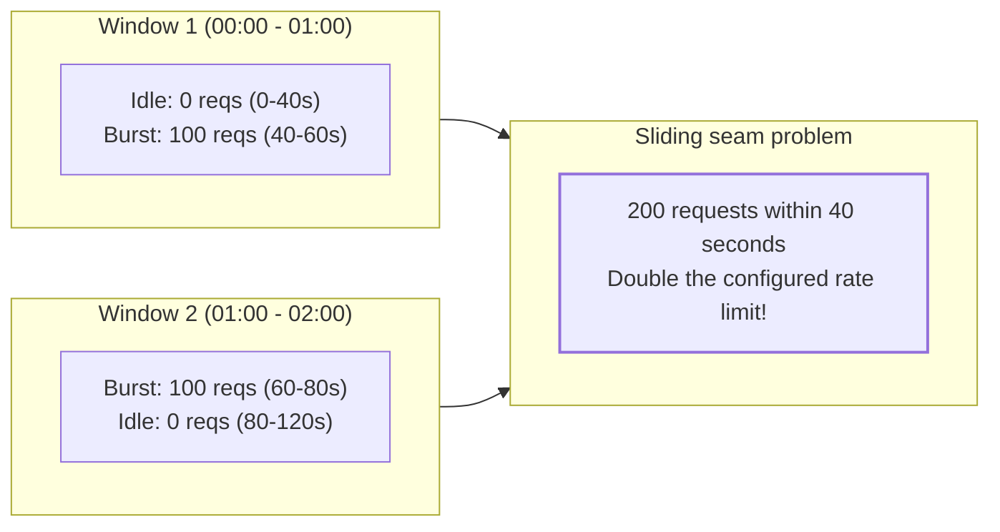

#### The Boundary Burst Problem
The fatal flaw of Fixed Window is the **boundary burst** (or seam effect). Assume a limit of 100 requests per minute:
* A client stays idle for the first 40 seconds of Window 1.
* At $t = 50\text{s}$, the client fires 100 requests. All are permitted.
* At $t = 61\text{s}$, Window 2 starts. The counter resets to 0.
* The client immediately fires another 100 requests. All are permitted.

Across the 60-second sliding duration from $t = 50\text{s}$ to $t = 110\text{s}$, the system processed 200 requests, completely violating the intended 100 req/min safety threshold.

---

### 2. Sliding Window Log

The Sliding Window Log algorithm resolves the boundary burst problem by tracking the precise timestamp of every admitted request in a chronological log.

#### Algorithm Mechanics
Instead of storing an aggregated integer, each tenant key references a sorted set or doubly linked list of 64-bit timestamps:

1. When a request arrives at time $t_{\text{now}}$, the algorithm calculates the lower sliding boundary:

   $$
   t_{\text{boundary}} = t_{\text{now}} - \Delta T
   $$

2. It purges all recorded timestamps older than $t_{\text{boundary}}$ from the log.
3. It counts the remaining timestamps in the log.
4. If $\text{count} < L$, $t_{\text{now}}$ is appended to the log, and the request is permitted.
5. If $\text{count} \ge L$, the request is rejected.

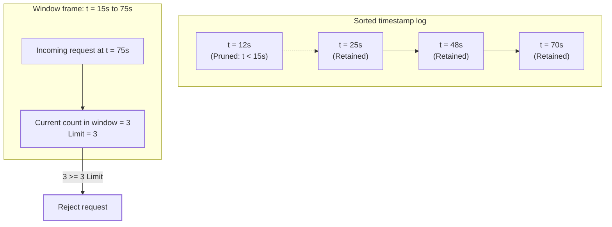

#### Memory Complexity Analysis
While Sliding Window Log provides mathematical perfection, its memory overhead makes it impractical for high-throughput edge systems:
* Assume a service allows 1,000 requests per minute per user, with 500,000 active concurrent users.
* Each timestamp stored as an 8-byte integer within a balanced search tree or Redis Sorted Set (`ZSET`) carries memory overhead (node pointers, hash table indices, metadata) of roughly 32 to 64 bytes per entry.
* Total memory:

  $$
  \text{Memory} \approx 500{,}000 \times 1{,}000 \times 48\text{ bytes} \approx 24\text{ GB RAM}
  $$

A sudden traffic surge increases memory consumption proportionately, making the rate limiter itself vulnerable to out-of-memory crashes.

---

### 3. Sliding Window Counter (Approximation)

The Sliding Window Counter algorithm combines the low memory overhead of the Fixed Window Counter with the sliding accuracy of the Sliding Window Log.

#### Algorithm Mechanics
Instead of tracking individual timestamps, it stores only the aggregate counts of the **current fixed window** and the **immediately preceding fixed window**.

When a request arrives at time $t$:
1. The limiter determines the percentage of the current window that has elapsed:

   $$
   \text{overlap} = \frac{t \pmod{\Delta T}}{\Delta T}
   $$

2. It estimates the total requests in the sliding frame by weighting the previous window's counter by the remaining unelapsed fraction:

   $$
   \text{Estimated Count} = \left( \text{Count}_{\text{prev}} \times (1 - \text{overlap}) \right) + \text{Count}_{\text{curr}}
   $$

3. If $\text{Estimated Count} < L$, $\text{Count}_{\text{curr}}$ is incremented by 1, and the request is admitted.

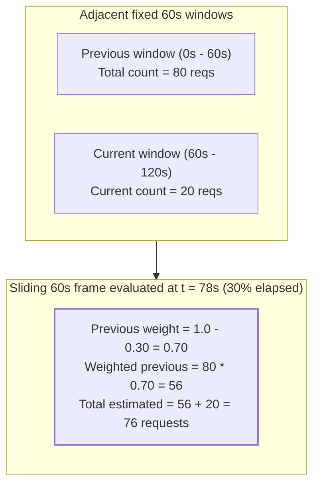

#### Error Bounds
The formula assumes that requests in the previous window were distributed uniformly across its duration. If all requests in the previous window occurred in its final two seconds, the linear weight underestimates true traffic. 

While the theoretical worst-case error can approach 100% if traffic within the prior window is concentrated entirely at a single boundary (for example, if all requests arrived in the first second of the prior window, they continue to be counted in the estimate long after they have fallen outside the true sliding window), Cloudflare's empirical analysis across 400 million requests from over 270,000 sources demonstrated that for real-world traffic distributions, 99.997% of requests exhibited an error margin of less than 5%.

Because it uses only two integer counters per key ($O(1)$ space), it provides the best memory-to-accuracy trade-off for high-volume distributed systems.

---

### 4. Token Bucket

The **Token Bucket** algorithm is the industry standard for API rate limiting (used by Amazon Web Services, Stripe, and Envoy Proxy). It allows controlled traffic bursts while strictly enforcing an average throughput ceiling.

#### Concept and Mechanics
Imagine a bucket with a maximum capacity of $C$ tokens:
1. The bucket continuously accumulates tokens at a constant refill rate of $r$ tokens per second.
2. Tokens added beyond capacity $C$ spill over and are discarded.
3. When a request arrives, the limiter attempts to draw $1$ token (or $k$ tokens for weighted operations) from the bucket.
4. If tokens are available, the token count is decremented, and the request proceeds immediately.
5. If the bucket is empty, the request is rejected (traffic policing) or held until tokens refill (traffic shaping).

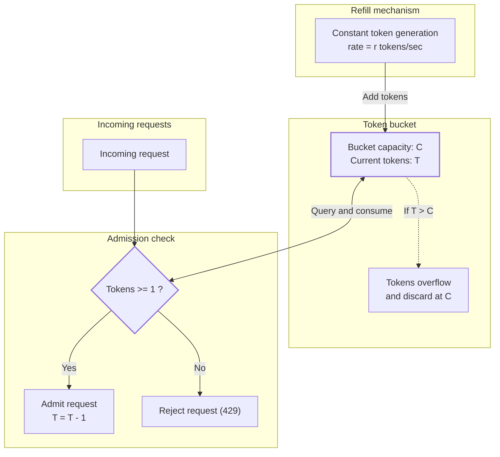

#### The Lazy Refill Optimization
A naive implementation would spawn a background timer thread to increment tokens for every active key every few milliseconds. With millions of active users, millions of concurrent timers would cripple the CPU.

Production implementations use **lazy evaluation**. No background threads exist. Instead, the limiter stores two scalar values per key:
* `tokens`: The floating-point count of available tokens.
* `last_update`: The timestamp when the bucket was last accessed.

When a new request arrives at time $t_{\text{now}}$, the system dynamically computes how many tokens were generated during the idle interval since `last_update`:

$$
\Delta t = \max(0, t_{\text{now}} - \text{last\_update})
$$

$$
\text{tokens}_{\text{new}} = \min(C, \text{tokens}_{\text{current}} + (\Delta t \times r))
$$

If $\text{tokens}_{\text{new}} \ge 1$, the limiter decrements the balance and saves $\text{tokens}_{\text{new}} - 1$ along with $t_{\text{now}}$. This reduces the entire token replenishment loop to basic arithmetic executed in $O(1)$ time and $O(1)$ space on the hot path.

---

### 5. Leaky Bucket

The **Leaky Bucket** algorithm is primarily a **traffic-shaping** mechanism. While the Token Bucket allows bursts up to its capacity $C$ before throttling down to rate $r$, the Leaky Bucket forces outbound execution to occur at a rigid, uniform cadence regardless of input burstiness.

#### Dual Implementations: As a Queue vs As a Meter
There are two distinct architectural variants of the Leaky Bucket:

1. **Traffic Shaping (Queue-Based)**:
   * Requests enter a FIFO queue of capacity $C$.
   * A worker thread pulls requests off the queue and executes them at a fixed cadence of $r$ operations per second.
   * If the queue is full, new requests overflow and are dropped immediately.
   * **Result**: Ingress spikes are smoothed into a flat line. However, queueing adds latency to requests caught behind a burst.

2. **Traffic Policing (Meter-Based / Virtual Leaky Bucket)**:
   * Instead of buffering requests in a physical queue, the algorithm calculates water accumulation using the same lazy-time delta pattern as the Token Bucket.
   * Water drops into the bucket with each request and leaks out at a constant rate $r$.
   * If the water level exceeds capacity $C$, the request overflows and is rejected with an immediate HTTP 429 without being queued.

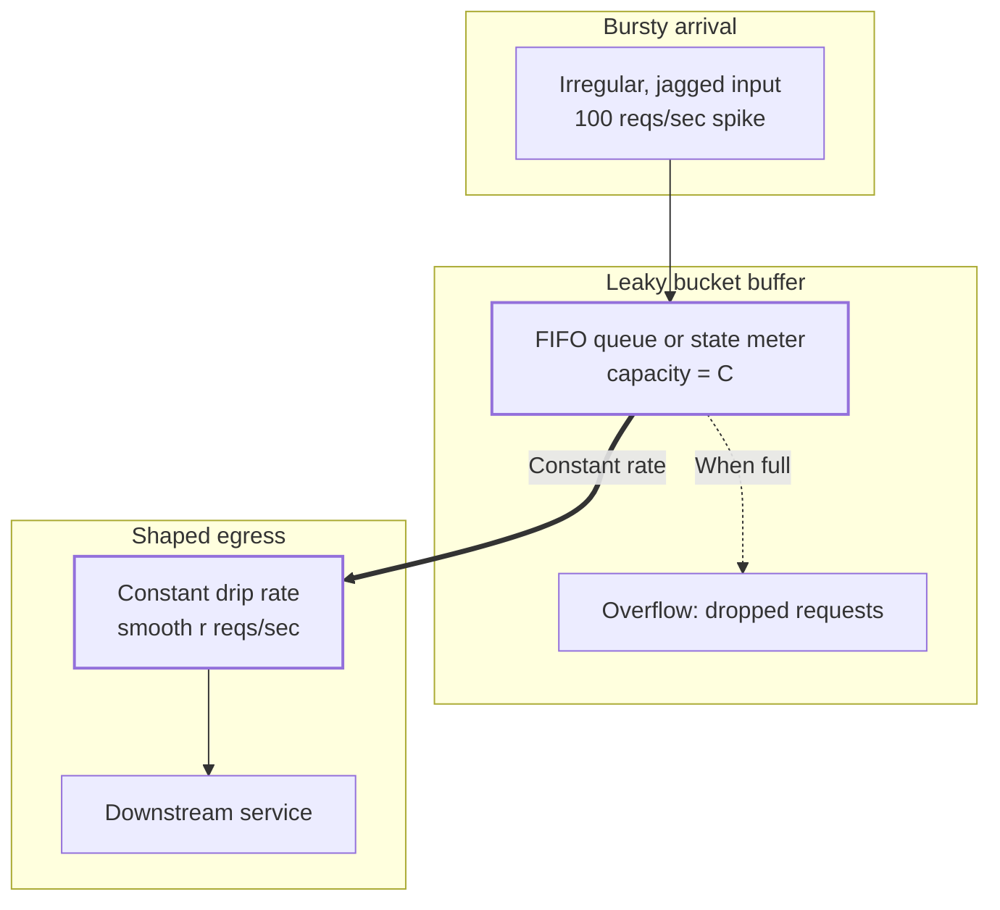

---

### 6. Generic Cell Rate Algorithm (GCRA)

Developed for Asynchronous Transfer Mode (ATM) network switches, the **Generic Cell Rate Algorithm** (GCRA) is a mathematically elegant formulation of the leaky bucket that tracks only a **single timestamp** per user: the **Theoretical Arrival Time (TAT)**.

#### Algorithm Mechanics
Instead of tracking counters and token quantities, GCRA defines:
* $T$: The emission interval between requests ($T = 1 / r$).
* $\tau$: The tolerance limit (burst allowance), defining how early a request is allowed to arrive relative to its theoretical schedule.

When a request arrives at time $t$:
1. The limiter retrieves the existing $\text{TAT}$ for the key. If no prior request exists, $\text{TAT} = t$.
2. It calculates the earliest allowable arrival time:

   $$
   \text{Arrival Threshold} = \text{TAT} - \tau
   $$

3. If the request arrives before this threshold ($t < \text{TAT} - \tau$), it has arrived too early. The request is rejected without updating state.
4. If the request arrives on or after the threshold ($t \ge \text{TAT} - \tau$), the request is admitted. The new $\text{TAT}$ is computed as:

   $$
   \text{TAT}_{\text{new}} = \max(t, \text{TAT}) + T
   $$

#### Mapping GCRA to Token Bucket Parameters
The parameters of GCRA map directly to the Token Bucket model:
* **Refill Rate ($r$)**: $r = \frac{1}{T}$ requests per unit time.
* **Burst Capacity ($C$)**: $C = \left\lfloor \frac{\tau}{T} \right\rfloor + 1$.
* **Burst Tolerance ($\tau$)**: $\tau = (C - 1) \times T$.

Because GCRA requires reading and writing only one 64-bit integer timestamp per tenant key, it consumes the lowest memory footprint of any burst-tolerant algorithm. This makes it the engine of choice for embedded systems and Redis modules like `redis-cell`.

## OS and System-Level Interactions

Rate limiting does not exist in an abstract userspace bubble; it interacts directly with kernel timers, network stacks, and hardware interfaces.

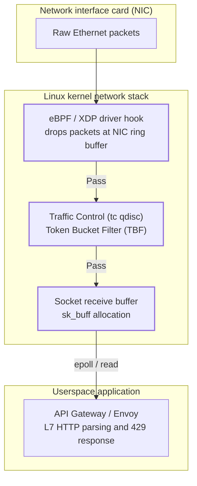

### 1. Monotonic Clocks vs. Wall-Clock Drift
Rate limiters that compute time deltas using standard system wall-clock functions (such as `System.currentTimeMillis()` in Java or `time.time()` in Python) suffer from time anomalies caused by Network Time Protocol (NTP) adjustments:
* **Clock Slew and Steps**: If an NTP daemon synchronizes an out-of-sync server clock, it may step the system clock backwards by several hundred milliseconds.
* **The Negative Delta Bug**: If a rate limiter reads $t_{\text{now}} < \text{last\_update}$, the calculated time delta $\Delta t$ becomes negative. In a Token Bucket, this drains available tokens; in a Sliding Window Log, it corrupts the sorted order.
* **Leap Seconds**: Leap second adjustments can cause wall clocks to repeat seconds or halt.

Systems-level rate limiters must read monotonic clocks via the POSIX `clock_gettime(CLOCK_MONOTONIC, ...)` syscall. Monotonic clocks are guaranteed to move forward monotonically from an arbitrary system boot point and are immune to NTP steps.

### 2. Kernel-Level Traffic Policing: eBPF and XDP
Terminating a request at Layer 7 in userspace is expensive:
1. The NIC receives the Ethernet frame and fires a hardware interrupt.
2. The kernel allocates a socket buffer structure (`sk_buff`).
3. The TCP stack executes checksum validation, sequence tracking, and connection state lookups.
4. The kernel wakes up the userspace proxy process via `epoll_wait`.
5. The proxy reads the socket, parses HTTP headers, queries Redis, and writes an HTTP 429 response.

Under a volumetric DDoS attack of 500,000 requests per second, userspace rate limiters collapse under the weight of kernel context switches and `sk_buff` memory allocations.

Modern infrastructure pushes rate limiting into the Linux kernel using **eBPF (Extended Berkeley Packet Filter)** and **XDP (eXpress Data Path)**:
* XDP hooks execute directly inside the network interface card driver before the kernel allocates an `sk_buff`.
* An eBPF program parses the raw IP/TCP packet headers, queries an eBPF memory map containing rate-limit counters, and issues an `XDP_DROP` instruction.
* Malicious traffic is discarded directly inside the NIC driver ring buffer at wire speed (tens of millions of packets per second) with zero CPU context switching.

### 3. Linux Traffic Control: `tc` and Token Bucket Filter (TBF)
At the operating system network queue level, Linux provides the **Token Bucket Filter (TBF)** queueing discipline (`qdisc`) via the `tc` subsystem:

```bash
# Configure eth0 egress with a token bucket rate of 10mbit, 50ms latency buffer, and 10kb burst
tc qdisc add dev eth0 root tbf rate 10mbit latency 50ms burst 10kb
```

TBF operates in the kernel network egress scheduler:
* Network packets are placed into a FIFO queue.
* The kernel maintains a token counter replenished by the CPU timer interrupt (`jiffies` or high-resolution timers `hrtimer`).
* Packets are transmitted across the physical wire only if sufficient byte tokens exist.
* If tokens are exhausted, the packet remains queued until the next timer tick. If the queue overflows, packets are dropped at the network interface layer.

## Failure Modes, Concurrency, and Trade-offs

Building rate limiters in distributed systems introduces concurrency traps, failure dilemmas, and operational trade-offs.

### 1. The Check-Then-Act Race Condition
In distributed environments using Redis, a naive implementation checks the counter with one command and increments it with another:

```
Thread A: GET user:101 -> returns 9 (Limit is 10)
Thread B: GET user:101 -> returns 9 (Limit is 10)
Thread A: INCR user:101 -> sets 10 (Admitted!)
Thread B: INCR user:101 -> sets 11 (Admitted! Limit violated!)
```

Under high concurrency, dozens of requests can read the stale counter before the first write commits, allowing clients to breach quotas.

This requires **atomic operations**:
* **Redis Lua Scripting**: Redis executes Lua scripts as single atomic operations on its primary thread. No other command or script can interleave during execution.
* **Lock-Free CAS in Memory**: Within a single JVM, use Compare-And-Swap (`AtomicReference.compareAndSet()`) loops or `AtomicLong.incrementAndGet()` to mutate state without locking.

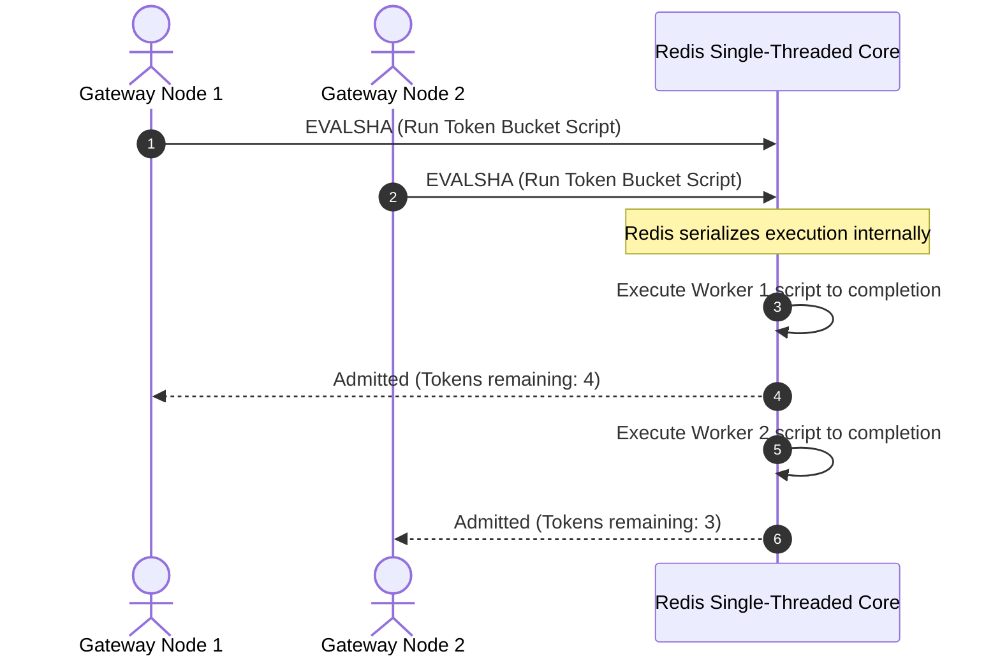

### 2. Distributed Store Failure: Fail-Open vs. Fail-Closed
What happens when the central Redis cluster fails, network partitions occur, or latency spikes from 1ms to 500ms?

* **Fail-Open (Availability Focus)**: If the rate limiter cannot reach the state store, it bypasses evaluation and allows the request through. This ensures legitimate users are not blocked during infrastructure outages, but risks overwhelming downstream databases if traffic spikes simultaneously.
* **Fail-Closed (Consistency & Protection Focus)**: If the rate limiter cannot verify quota, it rejects incoming requests with an HTTP 500 or 429. This guarantees downstream safety at the expense of total service unavailability.

Production platforms choose **Fail-Open with local fallback**: if Redis becomes unreachable, the gateway falls back to an in-memory, coarse-grained local token bucket per node to maintain partial protection.

### 3. Summary Comparison of Algorithms

| Algorithm | Time Complexity | Memory Complexity | Burst Behavior | Latency Impact | Optimal Use Case |
| :--- | :--- | :--- | :--- | :--- | :--- |
| **Fixed Window** | $O(1)$ | $O(1)$ (1 counter) | Boundary bursts allow $2 \times$ limit | Zero delay (drop immediately) | Monthly billing quotas, SaaS plan limits |
| **Sliding Window Log** | $O(\log N + M)$ | $O(N)$ (all timestamps) | Strictly enforced, zero bursts | Zero delay (drop immediately) | High-security financial transactions, auth endpoints |
| **Sliding Window Counter** | $O(1)$ | $O(1)$ (2 counters) | Approximates sliding window (empirically $\le 5\%$ error) | Zero delay (drop immediately) | High-volume API gateways (Cloudflare, Kong) |
| **Token Bucket** | $O(1)$ | $O(1)$ (2 scalars) | Configurable burst capacity ($C$) | Zero delay (drop immediately) | Public REST APIs (AWS, Stripe, GitHub) |
| **Leaky Bucket** | $O(1)$ | $O(C)$ queue / $O(1)$ meter | Completely eliminates bursts | Adds queue delay to buffered requests | Database write ingestion, payment processor gateways |
| **GCRA** | $O(1)$ | $O(1)$ (1 timestamp) | Configurable burst tolerance ($\tau$) | Zero delay (drop immediately) | Memory-constrained caches, RedisCell modules |

## Minimal Code

The following Java implementation demonstrates a thread-safe, lock-free **Token Bucket** using Compare-And-Swap (CAS) primitives and monotonic time measurement.

```java
import java.util.concurrent.atomic.AtomicReference;

public class MonotonicTokenBucket {

    private final double capacity;
    private final double refillRatePerNano;
    private final AtomicReference<BucketState> state;

    private static class BucketState {
        final double tokens;
        final long lastUpdateNanos;

        BucketState(double tokens, long lastUpdateNanos) {
            this.tokens = tokens;
            this.lastUpdateNanos = lastUpdateNanos;
        }
    }

    public MonotonicTokenBucket(double capacity, double refillRatePerSecond) {
        this.capacity = capacity;
        this.refillRatePerNano = refillRatePerSecond / 1_000_000_000.0;
        // Seed with full capacity using monotonic system time
        this.state = new AtomicReference<>(new BucketState(capacity, System.nanoTime()));
    }

    public boolean tryConsume(double tokensToConsume) {
        while (true) {
            BucketState current = state.get();
            long now = System.nanoTime();
            
            // Calculate elapsed time using monotonic clock
            long elapsedNanos = Math.max(0, now - current.lastUpdateNanos);
            
            // Refill tokens based on elapsed duration
            double refilledTokens = current.tokens + (elapsedNanos * refillRatePerNano);
            double currentTokens = Math.min(capacity, refilledTokens);

            // Capacity evaluation
            if (currentTokens < tokensToConsume) {
                return false; // Rejected: quota exhausted
            }

            // Prepare new state
            double remainingTokens = currentTokens - tokensToConsume;
            BucketState next = new BucketState(remainingTokens, now);

            // Atomic CAS ensures lock-free thread safety
            if (state.compareAndSet(current, next)) {
                return true; // Admitted
            }
            // If CAS failed, another thread updated state; loop retries
        }
    }
}
```

> [!TIP]
> **Allocation-Free Hot Paths**: In ultra-high-throughput systems, instantiating `new BucketState(...)` on every CAS retry can generate young-generation GC pressure. High-performance gateways often eliminate object allocations entirely by bit-packing fractional tokens and timestamps into a single 64-bit primitive `AtomicLong` or updating state via `VarHandle`. Notice also that on rejection (`currentTokens < tokensToConsume`), the method exits immediately without updating `state`, avoiding useless CAS contention during traffic surges.

For distributed environments, this atomic logic translates directly into a **Redis Lua script** executed via `EVALSHA`:

```lua
-- KEYS[1]: Rate limit key (e.g. "rate:token:tenant_984")
-- ARGV[1]: Bucket capacity (e.g. "100")
-- ARGV[2]: Refill rate per second (e.g. "10")
-- ARGV[3]: Tokens requested (e.g. "1")

local key = KEYS[1]
local capacity = tonumber(ARGV[1])
local refill_rate = tonumber(ARGV[2])
local requested = tonumber(ARGV[3])

-- Fetch authoritative Redis server-side time (seconds, microseconds)
local time_res = redis.call('TIME')
local now = tonumber(time_res[1]) + (tonumber(time_res[2]) / 1000000)

-- Fetch current bucket state
local data = redis.call('HMGET', key, 'tokens', 'last_update')
local tokens = tonumber(data[1])
local last_update = tonumber(data[2])

if not tokens then
    tokens = capacity
else
    -- Calculate newly accumulated tokens
    local elapsed = math.max(0, now - last_update)
    tokens = math.min(capacity, tokens + (elapsed * refill_rate))
end

-- Admission decision
if tokens >= requested then
    tokens = tokens - requested
    redis.call('HSET', key, 'tokens', tokens, 'last_update', now)
    -- Set TTL to duration needed to replenish back to full capacity, plus safety buffer
    local fill_time = refill_rate > 0 and math.ceil((capacity - tokens) / refill_rate) or 60
    redis.call('EXPIRE', key, math.max(60, fill_time + 60))
    return {1, math.floor(tokens)} -- Admitted
else
    -- Reject without mutating state to prevent AOF disk and replica write amplification under DDoS.
    -- If key is brand new, write initial state with TTL to avoid indefinite memory leaks.
    if not data[1] then
        redis.call('HSET', key, 'tokens', tokens, 'last_update', now)
        redis.call('EXPIRE', key, 60)
    end
    return {0, math.floor(tokens)} -- Rejected
end
```

## How to Think About Similar Systems

When designing or inspecting admission control in other domains, look for these universal systems patterns:

1. **TCP Congestion Control**: Algorithms like TCP Reno, Cubic, and BBR use the same underlying feedback loops. Instead of fixed quotas, they dynamically expand and contract a sliding transmission window (`cwnd`) based on packet loss and round-trip delay.
2. **Linux CFS Bandwidth Quotas**: Linux control groups (`cgroups v2`) enforce CPU bandwidth using a token bucket. A container configured with `cpu.max = 200000 100000` is granted 200ms of CPU run time every 100ms wall-clock period. When the token balance hits zero, the CFS scheduler unschedules the container threads until the period resets.
3. **Reactive Streams & Backpressure**: Protocols like RSocket and Reactive Streams (RxJava, Project Reactor) replace blind server-side rate limits with dynamic demand signaling. The subscriber issues `request(n)` tokens to the publisher, guaranteeing that producers never transmit more messages than consumers have explicitly allocated memory to process.
4. **Circuit Breakers**: Where rate limiters govern incoming volume based on request counts, circuit breakers (such as Resilience4j) govern incoming traffic based on downstream error rates. When downstream failure ratios cross a threshold, the circuit trips open, immediately rejecting requests to allow the downstream system time to recover.

