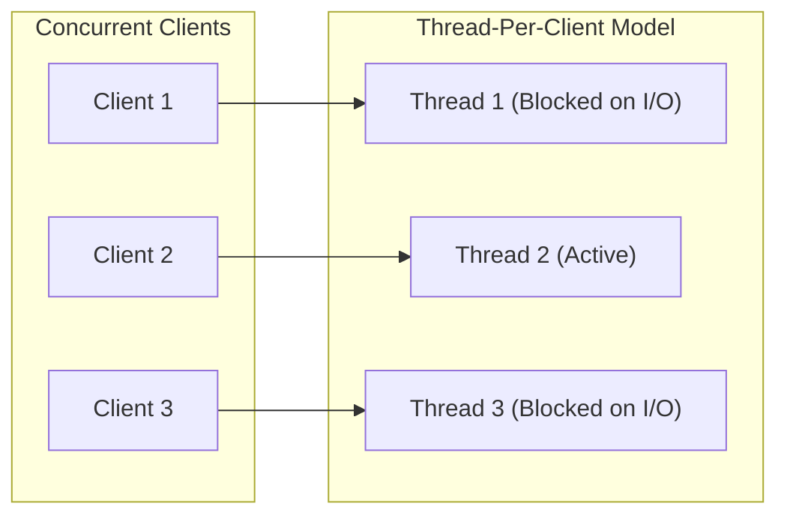
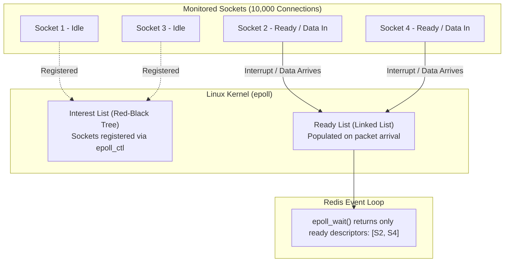
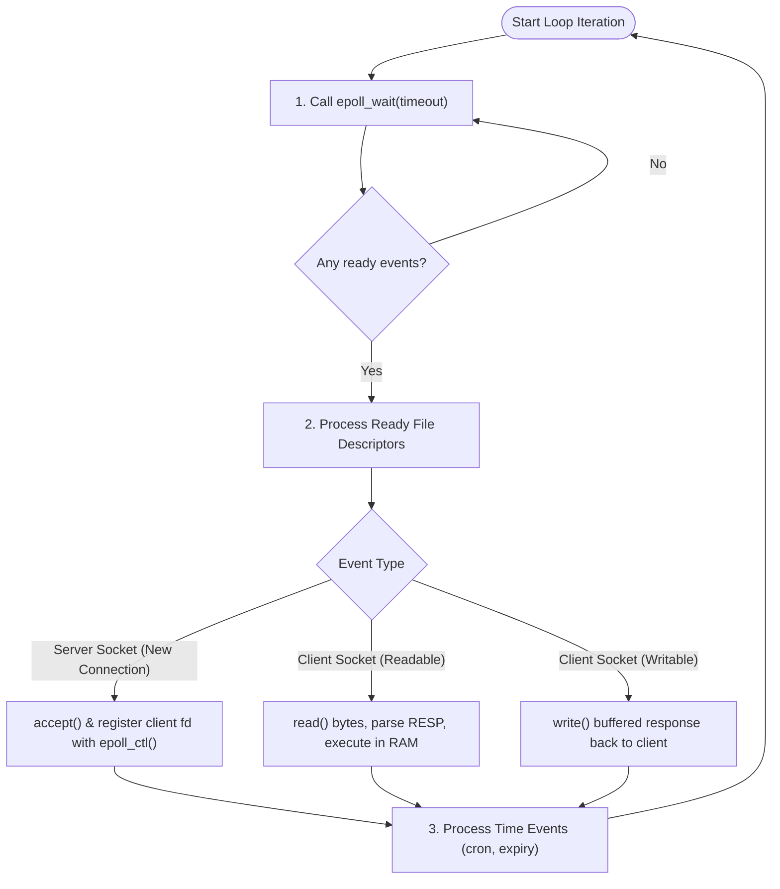

Redis is renowned for processing over 100,000 operations per second while running its core execution engine on a **single thread**.

At first glance, this sounds counterintuitive. Conventional software wisdom tells us to spawn multiple threads to handle thousands of concurrent client connections. Yet, Redis intentionally avoids multi-threaded execution for its core logic.

How can a single thread serve thousands of concurrent clients without stalling? The secret lies in **operating system I/O multiplexing**—specifically Linux's `epoll`—paired with an in-memory event loop.

## Table of contents

## The Concurrency Dilemma: Why Multi-Threading Isn't the Answer

To understand Redis's design, we first have to understand why traditional multi-threaded servers struggle at scale.

In a traditional **thread-per-client** model (used by early web servers and relational database connection pools), each client connection is assigned its own thread:



This model works well for tens of clients, but quickly degrades at thousands of concurrent connections:
1. **Thread Context Switching Overhead**: The CPU spends valuable cycles saving and restoring CPU registers, program counters, and stack pointers as it preemptively switches between threads.
2. **Lock Contention**: When multiple threads mutate shared in-memory data (like a cache or database table), you need mutexes, semaphores, or spinlocks. Threads spend significant time waiting in lock queues rather than doing real work.
3. **Memory Footprint**: Each OS thread allocates its own stack space (typically 1–8 MB), consuming gigabytes of memory just to keep idle connections open.

Redis avoids all of this by running a single main thread. But a single thread has one major vulnerability: **if it blocks waiting on network I/O, the entire server freezes.**

---

## Blocking vs. Non-Blocking I/O

When a client communicates with Redis over TCP, data travels through a network socket represented by the operating system as a file descriptor (FD).

### 1. Blocking I/O
By default, network sockets are **blocking**. If a thread calls `read()` on a socket with no incoming data, the OS suspends the thread until packets arrive from the network card. With a single-threaded server, if Client 1 is idle, all other clients are completely starved.

### 2. Non-Blocking Sockets (`O_NONBLOCK`)
To prevent starvation, Redis configures client sockets in non-blocking mode. When you call `read()` on a non-blocking socket:
- If data is available, it returns the bytes immediately.
- If no data is available, it returns immediately with an error code like `EAGAIN` or `EWOULDBLOCK` without halting the thread.

However, non-blocking I/O introduces a new problem: **busy polling**. If you loop through 10,000 sockets checking each one for data, your CPU runs at 100% just asking *"Got data yet? No? Got data yet?"*

What we really need is a way to tell the operating system:  
> *"Wake me up only when something interesting actually happens on any of these 10,000 sockets."*

This is where **I/O Multiplexing** comes in.

---

## The Solution: I/O Multiplexing and `epoll`

Operating systems provide multiplexing mechanisms so a single thread can monitor thousands of file descriptors simultaneously.

### The Evolution: `select` vs. `epoll`

Early Unix systems used `select()` and `poll()`:
- **`select()` / `poll()` ($O(N)$)**: You hand an array of all monitored sockets to the kernel. Every time you check, the kernel scans through every socket in the list. Even if only 1 socket out of 10,000 has data, the CPU still iterates through all 10,000.
- **`epoll` ($O(1)$ on Linux)**: Introduced in Linux 2.6, `epoll` completely changes the mechanism by being **event-driven**.



### The Three Syscalls of `epoll`

`epoll` is controlled via three primary system calls:

1. **`epoll_create()`**: Creates an epoll instance in the kernel and returns a file descriptor referencing it.
2. **`epoll_ctl()`**: Adds, modifies, or removes socket descriptors in the interest list. When a socket is registered (e.g., listening for readable `EPOLLIN` or writable `EPOLLOUT` events), the kernel tracks it in an efficient Red-Black tree.
3. **`epoll_wait()`**: Suspends the calling thread until one or more monitored sockets have events ready. When a network packet arrives, the network card triggers an interrupt, and the OS puts that specific socket onto a **Ready List**. `epoll_wait()` returns *only* the ready sockets in $O(1)$ time relative to total connections.

*(Note: On macOS and BSD systems, Redis uses `kqueue`, which operates on the same event-driven principle).*

---

## How Redis Leverages `epoll`: The Event Loop

Redis wraps OS-level I/O multiplexers inside a unified **Event Loop**. 

Instead of waiting for client requests, the Redis main thread stays in a continuous cycle:



### The Lifecycle of a Command

When a client runs a command like `SET user:100 "Anant"`:

1. **Connection Registration**: When the client first connects, the Redis server listening socket triggers an `epoll` notification. Redis accepts the connection, marks the client socket as non-blocking, and calls `epoll_ctl()` to register it for `EPOLLIN` (read) events.
2. **Command Ingress**: When the client sends the command over TCP, the OS network buffer receives the packets. The kernel flags the socket and appends it to epoll's ready list.
3. **Event Dispatch**: Redis's `epoll_wait()` unblocks, returning this socket descriptor.
4. **Execution in RAM**: Redis reads the bytes into a query buffer, parses the RESP protocol, and executes the mutation directly in its in-memory hash table. Because the data resides purely in RAM, this step takes **nanoseconds**.
5. **Response Buffering & Egress**: Redis formats the reply (`+OK\r\n`), queues it in the client's output buffer, and registers the socket for write readiness (or writes immediately if socket buffers allow).
6. **Cycle Repeats**: Redis immediately moves to the next ready descriptor.

---

## The Secret Ingredient: Why Single-Threaded Works

`epoll` is fast, but that alone doesn't explain why Redis outperforms multi-threaded architectures. 

The secret is the combination of **`epoll` + In-Memory Execution**:

- **RAM Access is in Nanoseconds**: A traditional database spends milliseconds waiting on disk I/O. If a single-threaded server waited on disk, everything would grind to a halt. But Redis accesses RAM (50–100 nanoseconds), meaning command execution finishes almost instantaneously.
- **CPU is Rarely the Bottleneck**: For key-value caching workloads, network latency and memory bus bandwidth are the bottlenecks, not CPU computation.
- **Zero Synchronization**: Because only one thread executes commands, Redis requires **no mutexes, no spinlocks, and no condition variables**. Data structures are updated cleanly with zero lock contention.

---

## Minimal Event Loop in Java (Java NIO)

To see this in action without digging through C code, here is a simplified implementation of the Redis event loop using Java NIO. 

In the JVM on Linux, `java.nio.channels.Selector` maps directly to OS-level `epoll` (`epoll_create`, `epoll_ctl`, and `epoll_wait`):

```java
import java.io.IOException;
import java.net.InetSocketAddress;
import java.nio.ByteBuffer;
import java.nio.channels.*;
import java.util.*;

/**
 * A minimal, single-threaded Redis-style event loop using Java NIO.
 * On Linux, Java's Selector delegates directly to OS-level epoll.
 */
public class MiniRedisServer {

    private final Selector selector;
    private final ServerSocketChannel serverChannel;
    // In-memory keyspace (global RAM dictionary)
    private final Map<String, String> database = new HashMap<>();

    public MiniRedisServer(int port) throws IOException {
        // 1. Creates epoll instance (equivalent to epoll_create)
        this.selector = Selector.open();

        // 2. Open non-blocking server socket
        this.serverChannel = ServerSocketChannel.open();
        this.serverChannel.bind(new InetSocketAddress(port));
        this.serverChannel.configureBlocking(false);

        // 3. Register server socket for incoming connection events (epoll_ctl)
        this.serverChannel.register(this.selector, SelectionKey.OP_ACCEPT);
    }

    public void run() throws IOException {
        System.out.println("MiniRedis event loop started...");

        while (true) {
            // Block until one or more channels are ready for I/O (epoll_wait)
            // If there is no activity, the thread sleeps and CPU usage is 0%.
            int readyChannels = selector.select();
            if (readyChannels == 0) continue;

            // Only inspect channels that actually have pending events (O(1) ready list)
            Set<SelectionKey> selectedKeys = selector.selectedKeys();
            Iterator<SelectionKey> iterator = selectedKeys.iterator();

            while (iterator.hasNext()) {
                SelectionKey key = iterator.next();
                iterator.remove(); // Prevent duplicate processing

                if (!key.isValid()) continue;

                if (key.isAcceptable()) {
                    handleAccept();
                } else if (key.isReadable()) {
                    handleRead(key);
                }
            }
        }
    }

    // Accept incoming connection and register with epoll
    private void handleAccept() throws IOException {
        SocketChannel clientChannel = serverChannel.accept();
        if (clientChannel != null) {
            clientChannel.configureBlocking(false);
            // Register client socket for read readiness (EPOLLIN)
            clientChannel.register(selector, SelectionKey.OP_READ);
        }
    }

    // Read command, execute against in-memory map, and write reply
    private void handleRead(SelectionKey key) throws IOException {
        SocketChannel clientChannel = (SocketChannel) key.channel();
        ByteBuffer buffer = ByteBuffer.allocate(1024);
        int bytesRead = clientChannel.read(buffer);

        if (bytesRead == -1) {
            // Client closed connection
            clientChannel.close();
            return;
        }

        buffer.flip();
        String command = new String(buffer.array(), 0, buffer.limit()).trim();
        
        // Execute against RAM database (sub-microsecond execution)
        String response = executeCommand(command);

        // Write response back to client socket
        clientChannel.write(ByteBuffer.wrap(response.getBytes()));
    }

    private String executeCommand(String rawCommand) {
        String[] parts = rawCommand.split("\\s+");
        String cmd = parts[0].toUpperCase();

        return switch (cmd) {
            case "SET" -> {
                if (parts.length >= 3) {
                    database.put(parts[1], parts[2]);
                    yield "+OK\r\n";
                }
                yield "-ERR wrong number of arguments\r\n";
            }
            case "GET" -> {
                if (parts.length >= 2) {
                    String val = database.get(parts[1]);
                    yield val != null ? "$" + val.length() + "\r\n" + val + "\r\n" : "$-1\r\n";
                }
                yield "-ERR wrong number of arguments\r\n";
            }
            default -> "-ERR unknown command\r\n";
        };
    }
}
```

Notice what makes this model so powerful:
- There are **no worker thread pools**, no synchronization locks, and no thread context switches.
- `selector.select()` sleeps gracefully until the OS kernel signals network traffic via `epoll`.
- Processing each request in memory takes less time than the network transmission itself.

---

## The Catch: Head-of-Line Blocking

The single-threaded event loop is exceptionally fast, but it has one famous vulnerability: **Head-of-Line Blocking**.

Because every query runs sequentially on the main thread:
- If a client runs a fast $O(1)$ command like `GET key` or `SET key val`, Redis finishes in microseconds.
- If a client runs a slow $O(N)$ command like `KEYS *` over a 50-million-key database, or deletes a massive set with millions of elements, **the single execution thread freezes**.

While that single command runs, `epoll_wait()` is not called, no other socket reads take place, and every other client's request sits waiting in the OS network queue.

This is why Redis best practices strongly advise:
- Never run `KEYS *` in production (use `SCAN` instead).
- Use asynchronous unlinking (`UNLINK` instead of `DEL`) so memory deallocation is offloaded to a background thread.

---

## Beyond the Single Thread: Background Threads & Threaded I/O

While Redis's *core command execution* is strictly single-threaded, modern Redis is not completely single-threaded:

1. **Background I/O Threads (BIO)**: Heavy, slow tasks—such as flushing data to disk (`fsync`), closing file descriptors, and lazy-freeing large memory allocations—are delegated to separate background threads so the main loop is never held up.
2. **Threaded I/O (Redis 6+)**: Reading bytes off TCP sockets and parsing RESP protocol payloads can consume CPU on high-throughput 100GbE networks. Redis 6 introduced multi-threaded network I/O: worker threads read and write network buffers, but **the actual command execution on data remains strictly single-threaded**.

---

## Cross-System Comparisons

The design choices in Redis reflect fundamental patterns found across high-performance systems:

- **Node.js & Nginx**: Both rely on the exact same pattern—a single execution thread (or event-driven worker processes) running an event loop on top of OS I/O multiplexing (`epoll` via `libuv` in Node.js, and native `epoll` in Nginx). They demonstrate that non-blocking event loops excel whenever workloads are I/O-bound rather than compute-bound.
- **Netty & Java Frameworks**: High-throughput networking frameworks like Netty use non-blocking Java NIO channels and selectors (backed by `epoll` on Linux) to serve tens of thousands of concurrent connections without the overhead of traditional thread-per-connection pools.
- **Dragonfly & KeyDB (Thread-Per-Core)**: Modern in-memory stores evolve Redis's design for multi-core machines by adopting a **shared-nothing, thread-per-core architecture**. Instead of introducing global locks and mutexes across shared memory, each CPU core runs its own dedicated event loop and manages an isolated partition of the keyspace.

These architectural principles form the backbone of modern cloud infrastructure and high-throughput networking.

---

## Summary

Redis doesn't achieve its legendary throughput by using complex thread synchronization. Instead, it pairs:

1. **Non-blocking sockets** configured with Linux `epoll` for efficient, $O(1)$ event notifications.
2. A single-threaded **event loop** that guarantees zero lock contention and zero context switching overhead.
3. Pure **in-memory data execution** that ensures commands finish in nanoseconds before moving to the next client.

By letting the operating system handle connection monitoring and keeping execution strictly in RAM, Redis proves that a single thread—designed right—can easily outperform massive thread pools.

---

*Want to explore a complete working implementation? Check out the source code on GitHub: [anantagarwal/java-redis-server](https://github.com/anantagarwal/java-redis-server).*
