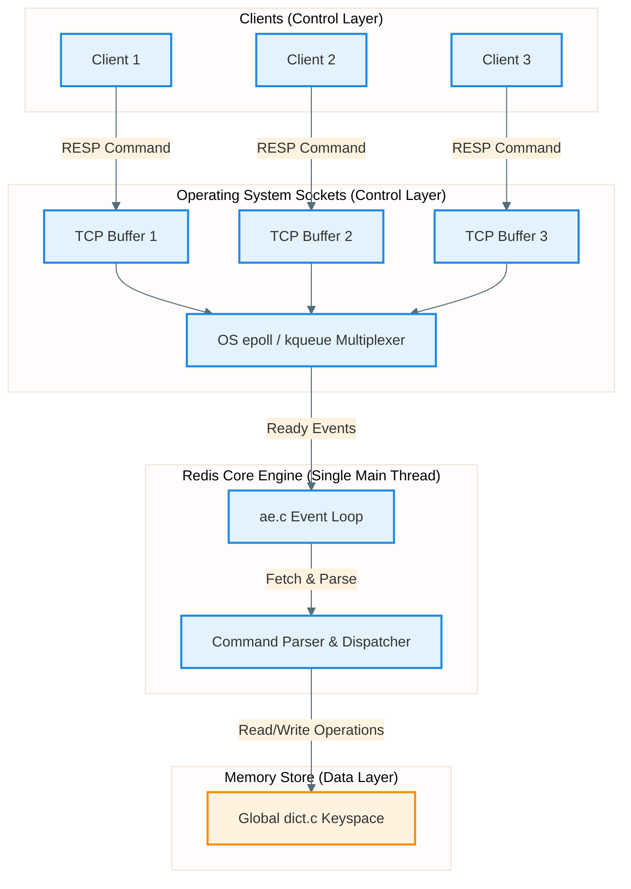
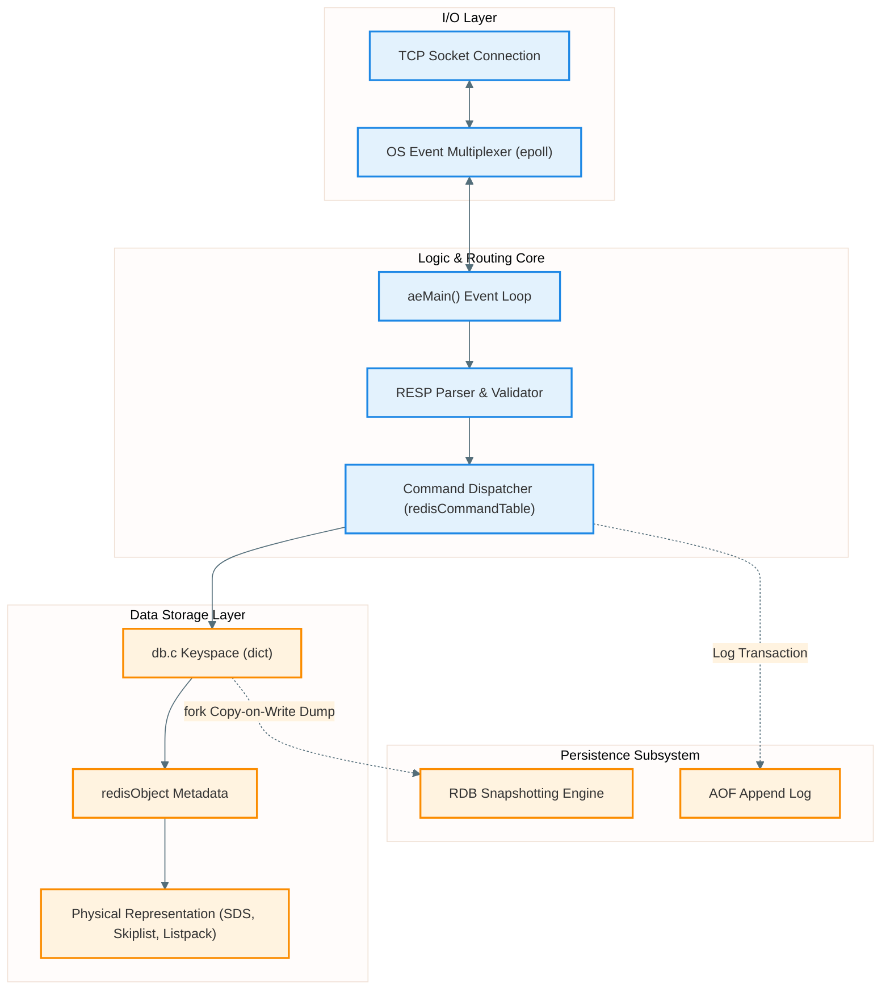
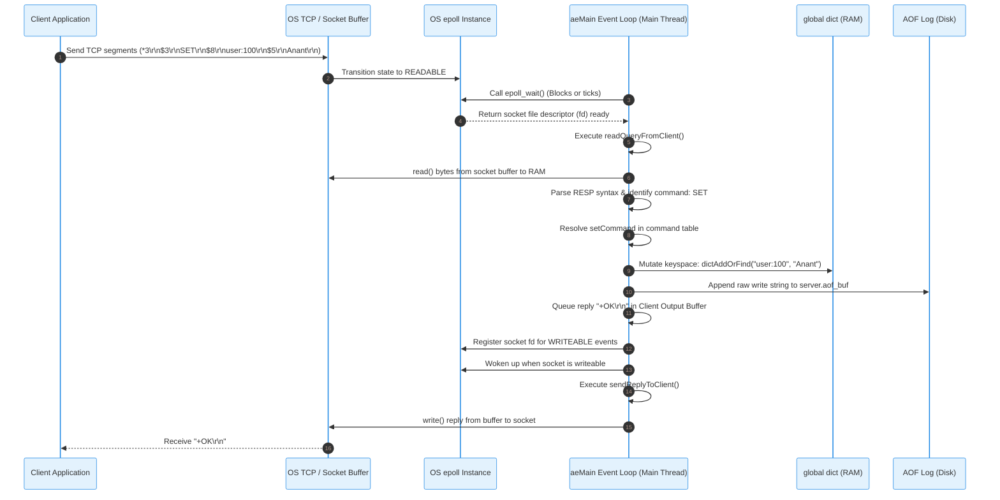
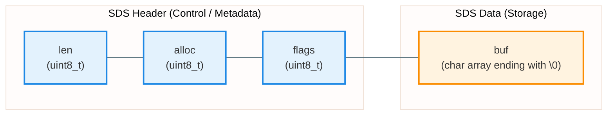
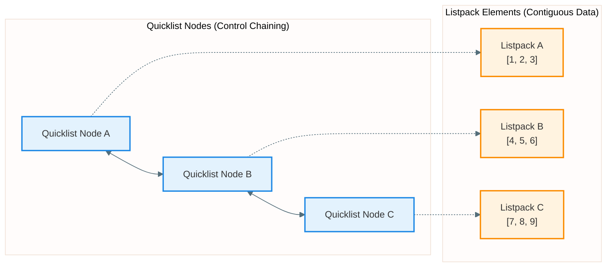
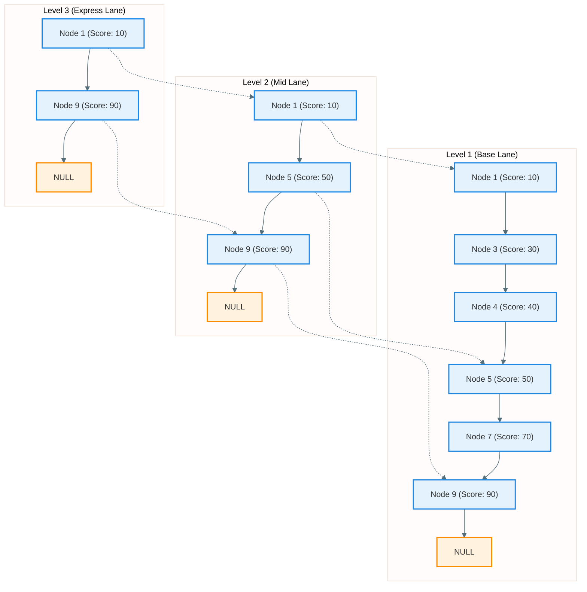
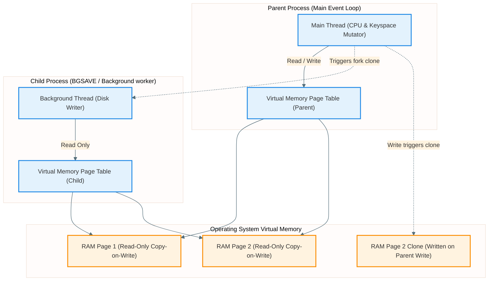

Redis is the default choice for sub-millisecond, high-throughput key-value operations. Spawning a single main execution thread to process millions of operations per second is a unique design choice. 

This post analyzes the internal mechanics of Redis: the event-loop execution engine, memory layouts, progressive rehashing, persistence, and system-level syscalls.

## Table of contents

## Problem Statement

Traditional relational and document-oriented databases (like MySQL or MongoDB) are designed as **disk-first** storage engines. They organize data in structures optimized for block-based disk layouts, such as B-Trees or Log-Structured Merge (LSM) Trees. While memory buffers (like the InnoDB Buffer Pool) cache frequent records, these systems must ultimately guarantee durability by performing disk transactions. 

Even with modern NVMe SSDs, a disk write (requiring bus transit, controller queues, and NAND flash programming) takes anywhere from tens to hundreds of microseconds, whereas a RAM access occurs in nanoseconds.

Furthermore, traditional database engines scale throughput by spawning concurrent threads. While multi-threading leverages multi-core CPUs, it introduces severe bottlenecks at scale:
1. **Thread Context Switching Overhead**: The OS kernel must repeatedly save and load CPU registers, program counters, and stack pointers.
2. **Lock Contention & Race Conditions**: Protecting shared database states, memory allocators, and cache structures requires locks, mutexes, and semaphores, turning concurrent workloads into serialized queues under high contention.
3. **Memory Footprint**: Each thread requires its own stack space, bloating memory utilization.

To solve this, early developers turned to memory caches like Memcached. Memcached solved the speed problem by storing everything in RAM, but it suffered from two key limitations:
- **No Native Rich Data Types**: It treats all values as opaque byte arrays. Changing a field inside a serialized JSON payload requires sending the whole object back to the client, mutating it, and uploading it again.
- **Volatile-Only Memory**: If a machine crashes or restarts, all data disappears instantly.

Redis addresses these limitations. It combines in-memory speed with rich server-side data structures, asynchronous persistence, and a single-threaded execution core that avoids lock contention.

---

## High-Level Mental Model

At its core, Redis is a **single-threaded, event-driven, memory-first key-value engine**. The entire database keyspace resides in RAM, structured as a global hash table. 

Instead of spawning a thread for each client, Redis runs a single loop (known as the Event Loop). Network sockets are configured as **non-blocking**. Instead of waiting for data to arrive on a socket, the single main thread registers socket descriptors with the operating system's non-blocking I/O multiplexer (e.g., `epoll` on Linux). 

When a socket is ready (e.g., a query has arrived in the OS kernel buffer), the operating system wakes the event loop. The loop processes the incoming command, mutates the in-memory hash table, formats the reply, writes it to an outgoing socket buffer, and immediately moves to the next task.



By scheduling all work on a single execution thread, Redis guarantees that every memory mutation is safe, predictable, and atomicity is achieved out of the box without a single mutex or transaction isolation level lock.

---

## Core Architecture

To understand how Redis components work, we can slice the system into 5 distinct architectural layers:

1. **Networking Layer**: Manages client TCP connections. It translates raw byte streams on sockets into packets using the REdis Serialization Protocol (RESP).
2. **Event Loop (`ae.c`)**: Coordinates execution and schedules events. It abstracts the platform-specific I/O multiplexing APIs (`epoll` on Linux, `kqueue` on macOS, `evport` on Solaris, or `select` as a generic fallback).
3. **Command Parser & Dispatcher (`server.c`)**: Evaluates incoming buffers, matches command strings against a static routing lookup table (`redisCommandTable`), validates argument counts, and passes them to the correct execution functions (like `setGenericCommand`).
4. **Keyspace Dictionary (`db.c` / `dict.c`)**: The core in-memory store. It maps a `Simple Dynamic String` key to a `redisObject` pointer, which wraps the actual underlying storage layouts.
5. **Persistence Engine (`aof.c` / `rdb.c`)**: Handles non-blocking background serialization to disk via binary snapshot files (RDB) and append-only transaction logging (AOF).



---

## Execution Flow (Step-by-Step)

Tracing a standard operation, such as a `SET user:100 "Anant"` command, shows how the internal layers interact.



### 1. Packet Dispatch & Socket Ingress
The client serializes the command into RESP (RESP2 or RESP3 format). The serial payload for `SET user:100 "Anant"` is:
```text
*3\r\n$3\r\nSET\r\n$8\r\nuser:100\r\n$5\r\nAnant\r\n
```
The client transmits this payload over TCP. The OS network interface card (NIC) receives the frames, compiles them, and places the raw stream into the kernel socket's read buffer.

### 2. OS Event Notification
Because the socket is configured in non-blocking mode, the OS does not wake a blocked reader thread. Instead, it transitions the socket state. The Redis main thread, constantly listening via `epoll_wait()`, receives an array of events detailing which file descriptors (fds) have data waiting.

### 3. Read & Parsing (`readQueryFromClient`)
Redis reads the raw bytes out of the kernel socket buffer using a standard `read()` syscall, placing it into a local client query buffer. The RESP parser processes the query buffer, converting it into a representation of Redis objects:
- `argc`: Number of arguments (3)
- `argv`: Array of `robj` objects containing `SET`, `user:100`, and `Anant`

### 4. Command Dispatching
Redis verifies the instruction. It runs a binary search on the `redisCommandTable` map. Once `setCommand` is matched, Redis runs validation routines:
- Ensuring the command matches permissions (ACL check).
- Ensuring the command doesn't exceed database capacity or write limits (if maximum memory limit is configured).
- Validating the arguments are well-formed.

### 5. Memory Keyspace Mutation
The executor accesses the global keyspace hash table (`dict.c`). It hashes `"user:100"`, locates the hash bucket, allocates a new `redisObject` containing `"Anant"` in memory, and maps the key to this object. If the key already existed, it frees the old memory value and updates the pointer.

### 6. Transaction Journaling & Output Buffering
- **AOF Logging**: Redis appends the mutation command to its internal memory append-buffer (`server.aof_buf`) so that it can be flushed to the AOF log file on disk.
- **Client Output**: Redis calls `addReply()`. It serializes the confirmation response `+OK\r\n` and places it directly into the client's output buffer in memory. It then registers a write event for this socket descriptor with the OS multiplexer (`epoll`).

### 7. Socket Egress
During the next pass of the event loop, the OS multiplexer signals that the client's socket is ready to receive data. Redis invokes `writeToClient()`, using the `write()` syscall to flush the memory buffer to the TCP socket buffer in the kernel. The network stack sends the payload to the physical line, and the client receives the `+OK` reply.

---

## Key Internal Mechanisms

To maximize memory utilization and speed, Redis bypasses standard high-level abstractions, relying on custom-written low-level data structures optimized for layout compactness and temporal locality.

### 1. Simple Dynamic Strings (SDS)
Standard C strings are null-terminated (`\0`) character arrays. This leads to severe architectural flaws:
- Calculating length `strlen()` is an $O(N)$ operation because it must iterate over the entire array to locate `\0`.
- They are not binary-safe; any embedded null character (like in images or serialized binaries) incorrectly signals the end of the string.
- Appending strings triggers frequent memory allocations (`realloc`), leading to heap fragmentation.

To solve this, Redis implements **Simple Dynamic Strings (SDS)**:



```java
// Equivalent memory structure represented as a Java class
public class SDSHeader8 {
    public byte len;      // 1 byte: Length of active data (uint8_t in C)
    public byte alloc;    // 1 byte: Total allocated buffer size excluding header (uint8_t in C)
    public byte flags;    // 1 byte: SDS type headers (unsigned char in C)
    public byte[] buf;    // Contiguous payload byte array (char buf[] in C)
}
```
- **$O(1)$ Length Check**: The explicit `len` field allows instantaneous size lookups.
- **Binary Safety**: The length dictates the boundary, allowing embedded nulls.
- **Header packing (`__packed__`)**: Eliminates compiler padding, keeping the structure tightly localized in the CPU cache.
- **Pre-allocation**: When a string grows, Redis allocates more space than currently requested (e.g., doubling the allocation up to 1MB) to prevent repeated resizing overhead.

### 2. Global Dictionary & Progressive Rehashing
All keys in a Redis database are stored inside a global hash table defined in `dict.c`.
A hash table runs at $O(1)$ lookup speed until collisions accumulate, requiring table expansion. 
In traditional systems, resizing involves pausing execution to allocate a larger table and copy all key-value entries. In Redis, doing this on a single thread with a 50-million-key database would cause the entire service to lock up for seconds.

To avoid this, Redis uses **Progressive Rehashing**:
- The dictionary contains two internal hash tables: `ht[0]` (active) and `ht[1]` (rehashing target).
- When a resize is triggered, Redis allocates `ht[1]` but does not copy data immediately.
- During client queries (read or write operations), or during background cron ticks (`databasesCron`), Redis moves a small subset of buckets (e.g., 100 buckets) from `ht[0]` to `ht[1]`.
- During this window, key lookups check `ht[0]` first; if the key is not found, they check `ht[1]`.
- Once all keys are migrated, `ht[1]` becomes `ht[0]`, and the memory of the original table is reclaimed. This guarantees that latency remains flat even during massive database resizes.

### 3. Contiguous Structures: Ziplists and Listpacks
Traditional dynamic structures (like linked lists or trees) require heap allocating separate nodes and chaining them via pointers. In a 64-bit operating system, a pointer costs 8 bytes. For small items (e.g., lists of IDs like `[12, 15, 22]`), the pointer overhead can easily consume 4-5 times more memory than the actual payload data. Additionally, scattered pointers cause high CPU cache misses.

Redis solves this with **Ziplists** and **Listpacks**:
- A Listpack is a **contiguous block of memory** storing a sequence of elements without pointers.
- Elements are encoded using variable-length integer representations. An integer that fits in a single byte is stored as 1 byte, while larger numbers use more bytes.
- Each entry has an encoded header specifying the string or integer length and a trailer indicating the entry size (which allows traversing the list backward).
- This structure reduces memory overhead to near-zero and aligns elements directly in consecutive CPU cache lines.
- **Trade-off**: Mutating the middle of a listpack requires shifting memory via `memmove()`, which becomes slow if the listpack grows too large. Therefore, Redis only uses listpacks for small collections (e.g., up to 128 elements or elements smaller than 64 bytes) before transparently converting them to standard dynamic layouts.

### 4. Hybrid Layouts: Quicklists and Skiplists
For large data sets, Redis switches to highly optimized dynamic hybrid layouts:

#### Quicklist (Used for LISTs)
A `quicklist` is a doubly linked list where each individual node is not a raw element, but a compressed, contiguous `listpack` block. This leverages the best of both worlds: fast insertion/deletion at list boundaries without causing high CPU cache misses or massive pointer overhead.



#### Skiplist (Used for ZSETs)
Sorted Sets (ZSET) require fast lookup, insertion, and range scanning. Redis structures large ZSETs using a **Skiplist** teamed up with a **Hash Table**:
- The hash table maps key names to scores in $O(1)$ time.
- The skiplist tracks sorting order. A skiplist is a probabilistic, multi-level singly-linked list structure that emulates binary search trees without needing rebalancing algorithms. It achieves $O(\log N)$ search, insertion, and deletion complexity.



### 5. Multi-Threading and Concurrency
"If Redis is single-threaded, how does it scale, and why does task manager show multiple threads?"

Redis is single-threaded **only** for its core database execution logic (the main event loop). To prevent blocking this main thread, Redis spawns auxiliary background threads for heavy physical tasks (known as Background I/O or **BIO**):
- `BIO_CLOSE_FILE`: Closes old, heavy file descriptors asynchronously.
- `BIO_AOF_FSYNC`: Periodically calls the heavy kernel disk sync syscall `fsync()`.
- `BIO_LAZY_FREE`: When you run `UNLINK key` (instead of `DEL`), a thread handles walking and freeing the memory pages of massive, nested structures (e.g., hashes containing 10 million elements) without blocking client operations.

#### Redis 6+ Threaded I/O
In modern cloud networking, parsing millions of incoming TCP commands and serializing massive responses can saturate a single CPU core's capacity. Redis 6 introduced **Threaded I/O**:
- Core database engine command execution remains strictly **single-threaded** on the main thread.
- Auxiliary I/O threads handle reading bytes off client sockets, parsing the RESP payload, and writing formatted replies back to outgoing sockets. This balances modern network processing workloads across multiple cores while keeping the database execution core simple, lock-free, and safe.

### 6. Memory Allocation with jemalloc
Redis does not manage low-level page allocations directly; it delegates this to **`jemalloc`** (or `libc malloc` as a fallback). 
Standard system allocators can suffer from severe memory fragmentation when frequent small allocations are made and destroyed, which prevents memory from being returned to the host OS. 

To combat this, Redis monitors fragmentation metrics and runs an **Active Defragmentation** routine:
- It scans memory page indexes at regular intervals.
- When it detects highly fragmented keys, it allocates a new, contiguous memory buffer for them, copies the payload, updates the keyspace pointers, and frees the fragmented buffers. This allows the system to clean up memory without needing to restart the database process.

---

## OS & System-Level Interactions

Redis relies heavily on direct operating system behaviors and system calls to achieve its speed and safety guarantees.

### 1. I/O Multiplexing with epoll
Redis configures TCP sockets with the `O_NONBLOCK` flag. To orchestrate connections, it calls:
- `epoll_create()`: Instantiates an epoll descriptor to monitor socket status changes.
- `epoll_ctl()`: Registers client socket descriptors with flags (`EPOLLIN` to check if data is readable, `EPOLLOUT` to check if write buffers are clear).
- `epoll_wait()`: Passes control to the OS kernel. The kernel pauses the main thread until at least one socket becomes active, instantly returning active fds.

Unlike older legacy APIs (like `select` or `poll`), which suffer from $O(N)$ scanning degradation where the CPU must iterate through every single registered socket, `epoll` has an $O(1)$ lookup cost because the OS kernel directly populates an active event queue.

### 2. Snapshots via fork() and Copy-on-Write (COW)
To execute disk snapshotting (`BGSAVE`) without freezing client requests, Redis uses the POSIX `fork()` syscall:



- When `fork()` is called, the OS spawns a lightweight child process. The child process does not duplicate the physical memory pages; instead, it duplicates only the **virtual memory page tables** pointing to the parent's memory addresses.
- The child process iterates through this shared memory mapping and serializes the keyspace into a binary `dump.rdb` file.
- While the child process is writing to disk, the main thread continues modifying keys in memory.
- To prevent the child from writing inconsistent data, the OS marks all memory pages as **Copy-on-Write (COW)**. If the main thread attempts to modify data on a memory page, the OS kernel intercepts the write, clones that specific memory page to a new physical address, applies the write to the cloned page, and updates the parent's page table. The child's page table remains pointing to the untouched original page.
- **Trade-off**: This approach achieves zero-lock, zero-overhead background serialization. However, if your database has a high write rate during a backup window, the OS may end up duplicating a massive number of pages. In the worst case, this can double your RAM utilization, potentially triggering the Linux Out-Of-Memory (OOM) Killer.

### 3. Durability with fsync()
When a program calls a standard `write()` syscall, the operating system does not write the data directly to disk. Instead, it places the data into a kernel buffer to optimize disk performance. If the server suddenly loses power during this window, that buffered data is lost.

To guarantee durability, Redis must force the OS to flush these buffers using the `fsync()` syscall. In the AOF subsystem, this behavior is controlled by the `appendfsync` configuration:

| Setting | Mechanism | Trade-off |
| :--- | :--- | :--- |
| `always` | The main thread calls `fsync()` after *every single command* before returning a reply. | Extremely safe, but reduces throughput to disk speeds (a few thousand writes/sec). |
| `everysec` | An auxiliary background BIO thread executes `fsync()` once per second. | Ideal balance. If the server crashes, you risk losing at most 1 second of write data, but execution throughput remains incredibly fast. |
| `no` | Redis does not call `fsync()`. It relies on the operating system kernel to decide when to flush the buffers (typically every 30 seconds). | Maximum speed, but offers very weak durability guarantees. |

---

## Failure Modes & Trade-offs

The single-threaded, in-memory model of Redis introduces specific trade-offs and operational failure modes:

### 1. Head-of-Line Blocking
Because Redis executes all database queries sequentially on a single thread, **any single slow command blocks all subsequent queries**.
- Running queries like `KEYS *`, `SMEMBERS`, or executing a massive `FLUSHALL` will lock the main event loop.
- While Redis is busy processing that single command, all incoming connections will back up in the OS TCP socket queues. Once the queues fill up, new client connection attempts will time out.
- **Remedy**: Avoid using $O(N)$ commands on large datasets in production. Instead, use non-blocking commands like `SCAN`, `SSCAN`, and use `UNLINK` instead of `DEL`.

### 2. Copy-on-Write Memory Spikes
Under intense write workloads (e.g., bulk loading data) while a background `BGSAVE` or AOF rewrite is active, Copy-On-Write can trigger massive page duplications.
- If your system memory footprint exceeds 50-60% of total host RAM, the physical memory can become saturated, triggering a kernel panic or causing the Linux OOM killer to terminate the Redis process.
- **Remedy**: Always configure the host operating system's virtual memory settings to allow overcommitting (`vm.overcommit_memory = 1`) and keep at least 30-40% of system RAM free to handle writes during backup windows.

### 3. Split-Brain & Data Loss in Sentinel/Cluster
Redis replication is asynchronous:
- The master node applies a write command, returns a reply to the client, and then replicates that command to its replica nodes.
- If the master node crashes or experiences a network partition before its replicas receive the replication stream, a failover will trigger, and the replica will be promoted to the new master. Any writes that were processed by the old master but not yet replicated are permanently lost.
- In split-brain scenarios where a network partition isolates the old master, it might continue accepting writes from local clients while the rest of the cluster promotes a new master. Once the partition heals, the old master is demoted to a replica, and its local writes are overwritten, resulting in data loss.
- **Remedy**: Configure `min-replicas-to-write` and `min-replicas-max-lag` to ensure the master rejects write commands if it loses connection to too many replica nodes.

---

## Minimal Event Loop Pseudocode

Below is a simplified, structured Java NIO equivalent of the core Redis event-loop architecture (`ae.c` and `server.c`), illustrating how file events and time events are processed in a single thread without blocking by leveraging the JVM's `Selector` API.

```java
import java.io.IOException;
import java.nio.ByteBuffer;
import java.nio.channels.SelectionKey;
import java.nio.channels.Selector;
import java.nio.channels.SocketChannel;
import java.util.Iterator;
import java.util.Set;

/**
 * A simplified Java NIO (Non-blocking I/O) equivalent of the core Redis
 * event-loop architecture (ae.c and server.c).
 * In Java, Selector delegates directly to OS-level epoll (Linux) or kqueue (macOS).
 */
public class RedisEventLoop {
    private Selector selector;
    private boolean stop = false;
    private static final int MAX_EVENTS = 1024;

    // The main Event Loop execution block (aeMain in C)
    public void aeMain() throws IOException {
        stop = false;
        while (!stop) {
            // Process any active File I/O events or Time-based Cron events
            aeProcessEvents(AE_ALL_EVENTS);
        }
    }

    // Process active I/O descriptor readiness and timed events (aeProcessEvents in C)
    public int aeProcessEvents(int flags) throws IOException {
        // Calculate timeout based on nearest scheduled time event
        long timeoutMs = calculateNearestTimeEventTimeout();

        // Selector.select() blocks the thread until channels are ready (delegates to epoll_wait)
        int readyChannels = selector.select(timeoutMs);

        if (readyChannels == 0) {
            // Process Time Events if selector timed out
            processTimeEvents();
            return 0;
        }

        Set<SelectionKey> selectedKeys = selector.selectedKeys();
        Iterator<SelectionKey> keyIterator = selectedKeys.iterator();

        // 1. Process File Events (Socket Read / Write)
        while (keyIterator.hasNext()) {
            SelectionKey key = keyIterator.next();

            if (key.isReadable()) {
                // Read incoming RESP data from client socket
                readQueryFromClient(key);
            }
            if (key.isWritable()) {
                // Flush buffered response bytes back to client socket
                writeToClient(key);
            }

            keyIterator.remove(); // Clear from selected set
        }

        // 2. Process Time Events (Cron ticks, Eviction loops, TTL checks)
        if ((flags & AE_TIME_EVENTS) != 0) {
            processTimeEvents();
        }
        
        return readyChannels;
    }

    // Handler executed when a socket is ready to be read
    private void readQueryFromClient(SelectionKey key) throws IOException {
        SocketChannel channel = (SocketChannel) key.channel();
        ByteBuffer buffer = ByteBuffer.allocate(4096);
        int bytesRead = channel.read(buffer);

        if (bytesRead > 0) {
            buffer.flip();
            byte[] rawBytes = new byte[buffer.remaining()];
            buffer.get(rawBytes);

            // 1. Parse RESP bytes
            RedisCommand cmd = parseCommand(rawBytes);

            // 2. Execute command handler and mutate database dictionary in memory
            executeCommand(cmd);

            // 3. Buffer reply ("+OK\r\n") into client structure and register SelectionKey for write
            queueReplyForClient(key, "+OK\r\n");
        }
    }

    // Mock constants and helper methods representing internal system behaviors
    private static final int AE_ALL_EVENTS = 1;
    private static final int AE_TIME_EVENTS = 2;
    private long calculateNearestTimeEventTimeout() { return 100; }
    private void processTimeEvents() {}
    private RedisCommand parseCommand(byte[] rawBytes) { return new RedisCommand(); }
    private void executeCommand(RedisCommand cmd) {}
    private void queueReplyForClient(SelectionKey key, String reply) {
        key.interestOps(SelectionKey.OP_WRITE);
    }
    private void writeToClient(SelectionKey key) {}
    
    private static class RedisCommand {}
}
```

---

## Cross-System Comparisons

The design choices in Redis reflect fundamental patterns in systems engineering:

- **Node.js & Nginx**: Both share the same architectural pattern: a single-threaded event loop combined with non-blocking I/O multiplexing. This approach scales network connections without the heavy overhead of multi-threaded setups.
- **Append-Only Logs (LSM-based Engines)**: Redis’s AOF mechanism (sequentially writing mutation operations to a file and periodically compacting it) is the core pattern behind modern transactional engines like RocksDB, Cassandra, and Kafka.
- **Shared-Nothing Multi-Threading**: As multi-core processors continue to scale, modern in-memory stores like KeyDB (a multi-threaded fork of Redis) and Dragonfly use a thread-per-core architecture. Each thread runs its own event loop and manages a specific partition of the keyspace, scaling across available CPU cores without requiring global mutexes.

These architectural patterns form the foundation of high-performance networking and storage systems across modern infrastructure.
