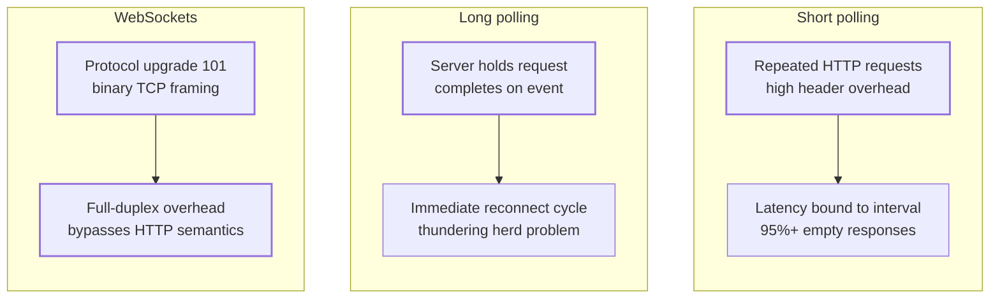
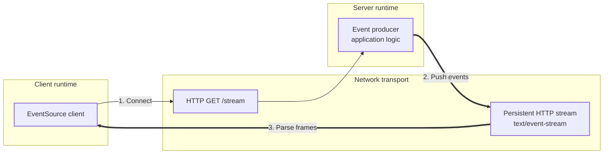
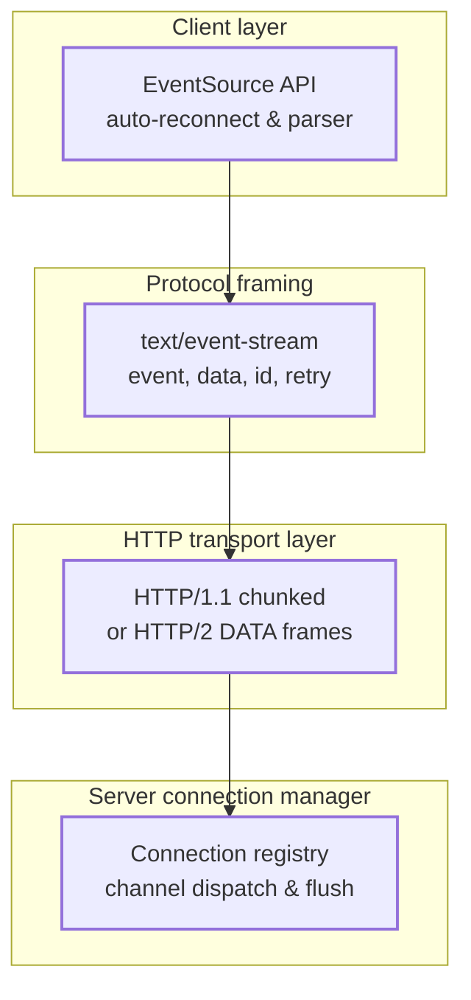
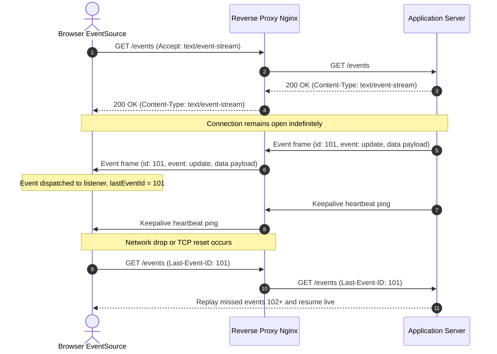
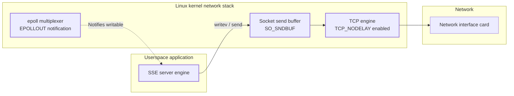
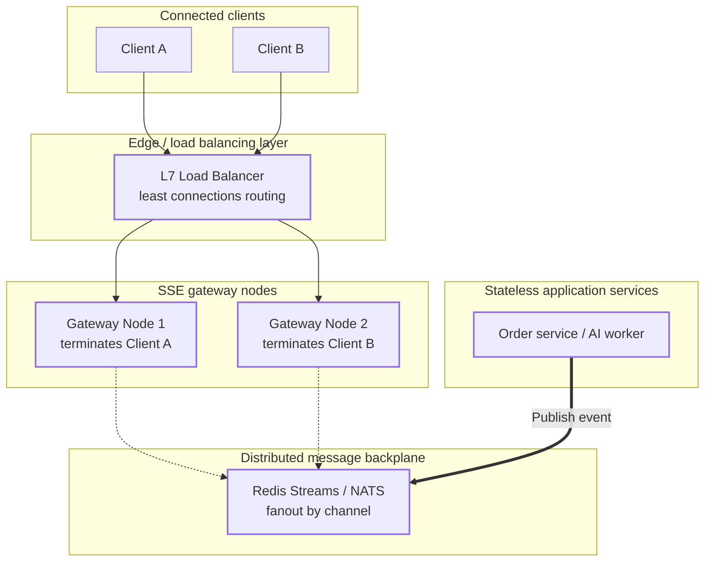
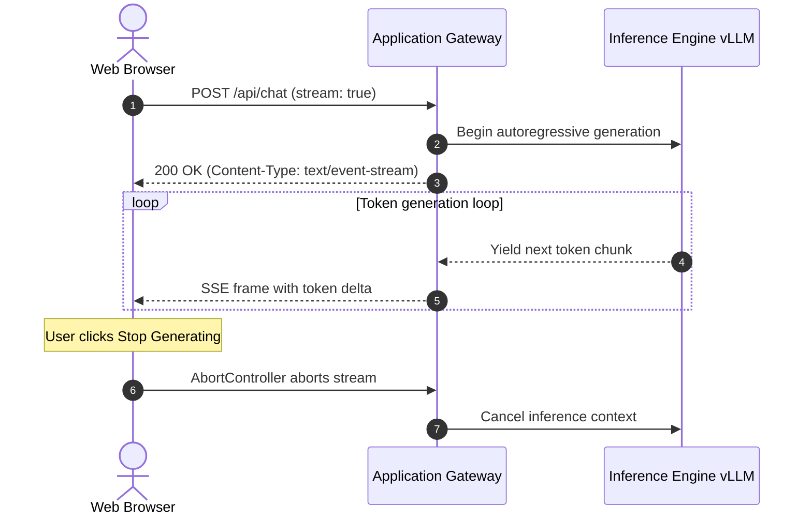

Real-time web applications require servers to push data to clients the moment an event occurs. For years, engineers had to choose between crude polling hacks and heavy bidirectional protocols like WebSockets.

Server-Sent Events (SSE) took a different approach: keep standard HTTP, keep the connection open, and stream lightweight text frames down an open socket. Today, SSE powers live dashboards, stock feeds, and the entire generative AI ecosystem, where large language models stream tokens to users in real time.

This post breaks down how Server-Sent Events work at the protocol, operating system, and architectural levels.

## Table of contents

## Problem Statement

HTTP was originally conceived as a short-lived request-response protocol. A client opens a TCP socket, sends an HTTP request, the server returns an HTTP response, and the connection closes or returns to a pool.

Pushing updates to a client required engineering workarounds, each with fundamental architectural flaws:

1. **Short Polling**: The client periodically issues HTTP GET requests (for example, every two seconds) asking for new data. Most requests return empty payloads or HTTP 304 status codes. Each polling cycle incurs full HTTP request/response headers, TLS encryption overhead, and connection bookkeeping. Latency is artificially capped by the polling interval.
2. **Long Polling (Comet)**: The client issues an HTTP request, and the server suspends the response until new data is available or a timeout occurs. Once data arrives, the server completes the response, closes the HTTP transaction, and the client immediately opens a brand new request. While this reduces event latency, it causes connection thrashing. During a broadcast to thousands of clients, every client reconnects simultaneously, triggering a thundering herd on authentication layers and reverse proxies.
3. **WebSockets**: WebSockets solve the problem by upgrading an HTTP connection to a full-duplex TCP stream via the `101 Switching Protocols` handshake. While ideal for bidirectional, low-latency traffic (such as multiplayer gaming or collaborative document editing), WebSockets introduce substantial operational complexity. They abandon standard HTTP semantics, bypass standard HTTP caching layers, require specialized proxy configurations, break through corporate firewalls less cleanly, and require custom application code to handle reconnections and message buffering.



Most real-time requirements do not need two-way communication over the same channel. In stock tickers, sports updates, status monitors, notification feeds, and LLM text generation, the client only needs to receive data from the server. Upstream user commands are sparse and fit standard REST calls.

Server-Sent Events address this asymmetric access pattern by layering a lightweight streaming protocol directly on top of ordinary HTTP.

## High-Level Mental Model

Server-Sent Events turn an HTTP response into a persistent, unidirectional stream of text records. The client sends a single HTTP GET request with an `Accept: text/event-stream` header. The server responds with `HTTP/1.1 200 OK` and a `Content-Type: text/event-stream` header, but intentionally omits a terminating `Content-Length` and never closes the response body.

Instead of terminating, the server keeps the underlying TCP connection open and flushes structured text chunks whenever events happen. The browser's native `EventSource` API receives these raw chunks from the network buffer, splits them on double newline boundaries, and emits JavaScript events.



## Core Architecture

An SSE architecture consists of four distinct layers operating between the user application and the host operating system:



### 1. Client EventSource Engine

In browsers, SSE is driven by the W3C `EventSource` interface. This component is not just an HTTP client; it is a stateful streaming parser and reconnection supervisor. It:

- Issues the initial handshake request.
- Buffers incoming TCP fragments and scans for double-newline delimiters (`\n\n`).
- Emits typed events (`onmessage` or named event listeners).
- Tracks the latest event identifier (`id: <value>`).
- Automatically triggers reconnection if the socket drops (using the duration specified in the `retry:` field or user-agent default ~3s, with discretionary backoff on consecutive failures), sending the last seen event ID in the `Last-Event-ID` header.

### 2. Wire Framing Protocol (`text/event-stream`)

The data format is UTF-8 plain text specified by the **WHATWG HTML Living Standard** (Section 9.2: Server-sent events) and registered with IANA under the `text/event-stream` MIME type. Every message consists of one or more field lines terminated by a single newline (`\n`), with messages separated by an empty line (`\n\n`). Four field names are defined:

- `data`: The payload string. Multiple consecutive `data` lines are concatenated with a newline character.
- `event`: A custom event type string. When present, the browser dispatches this to listeners registered via `addEventListener(eventType, handler)`.
- `id`: A unique message sequence identifier. Sets the client's internal `lastEventId` property.
- `retry`: An integer in milliseconds telling the client how long to wait before attempting to reconnect if the connection drops.
- Comments: Any line starting with a colon (`:`) is treated as a comment and ignored by the parser. This is used for transport-level heartbeats.

### 3. Transport Layer Framing

Because an SSE response is indefinite, the server cannot declare a fixed `Content-Length`. The underlying transport depends on the HTTP version:

- **HTTP/1.1**: The server uses `Transfer-Encoding: chunked`. Each event or heartbeat is emitted as an HTTP chunk containing the hexadecimal chunk length, CRLF, the SSE text payload, and another CRLF.
- **HTTP/2 & HTTP/3**: Chunked transfer encoding is removed in HTTP/2. Instead, SSE runs as a long-lived bidirectional stream inside a single TCP or QUIC connection. The server packages event text into standard HTTP/2 `DATA` frames. Multiple SSE streams can share the exact same underlying connection without blocking other asset downloads.

### 4. Server Connection Registry

Because an SSE connection is long-lived, the server cannot use a traditional thread-per-request model. The connection registry holds references to open response output streams or socket file descriptors. When a domain event occurs, the registry iterates over subscribed client channels, formats the SSE text record, and immediately flushes the bytes to the socket.

## Execution Flow (Step-by-Step)

Here is the end-to-end lifecycle of an SSE connection, from initial handshake to automated failover and replay:



### Step 1: Client Handshake Request

The client instantiates the stream:

```javascript
const source = new EventSource("/api/events");
```

The browser sends an HTTP GET request with specialized headers:

```http
GET /api/events HTTP/1.1
Host: example.com
Accept: text/event-stream
Cache-Control: no-cache
Connection: keep-alive
```

### Step 2: Server Response Headers

The server validates the request and immediately sends back response headers without closing the body:

```http
HTTP/1.1 200 OK
Content-Type: text/event-stream; charset=utf-8
Cache-Control: no-cache, no-transform
Connection: keep-alive
X-Accel-Buffering: no
Transfer-Encoding: chunked
```

`Cache-Control: no-cache, no-transform` prevents browsers and intermediate caches from caching the stream or applying compression that requires buffering the entire stream. `X-Accel-Buffering: no` instructs reverse proxies like Nginx to disable response buffering.

### Step 3: Event Emission and Framing

The server formats an event and writes it to the socket. In the wire protocol, each field line ends with a single newline (`\n`), and the event frame is finalized with an extra blank line, producing the terminal double newline (`\n\n`):

```text
id: 101\n
event: ticker\n
data: {"symbol":"AAPL","price":225.40}\n
\n
```

On the wire, this looks like text fields followed by an empty line:

```text
id: 101
event: ticker
data: {"symbol":"AAPL","price":225.40}
<empty line>
```

This trailing blank line acts as the frame delimiter. The client TCP stack delivers these bytes to the browser. The parser extracts the fields, stores `101` as the active `lastEventId`, and dispatches a CustomEvent named `ticker` containing the JSON string.

### Step 4: Transport Heartbeats

If no domain events occur for several seconds, intermediate firewalls, NAT gateways, and load balancers may classify the TCP connection as idle and silently terminate it. To keep the connection alive, the server writes a comment line followed by the double newline delimiter every 15 to 30 seconds:

```text
: ping\n
\n
```

Because the line begins with a colon, the browser parser silently drops it without firing any JavaScript event handlers. The underlying TCP socket registers data movement, resetting all idle timers across the network path.

### Step 5: Network Interruption and Transparent Reconnection

Suppose a Wi-Fi switch or cellular handoff breaks the TCP connection. The browser detects the socket closure or read timeout. It does not crash or throw an unhandled exception. Instead:

1. It transitions `source.readyState` from `OPEN` (1) to `CONNECTING` (0).
2. It waits for the duration specified in the last received `retry:` field (defaulting to 3000 ms).
3. It issues a new HTTP GET request containing the `Last-Event-ID` header:

```http
GET /api/events HTTP/1.1
Host: example.com
Accept: text/event-stream
Last-Event-ID: 101
```

### Step 6: Server Replay and Stream Resumption

The server inspects the `Last-Event-ID` header. If the server maintains an event log or an in-memory ring buffer, it queries for all events with an ID greater than `101`. It flushes the missed events (for example, event `102` and `103`) to the client, and then seamlessly transitions back to streaming live events.

## Key Internal Mechanisms

Understanding the mechanics of SSE requires examining how framing, parsing, and non-blocking I/O interact.

### 1. The Wire Protocol Grammar

The SSE specification requires a streaming parser capable of processing byte fragments. A single event may arrive split across three TCP packets, or three events may arrive packed into one packet.

The parser functions as a line-oriented state machine:

- It scans the incoming stream for `\r\n`, `\r`, or `\n`.
- If a line starts with `data: `, the string after the prefix is appended to an internal `data_buffer`. If multiple `data:` lines appear before a blank line, they are joined with `\n`. This allows streaming multi-line strings (such as Markdown or formatted JSON) without escaping newlines.
- If a line starts with `event: `, the event name is stored in an `event_type_buffer`.
- If a line starts with `id: `, the ID string is stored in an `id_buffer`.
- When an empty line (`\n\n`) is encountered, the parser checks if `data_buffer` is non-empty. If so, it dispatches the event, assigns `lastEventId = id_buffer`, and resets all temporary buffers.

```
data: line one\n
data: line two\n
\n
--> Dispatches event with data: "line one\nline two"
```

### 2. Concurrency and Threading: Why Thread-Per-Connection Fails

In a standard servlet container or blocking I/O server (such as traditional Apache HTTP Server or Tomcat with blocking connectors), each HTTP request binds to an OS thread:

```
10,000 idle SSE connections = 10,000 OS threads
10,000 threads * 1 MB stack size = 10 GB RAM just for thread stacks
```

Under this model, the server spends more time performing kernel context switches than doing real work, quickly running out of memory.

Modern SSE servers rely on non-blocking I/O (NIO) multiplexing (such as Netty, Node.js, Go goroutines, or Java virtual threads):

- When an SSE connection is established, its socket file descriptor is registered with the OS event loop (`epoll` or `kqueue`).
- No dedicated thread sleeps on the connection.
- When an event needs to be pushed, a worker thread claims the connection, writes the chunk to the socket buffer, flushes it, and immediately releases the thread back to the pool.

### 3. Backpressure and Slow Consumer Handling

What happens if the server generates 5,000 events per second, but the client is connected over a slow 3G cellular network?

1. The kernel TCP send buffer (`SO_SNDBUF`) fills up.
2. Subsequent non-blocking `write()` calls return `EAGAIN` or `EWOULDBLOCK`.
3. If the application server naively queues unsent messages in memory without a ceiling, it will suffer an `OutOfMemoryError`.
4. Robust SSE engines implement backpressure: they track the unwritten buffer size per connection. If a slow consumer exceeds a high watermark, the server drops transient events, pauses upstream production for that subscriber, or terminates the connection to protect the host.

## OS and System-Level Interactions

At the operating system level, an SSE stream is a long-lived TCP socket managed via kernel file descriptors.



### 1. Syscalls and Socket Multiplexing

Under Linux, SSE servers use the `epoll` subsystem (`epoll_create1`, `epoll_ctl`, `epoll_wait`).

- When an SSE connection is opened, its file descriptor is registered with `epoll_ctl` for read events (`EPOLLIN`) and hangup events (`EPOLLRDHUP`) to detect immediately when a client or intermediate proxy closes the socket.
- When the application has data to write, it invokes `send()` or `writev()`. If the kernel's `SO_SNDBUF` is full, the server registers the FD for `EPOLLOUT`.
- The kernel wakes the server thread via `epoll_wait` as soon as the network interface card (NIC) clears space in the send buffer, allowing the application to drain remaining bytes without blocking.

### 2. Nagle's Algorithm and `TCP_NODELAY`

By default, the Linux kernel enables Nagle's algorithm (`RFC 896`) on TCP sockets. Nagle's algorithm coalesces small outbound data packets into larger segments before transmission, waiting for an acknowledgment (ACK) of previous packets to conserve network bandwidth.

For Server-Sent Events, this default is catastrophic. If an AI model streams tokens or a financial service pushes price updates, each token or tick is a small packet (often under 50 bytes). Nagle's algorithm will hold these bytes in the kernel buffer for up to 40 milliseconds waiting for more data, introducing artificial latency.

SSE servers must explicitly set the `TCP_NODELAY` socket option via `setsockopt`:

```c
int flag = 1;
setsockopt(socket_fd, IPPROTO_TCP, TCP_NODELAY, (void *)&flag, sizeof(flag));
```

Disabling Nagle's algorithm forces the kernel to packetize and transmit chunks immediately, ensuring real-time delivery to the client.

### 3. File Descriptor Limits and Ephemeral Sockets

Because every open SSE client holds an active socket, high-concurrency SSE gateways run into operating system resource ceilings:

- **`nofile` Limit (`RLIMIT_NOFILE`)**: The maximum number of open file descriptors allowed per process. Systems must tune `/etc/security/limits.conf` and systemd service descriptors from the default (typically 1024) to target concurrency levels (e.g. 1,048,576).
- **Process Ceiling (`fs.nr_open`)**: The system-wide upper limit on what a process can set for `nofile`. If `nofile` in `limits.conf` exceeds `fs.nr_open` (default 1,048,576), logins and services will fail to start.
- **System File Maximum (`fs.file-max`)**: The kernel-wide ceiling for open file allocations across all processes on the system, which should be tuned to millions in `/etc/sysctl.conf`.
- **TCP Memory (`tcp_mem`)**: The kernel allocates read and write buffers for each socket governed by `net.ipv4.tcp_rmem` and `net.ipv4.tcp_wmem`. At 100,000 concurrent connections, allocating an average of 16 KB read buffer + 16 KB write buffer (32 KB per socket) consumes ~3.2 GB of kernel RAM exclusively for socket buffers.
- **Connection Tracking (`nf_conntrack`)**: If Linux runs iptables or connection tracking firewalls, `nf_conntrack_max` must be increased to prevent dropping incoming connections when the connection table saturates.

## Failure Modes, Trade-offs, and Pros vs. Cons

Choosing SSE requires balancing its operational simplicity against the realities of long-lived HTTP connections.

### Pros

- **Extremely Lightweight**: SSE operates directly over plain HTTP. There is no binary masking, no frame encapsulation, and no secondary handshake.
- **Firewall and Corporate Proxy Friendly**: Because SSE runs as standard HTTP/HTTPS over port 80 and 443, it passes through enterprise firewalls, inspection proxies, and VPNs that routinely block WebSocket upgrade requests.
- **Built-in Client Resilience**: The browser's `EventSource` API handles reconnection, exponential backoff, and state recovery via `Last-Event-ID` natively in C++ browser code, requiring zero custom client-side recovery libraries.
- **HTTP/2 Multiplexing**: Over HTTP/2, multiple SSE streams to the same origin share a single underlying TCP connection. This eliminates the historic browser limit of 6 connections per origin and resolves HTTP request-level head-of-line blocking. (Note: TCP transport-level head-of-line blocking still applies if packets drop; complete transport independence across multiplexed streams requires HTTP/3 with QUIC).

### Cons and Failure Modes

- **Proxy Buffering Traps**: Reverse proxies (such as Nginx, HAProxy, AWS CloudFront, and Envoy) are designed to buffer HTTP responses from upstreams to optimize client transmission. If buffering is enabled, the proxy holds SSE event chunks until its buffer (often 4 KB, 8 KB, or 64 KB) fills up, completely breaking real-time streaming. You must explicitly configure proxies to disable buffering (`proxy_buffering off;` in Nginx, or `X-Accel-Buffering: no` from the backend).
- **L7 Load Balancer Idle Timeouts**: Layer 7 load balancers (such as AWS Application Load Balancer) track connection activity. If no bytes cross the socket for a configured period (the AWS ALB default is 60 seconds), the load balancer terminates the connection with a TCP RST or 504 status code. SSE servers must continuously send heartbeat comments (`: keepalive\n\n`) to keep the load balancer state table alive.
- **Stateful Long-Lived Connections**: Unlike standard REST APIs where requests are stateless and load balancers can distribute traffic evenly per call, an SSE client holds a socket open for minutes or hours. A round-robin load balancer will cause severe server load imbalances over time as connections accumulate on older instances.
- **Horizontal Scaling Complexity**: An event producer cannot simply emit a message to "the server". It must locate which specific backend node holds the open socket to that specific user.
- **Unidirectional Limitation**: Data flows only from server to client. Any upstream message from the client requires a separate HTTP POST or PUT request, requiring separate authentication validation and routing.
- **HTTP/1.1 Connection Starvation**: Browsers enforce a hard limit of 6 concurrent TCP connections per origin under HTTP/1.1. If a user opens six browser tabs running SSE streams, the entire origin freezes; the user cannot load images, navigate pages, or submit forms. HTTP/2 or HTTP/3 is mandatory for production SSE deployments.

| Feature                | Server-Sent Events (SSE)                                                                                         | WebSockets                            | Long Polling                   |
| :--------------------- | :--------------------------------------------------------------------------------------------------------------- | :------------------------------------ | :----------------------------- |
| **Directionality**     | Unidirectional (Server to Client)                                                                                | Full-duplex (Bidirectional)           | Emulated unidirectional        |
| **Protocol**           | Standard HTTP (HTTP/1.1, HTTP/2)                                                                                 | Custom protocol (`ws://`, `wss://`)   | Standard HTTP                  |
| **Transport Format**   | UTF-8 text (`text/event-stream`; binary requires Base64)                                                         | Binary or UTF-8 text frames           | Any (typically JSON)           |
| **Auto-reconnection**  | Native browser support with ID tracking                                                                          | Manual implementation required        | Manual implementation required |
| **Firewall Traversal** | Seamless (Standard HTTP/HTTPS)                                                                                   | Often blocked or intercepted          | Seamless (Standard HTTP/HTTPS) |
| **Connection Limit**   | 6 per origin (HTTP/1.1), negotiated stream limit (typically 100 via `SETTINGS_MAX_CONCURRENT_STREAMS` in HTTP/2) | Browser limits apply                  | 6 per origin (HTTP/1.1)        |
| **Use Case Fit**       | LLM streaming, feeds, notifications                                                                              | Online gaming, live chat, whiteboards | Legacy fallback                |

## How to Scale Server-Sent Events

Scaling an SSE infrastructure from a single server to a distributed cluster presents unique architectural challenges due to the stateful nature of long-lived TCP connections.



### 1. The Distributed Pub/Sub Backplane

When a client connects, its socket is pinned to one physical node in the fleet. If an event producer on another node generates an update for that client, it cannot write to the client's socket directly.

The solution is a distributed pub/sub backplane using Redis Pub/Sub, Redis Streams, NATS, or Apache Kafka:

1. Each SSE gateway node maintains a local connection registry mapping `userId -> Set<SocketChannel>`.
2. Gateway nodes subscribe to the message broker for relevant tenant or user channels (for example, `events.user.1042`).
3. When any backend service generates an event, it publishes the payload to the broker.
4. The message broker broadcasts the event to the gateway fleet. The specific node holding the open socket for that user receives the message, formats the SSE frame, and pushes it to the client.

### 2. Connection Offloading via Edge Gateways

Application microservices running heavy business logic or Python AI frameworks should never hold persistent client connections. Holding 50,000 open connections consumes memory and complicates zero-downtime rolling deployments.

Instead, separate connection management from application compute:

- Deploy a dedicated, lightweight SSE gateway layer written in Go, Rust, or Netty, or utilize modern API gateways (such as Kong or Envoy).
- The edge gateway terminates client TLS and holds the long-lived SSE connections.
- Backend services communicate with the gateway over internal gRPC streams or message queues. This allows rolling updates to backend application servers without severing client connections.

### 3. Load Balancer Configuration for Long-Lived Connections

Standard round-robin load balancing fails for SSE. If 1,000 clients connect and remain open for hours, round-robin can cause severe traffic skew as old connections persist while new ones arrive.

- **Use Least-Connections Routing**: Configure load balancers to route incoming requests to the instance with the fewest active connections (`least_conn`).
- **Heartbeat Tuning**: Set server heartbeat intervals (e.g. 15 seconds) to be safely lower than the load balancer idle timeout (e.g. 60 seconds).
- **Graceful Draining**: During deployments, the gateway must not brutally terminate all TCP sockets. It should send an application reconnect event (`event: reconnect\n\n`) with randomized retry intervals to a subset of clients, allowing them to reconnect cleanly to newly provisioned nodes over several minutes.

## Server-Sent Events in the Era of AI

The emergence of Large Language Models (LLMs) established Server-Sent Events as the primary transport protocol for generative AI applications.



### 1. The Generative Latency Problem

Autoregressive LLMs generate text token by token. A model cannot compute token 50 until tokens 1 through 49 have been evaluated by the neural network.

Generating a comprehensive 600-word response can take between 5 and 25 seconds depending on model parameter size and GPU memory bandwidth. If the server waits for the entire completion before returning an HTTP response:

- The user stares at a frozen screen with zero feedback.
- Perceived latency is catastrophic.
- Intermediate reverse proxies and browser timeouts often sever the connection before the first byte arrives.

SSE solves this by streaming tokens to the client as they exit the GPU decode layer. Time-to-First-Token (TTFT) drops from 15 seconds down to 200 milliseconds, giving the user immediate visual progress.

### 2. Why AI APIs Standardized on SSE Over WebSockets

Every major AI provider (OpenAI, Anthropic, Google Gemini, Mistral, Ollama, and vLLM) adopted SSE for streaming inference:

- **Strictly Unidirectional**: The inference process is one-way. The user sends a prompt, and the model streams tokens back. Establishing full-duplex WebSockets with binary framing and mask keys adds protocol overhead for no functional benefit.
- **Standard HTTP Semantics and Request Flexibility**: AI streaming requests require sending complex JSON payloads (prompts, temperature, model selection, tool definitions) along with standard `Authorization: Bearer <token>` headers. While the browser's native `new EventSource()` constructor does not support custom headers or HTTP `POST` (it only supports `GET` with cookie authentication), SSE wire formatting is standard HTTP. Frontends consume SSE via `fetch()` with `ReadableStream` (e.g. `response.body.getReader()`) or libraries like `@microsoft/fetch-event-source`. WebSockets cannot send custom headers during the browser `new WebSocket()` handshake, forcing developers to pass API tokens in URL query strings. In contrast, SSE consumed via `fetch()` works transparently with standard HTTP authentication, caching rules, and API gateways.
- **Tool Calling and Structured Streaming**: Modern models stream structured tool invocations alongside text. Because SSE supports arbitrary string payloads, providers stream JSON patches or delta objects:
  ```text
  data: {"choices":[{"delta":{"content":"Searching"}}]}

  data: {"choices":[{"delta":{"content":" database..."}}]}

  data: {"choices":[{"delta":{"tool_calls":[{"function":{"name":"query_db"}}]}}]}

  data: [DONE]

  ```
- **Stream Completion and Clean Termination**: In native SSE, closing the connection from the server causes the client to treat it as an unexpected drop and trigger an automatic reconnect. To signal that an LLM response has legitimately completed, providers stream a terminal sentinel (like `data: [DONE]`), signaling the client's reader to close cleanly without retrying. (Alternatively, returning HTTP `204 No Content` instructs compliant SSE clients to permanently stop reconnecting).

### 3. Client Cancellation and GPU Compute Conservation

GPU inference compute is scarce and expensive. If a user realizes the model is generating an incorrect response or hallucinating, they click "Stop Generating".

In modern web applications, the client uses the Fetch API with `AbortController`:

```javascript
const controller = new AbortController();
const response = await fetch("/api/generate", {
  method: "POST",
  body: JSON.stringify({ prompt: "Explain quantum mechanics" }),
  signal: controller.signal,
});

// User clicks stop:
controller.abort();
```

When `abort()` is called:

1. The browser immediately closes the TCP socket or sends an HTTP/2 `RST_STREAM` frame.
2. The server network layer detects an `EPIPE` or broken pipe error on the next write attempt.
3. The server cancels the upstream inference task on the GPU cluster (such as calling vLLM or TensorRT-LLM cancellation APIs).
4. GPU compute is reclaimed immediately, saving memory bandwidth and operational costs.

## Minimal Pseudocode

The following Java example provides a reference implementation illustrating wire framing, multi-line data payloads, periodic keepalive heartbeats, and client disconnect detection:

```java
import java.io.IOException;
import java.io.PrintWriter;
import java.util.concurrent.ScheduledExecutorService;
import java.util.concurrent.ScheduledFuture;
import java.util.concurrent.TimeUnit;
import java.util.concurrent.atomic.AtomicBoolean;

public class SseStreamHandler {

    private final PrintWriter writer;
    private final ScheduledExecutorService scheduler;
    private final AtomicBoolean isClosed = new AtomicBoolean(false);
    private ScheduledFuture<?> heartbeatTask;

    public SseStreamHandler(PrintWriter writer, ScheduledExecutorService scheduler) {
        this.writer = writer;
        this.scheduler = scheduler;
    }

    public void initializeStream() {
        // Essential protocol headers must be committed before writing data:
        // Content-Type: text/event-stream; charset=utf-8
        // Cache-Control: no-cache, no-transform
        // Connection: keep-alive
        // X-Accel-Buffering: no

        // Schedule periodic comment pings to defeat L7 proxy idle timeouts
        this.heartbeatTask = scheduler.scheduleAtFixedRate(this::sendHeartbeat, 15, 15, TimeUnit.SECONDS);
    }

    public synchronized void sendEvent(String eventType, String id, String payload) {
        if (isClosed.get()) {
            return;
        }

        if (id != null) {
            writer.print("id: " + id + "\n");
        }
        if (eventType != null) {
            writer.print("event: " + eventType + "\n");
        }

        // Support multiline strings by prepending "data: " to each line
        String[] lines = payload.split("\n");
        for (String line : lines) {
            writer.print("data: " + line + "\n");
        }

        // Terminal double newline dispatches the event in the client parser
        writer.print("\n");
        writer.flush();

        // Check if socket was closed by the client
        if (writer.checkError()) {
            close();
        }
    }

    private synchronized void sendHeartbeat() {
        if (!isClosed.get()) {
            // Comment lines begin with a colon and are ignored by EventSource
            writer.print(": ping\n\n");
            writer.flush();
            if (writer.checkError()) {
                close();
            }
        }
    }

    public synchronized void close() {
        if (isClosed.compareAndSet(false, true)) {
            if (heartbeatTask != null) {
                heartbeatTask.cancel(true);
            }
            writer.close();
        }
    }
}
```

> **Note**: In high-throughput production environments, synchronous writers like `PrintWriter` will block worker threads if client TCP windows shrink. Production SSE gateways utilize non-blocking asynchronous APIs (such as Java NIO `SocketChannel`, Servlet 3.0+ `AsyncContext`, Spring `SseEmitter`, or Netty event loops) so that threads are freed immediately after submitting chunks to the socket buffer.

## How to Think About Similar Systems

When analyzing streaming and real-time architectures, recognize these recurring systems patterns:

1. **Unix Pipes Over the Network**: An SSE stream is conceptually identical to piping standard output across a network socket (`cat log | nc`). It treats an HTTP response body as an infinite byte stream rather than a static document.
2. **Cursor-Based Streaming**: The `id:` field and `Last-Event-ID` header implement the exact same offset reconciliation pattern found in Apache Kafka consumer offsets, Git commit hashes, and PostgreSQL Write-Ahead Log (WAL) sequence numbers. The client tracks the cursor; the server resolves the diff.
3. **gRPC Server Streaming**: In gRPC and HTTP/2 RPC frameworks, server streaming operates on the same core principle: a single client request initiates an open-ended sequence of protobuf-encoded response frames over a multiplexed HTTP/2 channel.
4. **Push vs. Pull Duality**: Systems oscillate between push and pull. Pulling (polling) provides simple backpressure control at the cost of latency and overhead. Pushing (SSE, WebSockets) delivers minimal latency and network efficiency, but shifts backpressure management and connection state tracking entirely onto the server.
